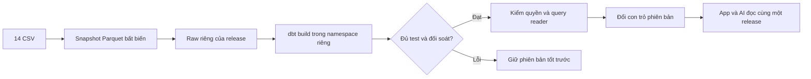

# Automation batch: snapshot → dbt → quality gate → publish

Triển khai 2026-10-11 cho mốc automation của kế hoạch GĐ1/GĐ2. Không đổi công thức R/G và grain.
Giữ nguyên baseline dự báo cũ. XAI, RAG và Kafka chưa nằm trong implementation này. Stage dự báo thêm ngày 2026-10-15, xem mục "Stage dự báo" bên dưới.

## Kiến trúc đã triển khai

`scripts/pipeline/cli.py` chạy độc lập hoặc qua DAG `retail_batch_pipeline`:



- Snapshot kiểm chính xác header, số dòng, số field, SHA-256 và `_src_row` theo record CSV, kể cả ô xuống dòng.
- Namespace: `r_<release_id>_raw/staging/intermediate/marts/reporting/ops`. Mặc định không truyền `release_id` thì dbt giữ schema cũ.
- DuckDB dựng file riêng từng run; Databricks dựng bảng/schema riêng từng release. Các bản `ready` không được rebuild.
- Quality gate yêu cầu full build, đủ mọi model/seed/test trong manifest, cùng invocation và mọi node/hook đạt. Không hardcode 217 thành số test: lần nghiệm thu có 158 test, tổng 217 node gồm model/seed/hook.
- Đối soát G/COGS từng ngày với `sales.parquet`. Trên cloud còn so từng dòng 33 relation nghiệp vụ với bản DuckDB mới dựng từ cùng snapshot/code, tái sử dụng comparator hiện hành.
- Registry gồm các bản đã đạt kiểm dữ liệu và con trỏ `active`. Bản qua kiểm dữ liệu chỉ được trở thành `active` sau kiểm reader. Cloud cập nhật một payload trong `retail_control.state` bằng version compare-and-swap; local dùng JSON thay thế nguyên tử dưới writer lock.
- Các quyền reader được cấp từng relation sau kiểm dữ liệu. Guard cho phép whitelist của các bản đã kiểm, bao gồm bản cũ để các lượt đang chạy và rollback tiếp tục hoạt động; không cho đọc raw/candidate chưa kiểm.
- App giữ một release mỗi rerun; chat giữ cùng release qua nhiều tool. Cache chứa `release_id`; evidence chứa snapshot, code và run. Chế độ cũ vẫn là mặc định cho tới khi bật `RETAIL_RELEASE_MODE=versioned`.

## Stage dự báo (B2b, thêm 2026-10-15)

Trong stage `build`, sau bước chặn dựng lại bản ready và trước dbt, `forecast_stage` (`scripts/pipeline/cli.py`) gọi
`scripts/forecast/stage.py`:
- đọc `sales`, `promotions`, `sample_submission` từ parquet của snapshot;
- chạy backtest ba fold cho 12 ứng viên và 3 mốc, áp luật chọn của `docs/hop_dong_du_bao.md` §5, rồi train bản cuối tới ngày thực tế cuối.
  Code nằm ở `scripts/forecast/core.py`, cùng code notebook `notebooks/04_forecasting/so_sanh_model.ipynb` dùng;
- ghi `forecast_daily.parquet`, `forecast_backtest.parquet`, `forecast_meta.json` vào `<root>/runs/<run_id>/forecast/`.
  Retry cùng run dùng lại kết quả nếu khớp snapshot, `model_version` (hash `scripts/forecast/*.py`) và hash file.

dbt nhận thêm var `forecast_path` và dựng `reporting.rpt_forecast_daily`, `reporting.rpt_forecast_backtest`,
`reporting.rpt_forecast_actual` (số thực tế G, COGS theo ngày cho trang Dự báo, thêm 2026-10-15), cùng test `assert_rpt_forecast`
và `assert_rpt_forecast_actual` trong quality gate. Không có var này (build thường) thì ba model và hai test tắt, số node không đổi.
`scripts/forecast` nằm trong `code_version()`: đổi code dự báo thì pipeline tạo bản mới.

- **Lỗi hợp đồng** (fit không hội tụ, tháng 8/2023 không đạt, COGS/G ra ngoài khoảng lịch sử): `ValueError`, exit 2, Airflow không retry.
- **Thời gian:** stage dự báo chạy 956 giây trong lần nghiệm thu local `b2b-01` (`forecast_meta.json`). Máy bận thì lâu hơn. Airflow cho mỗi task tối đa 65 phút.
- **Databricks:** `runtime.ingest_forecast` tải hai parquet lên Volume rồi tạo `r_<id>_raw.forecast_*` cho dbt. **Chưa chạy** trên workspace.
- **Docker:** image cần statsmodels, lightgbm, holidays, scipy (`deploy/airflow/requirements-pipeline.txt`) và `libgomp1` (Dockerfile).
  Image dùng Python 3.12, máy Windows dùng 3.13. **Đã build và chạy DAG 2026-10-15** (kết quả ở dòng nghiệm thu `b3c-docker-02` bên dưới).
  Lần chạy đầu (`b3c-docker-01`) dừng ở stage dự báo vì thư viện `holidays` đặt tên ngày lễ theo biến `LANG`
  (image có `LANG=C.UTF-8` nên trả tên tiếng Việt); `scripts/forecast/core.py` nay cố định `language='en_US'`.
- **Quyền đọc bảng dự báo** (cập nhật 2026-10-15): bảng tùy chọn, không vào danh sách bắt buộc. Chat: var `ai_optional_relations`
  (hai bảng `rpt_forecast_*`, B3a/RV04). App: var `app_optional_relations` (ba bảng trang Dự báo, gồm `rpt_forecast_actual`, RV11).
  `consumers()` gộp chúng vào danh sách reader; `present()` chỉ cấp quyền / thử đọc bảng có trong bản, nên rollback về bản trước B2b
  vẫn chạy. Đường cloud (GRANT + thử đọc bằng chính app SP) **chưa chạy** trên workspace.

Nghiệm thu local 2026-10-15 (`b2b-01`, snapshot `5bd9a84aaf73`, release `4a117159e10b4362ac7f6c7b`): dbt 220/220 đạt;
stage chọn `lgbm_full / direct`, dự báo và 45 điểm ứng viên × fold khớp notebook; thử gắn tay sai ứng viên chính thì `assert_rpt_forecast` báo lỗi;
rollback về release `6f8654fb4b4348c483a78b64` (trước B2b) rồi trở lại release mới đều chạy.

Nghiệm thu local 2026-10-15 (`b3b-01`, cùng snapshot, release `fc14b8a2f5a24ff99a434d7c`): thêm `rpt_forecast_actual` và test `assert_rpt_forecast_actual`, dbt 222/222 đạt; dự báo và backtest trùng `b2b-01` (sai khác 0), stage dự báo chạy 425 giây.

Nghiệm thu Airflow Docker 2026-10-15 (DAG run `b3c-docker-02`, pipeline run `9aa80137c3adf8d7f1e341e8`, target duckdb, cùng snapshot,
state riêng `warehouse/pipeline/docker`): bốn task đạt, dbt 222/222 (gồm `assert_rpt_forecast`, `assert_rpt_forecast_actual`), `rpt_forecast_daily` / `rpt_forecast_actual` / `rpt_forecast_backtest` có 8.220 / 3.833 / 546 dòng, publish release `2dfcef8f75e04d01bab89cfa`; build gồm stage dự báo chạy khoảng 5 phút
(stage dự báo 268 giây). Image này build trước khi sửa RV12 (`ai_explain`) và trước `scripts/ops/so_sanh_du_bao.py`: **build lại image trước khi chạy `--target databricks`**, để `code_version` của bản cloud khớp code sẽ merge. Notebook `so_sanh_model.ipynb` chưa chạy lại sau khi sửa `core.py`. So với `b3b-01` (Windows, Python 3.13):
- cùng ứng viên chính `lgbm_full / direct`, cùng bước luật (bước 2); không ứng viên nào vào vùng hòa 1%
  (`blend_full / direct` cách 1,34%, `lgbm_full / ratio` cách 1,43%; ở Windows là 1,31% và 1,22%);
- dự báo điểm G và COGS của mọi ứng viên LightGBM, bản gộp và các mốc **trùng tuyệt đối**; tổng tháng của model chính trùng (08/2023: 74.151.832);
- lệch nhỏ ở: điểm backtest của LightGBM (điểm ngày tối đa 0,15%), biên khoảng 80% (tính từ sai số backtest; model chính lệch tối đa khoảng
  11 nghìn đồng một ngày), dự báo SARIMAX (bộ tối ưu: 1 lần fit phải dùng phương án dự phòng, Windows 2 lần; `sarimax_2019` lệch tối đa 859 đồng một ngày).
Vì vậy số dự báo trên cloud có thể lệch bản local ở biên khoảng và SARIMAX; so theo từng cột như trên, không chỉ so tên ứng viên thắng.
Chạy lại phép so: `.venv/Scripts/python.exe -m scripts.ops.so_sanh_du_bao warehouse/pipeline/runs/b3b-01 warehouse/pipeline/docker/runs/9aa80137c3adf8d7f1e341e8`
(đọc hai bộ parquet và `forecast_meta.json` của stage, không ghi file).

## Chạy local Windows

Từ root, môi trường `.venv` và 14 CSV đã có:

```powershell
.venv/Scripts/python.exe -m scripts.pipeline.cli run --run-id demo-01
```

Chạy lại với run-id mới và cùng nguồn/code: bỏ qua rebuild. Truyền `--force` để tạo release mới phục vụ diễn tập.
Chạy lại cùng run-id là resume/retry, không phải yêu cầu tạo bản mới. Code thay đổi giữa các stage thì phải dùng run-id mới.
Phát lại snapshot: `--snapshot-id <12-hex>`, chỉ đọc snapshot trong `<root>/snapshots/`.

Để app local đọc bản công bố:

```powershell
$env:RETAIL_RELEASE_MODE = 'versioned'
$env:RETAIL_BACKEND = 'duckdb'
$env:RETAIL_RELEASE_STATE = 'D:/retail-analytics/warehouse/pipeline/state.json'
.venv/Scripts/python.exe -m streamlit run apps/retail_app/app.py
```

Khôi phục một `release_id` đã đạt kiểm tra:

```powershell
.venv/Scripts/python.exe -m scripts.pipeline.cli rollback --run-id rollback-demo --release-id <24-hex>
```

Không xóa release đang phục vụ hoặc còn người đọc. Mốc này chưa tự dọn lịch sử release.

## Airflow Docker

```powershell
docker compose -f docker-compose.airflow.yml build
docker compose -f docker-compose.airflow.yml up -d airflow-api airflow-scheduler airflow-dag-processor
```

Metadata DB riêng, không dùng/xóa PostgreSQL DWH hiện có. UI chỉ bind `127.0.0.1:8080`.
Airflow SimpleAuthManager dùng `admin/admin` cho demo local; UI chỉ bind `127.0.0.1`.
Nếu muốn đổi mật khẩu, đặt `RETAIL_AIRFLOW_ADMIN_PASSWORD` trong `.env.airflow.local` rồi recreate các dịch vụ.
File mật khẩu nằm trong volume local tại `/opt/airflow/logs/passwords.json`; không dùng cấu hình demo này khi mở Airflow ra mạng.

DAG gồm bốn task: `prepare_snapshot` → `ingest_and_dbt_build` → `quality_and_reader_gate` → `publish_release`.
Mặc định DAG paused, schedule tắt và target `duckdb`. Trigger thủ công từ UI với target/snapshot_id/force.
Chỉ sau nghiệm thu mới đặt `RETAIL_PIPELINE_SCHEDULE_ENABLED=true` trong `.env.airflow.local`, recreate dịch vụ và unpause:
lịch 08:00 Asia/Ho_Chi_Minh, không catchup, tối đa một DAG run. Laptop/Docker phải đang hoạt động.

Airflow dùng `warehouse/pipeline/docker` để tách state khỏi chạy CLI Windows. Muốn app host đọc kết quả Docker,
đặt `RETAIL_RELEASE_STATE` tới `warehouse/pipeline/docker/state.json`; artifact được giải qua đường dẫn tương đối.

## Databricks: chạy lần đầu trên workspace 2026-10-17

**Lần chạy thật đầu tiên** (2026-10-17, run `dbx-20261017-01`, release `cfe19211211e420abdfcabb3`, snapshot `5bd9a84aaf73`, code `153630d` (`code_version` `a974443dbfe90c84…`), catalog `retail_lab`, warehouse serverless của workspace `retail-dev`):
- Chạy bằng CLI trên máy Windows, từng stage `prepare` → `build` → `validate` → `publish`, không dùng `run`, để dừng kiểm được giữa validate và publish. Biến môi trường nạp từ `.env.airflow.local`.
- `.venv` chỉ có adapter duckdb, `.venv-databricks` chỉ có adapter databricks, mà pipeline gọi một dbt cho cả hai target. Đã cài thêm `dbt-duckdb==1.11.0` vào `.venv-databricks` (thử khô: chỉ thêm đúng gói này) và đặt `RETAIL_DBT_EXECUTABLE=.venv-databricks/Scripts/dbt.exe`. Image Airflow đã có cả hai adapter (`deploy/airflow/requirements-pipeline.txt`).
- Thời gian: prepare 49 giây, build 1.420 giây (stage dự báo 747 giây), validate 437 giây, publish 108 giây.
- Kết quả:
  - dbt 222/222 trên DuckDB đối chứng và 222/222 trên Databricks;
  - G / COGS 3.833 ngày trên cloud khớp `sales.parquet` của snapshot;
  - parity từng dòng 36 relation marts / reporting khớp;
  - cấp quyền và thử đọc bằng chính SP app (`retail-web-ro`) và SP AI (`retail-ai-ro`) đạt, kể cả kiểm quyền thừa;
  - registry `retail_control.state` trên cloud: active = `cfe19211211e420abdfcabb3`, status `ready`.
- Bảng dự báo của bản mới: `rpt_forecast_daily` 8.220, `rpt_forecast_backtest` 546, `rpt_forecast_actual` 3.833 dòng; model chính `lgbm_full / direct`; tổng G dự báo 08/2023 là 74.151.832, như bản local.
- Giữa validate và publish đã kiểm bước 3 dưới đây bằng test: `RETAIL_TEST_DATABRICKS=1 pytest apps/retail_app/tests/test_ai_databricks.py` (SP AI, chế độ cũ, code `153630d`): 124/124 đạt. Một ca lỗi kết nối thoáng qua, chạy lại đạt. Test mất 72 phút, vì mỗi tổ hợp tool đăng nhập và đọc lại quyền từ đầu.
- **Sự cố sau publish (2026-10-17):** sau khi PM bật `RETAIL_RELEASE_MODE = "versioned"`, chat public báo "Không đọc được danh sách nhóm… (GuardError)" ở mọi câu có số, kể cả câu PS. Tool vẫn đọc đúng bản mới. Nguyên nhân: `tools.known_groups` mở phiên đọc không kèm `OPTIONAL_RELATIONS`, nên quyền đọc `rpt_forecast_*` mà pipeline cấp cho SP AI bị guard coi là quyền thừa. Lỗi này có ở cả chế độ cũ, ngay từ khi validate cấp quyền. Test `test_databricks_tra_cung_so_duckdb` chỉ gọi `tools.run`, không chạy trọn một lượt chat, nên không bắt được. Sửa ở `20aa3f5`, test ở `6335164`. Từ nay, sau khi cấp quyền hoặc bật versioned, kiểm bằng một lượt chat trọn vẹn: `service.run_turn` trên backend `databricks` với provider giả, gồm một câu dự báo và một câu PS. Test `test_ai_databricks.py` chỉ gọi tool, nên không đủ.
- Tài khoản cá nhân của PM không có `USE SCHEMA` trên `retail_control`, vì writer tạo schema này. Muốn đọc registry thì dùng writer hoặc SP reader.
- Bước 3–4 xong (sau bản sửa sự cố bên dưới): PM bật `RETAIL_RELEASE_MODE = "versioned"` trong Secrets và Reboot sau bản sửa `6335164`; 19:42 chat public trả lời "Dự báo doanh thu tháng 8/2023" ra 74.151.832 VND, nhãn dự báo, LightGBM, `model_version` 3ac33fc83143, đọc Databricks (ảnh PM gửi).
- **Chạy cloud qua Airflow Docker đạt** (2026-10-17):
  - run Airflow `dbx-airflow-20261017-01`, pipeline run `de80c263dce23aec44d70c44`, release `b25b3e471bae45768a79e4a2`;
  - image dựng từ bản xuất sạch của commit `532b240`; `code_version` `660b2aff…`;
  - 4/4 task đạt trong 22 phút 34 giây (build 13 phút 34 giây, trong đó stage dự báo 321 giây; validate 6 phút 16 giây);
  - dbt 222/222 trên cả hai target; G / COGS 3.833 ngày khớp; parity 36 relation;
  - model chính `lgbm_full / direct`, `model_version` `3ac33fc83143`, như bản `cfe19211…`;
  - so với bản `cfe19211…`: dự báo điểm của model chính trùng; khoảng 80% lệch ≤ 0,3%; điểm backtest lệch ≤ 1,03%, thứ hạng
    không đổi (lần so Docker / Windows ngày 2026-10-15 là ≤ 0,15%; chưa rõ vì sao lần này lớn hơn).
- **Rollback trên cloud đạt** (2026-10-17): chạy trong container Airflow (`--root warehouse/pipeline/docker --target databricks`).
  - `b25b3e47…` → `cfe19211…` → `b25b3e47…`; sau mỗi lần đổi, app (SP `retail-web-ro`) và chat (SP `retail-ai-ro`, một lượt
    `service.run_turn` trọn vẹn) đọc đúng bản; R 2019 và G dự báo 08/2023 không đổi.
  - Chạy lại cùng lệnh rollback thì version của registry không đổi.
  - Mã bản không có trong registry thì bị từ chối. Lúc chạy cloud lệnh báo `KeyError` thô, exit 1; đã sửa 2026-10-17 (`2c067ac`, test `b5aa37c`): giờ lệnh báo một câu rõ, nêu mã gõ sai và các bản rollback được, exit 2, registry không đổi.
  - Chi tiết từng lệnh: [ghi_chu_l2_airflow_rollback_20261017.md](ghi_chu_l2_airflow_rollback_20261017.md).
- Chưa làm: cố ý làm hỏng quality gate trên cloud để thấy bản đang phục vụ được giữ (mới có test local); bật lịch Airflow.

Mô tả gốc của đường cloud (viết trước lần chạy thật):

Chép `deploy/airflow/env.example` thành `.env.airflow.local`, điền writer M2M riêng và hai reader APP/AI.
Không gửi secret vào chat. CLI ngoài Docker nhận cùng biến môi trường; không tự đọc profile cá nhân.
Writer cần quyền tạo schema/table trong catalog, upload Volume và cấp quyền đọc các relation được công bố.
APP phải là danh tính giao diện sẽ thực sự sử dụng; AI là danh tính riêng đang dùng cho chat.

Pipeline cloud sẽ upload snapshot, build Databricks + DuckDB đối chứng, kiểm parity, cấp SELECT từng bảng,
rồi mở kết nối bằng chính reader và kiểm quyền thừa/thiếu trước khi đổi con trỏ. Không dùng Delta CLONE.
Chưa có writer nên không tạo/sửa tài nguyên cloud hoặc đổi cấu hình app public trong đợt này.

Khi triển khai cloud cần nghiệm thu quyền/view và rollback trên workspace thật trước khi bật chế độ versioned cho app.

### Thứ tự chuyển bản public sang chế độ versioned (sửa 2026-10-12)

Stage `validate` cấp cho SP AI quyền đọc bảng của bản mới và `retail_control.state`, **trước** khi app bật chế độ
versioned. Guard chế độ cũ của chat coi các quyền đó là quyền thừa và khóa chat, trừ khi nó đọc được registry và thấy
bản đó đã qua quality gate (`_release_scope` trong `apps/retail_app/dwh/guarded.py`). Code cũ không có bước đọc
registry, nên phải làm đúng thứ tự:

0. **Writer SP và cấu hình** (thêm 2026-10-15, PM chốt đưa dự báo lên production): tạo SP `retail-pipeline-writer`, secret OAuth,
   quyền `Can use` trên SQL warehouse, và `GRANT USE CATALOG, CREATE SCHEMA, MANAGE ON CATALOG retail_lab` (MANAGE để cấp quyền
   đọc cho reader; chưa thử trên bản Free). Điền `.env.airflow.local`: `RETAIL_PIPELINE_*` = writer; `RETAIL_APP_DBX_*` = SP của
   bản public `retail-web-ro` (pipeline cấp quyền và thử đọc bằng chính danh tính này); `RETAIL_AI_DBX_*` = SP của chat.
   Chạy CLI trên máy thì nạp file này vào biến môi trường. Hướng dẫn từng bước cho PM: `dwh_huong_dan_pm_ba.md` §9.
   **Đã làm 2026-10-15** bằng CLI (`service-principals create`, `service-principal-secrets-proxy create`, `warehouses
   update-permissions`, `grants update catalog`): `MANAGE` nhận được trên bản Free; writer đăng nhập OAuth M2M được. Secret hết hạn 2027-01-13.
1. Merge qua PR toàn bộ phần đọc theo bản phía app (mặc định tắt), không chỉ riêng guard: `dwh/releases.py`,
   `dwh/guarded.py` (`_release_scope`), `dwh/connection.py`, `ai_explain/tools.py`, `ai_explain/service.py`,
   `ui/common.py`. Rồi **Reboot** bản public trên Streamlit Cloud (push không tự cập nhật, xem
   `streamlit_cloud_deploy.md`). Bản Databricks Apps dùng chung SP AI: cũng phải lên code này, hoặc dừng hẳn.
2. Chạy pipeline target `databricks` tới `publish`. Pipeline cấp quyền đọc registry trước bảng của bản mới
   (`reader_grants` trong `scripts/pipeline/cli.py`), nên chat không bị khóa giữa chừng (chỉ còn khoảng hở rất ngắn
   giữa lệnh `USE SCHEMA retail_control` và `SELECT state`). Chạy qua Airflow thì trước đó phải
   `docker compose -f docker-compose.airflow.yml build` và tạo lại các service: image chép code lúc build, nên image cũ
   vẫn cấp quyền theo thứ tự cũ. Chạy CLI trên máy thì không cần bước này.
3. Hỏi chat public một câu và kiểm vẫn có số. Nếu chat báo "không đạt điều kiện chỉ đọc":
   - Mở khóa ngay: thu hồi của SP AI quyền `SELECT`/`USE SCHEMA` trên `r_<id>_reporting.*` và `retail_control`.
     Guard quay về luật cũ và đạt như trước khi chạy pipeline.
   - Rồi tìm nguyên nhân, thường là bước 1 chưa xong, hoặc SP AI không thấy `retail_control.state` trong
     `system.information_schema.tables`. Chưa rõ nguyên nhân thì chưa làm bước 4.
4. Đặt `RETAIL_RELEASE_MODE = "versioned"` trong **Settings → Secrets** (app tự khởi động lại). Kiểm evidence của chat
   có `release_id`.
5. Quay lại chế độ cũ: xóa biến đó. Schema `reporting.*` cũ và quyền cũ vẫn còn, app đọc lại như trước.

Chưa chạy trên workspace thật: các bước trên mới kiểm bằng test giả lập guard (`apps/retail_app/tests/test_releases.py`).

Một catalog chỉ có một writer deployment. Mọi CLI/Airflow của deployment phải dùng chung root/volume có writer lock;
không hỗ trợ nhiều writer trên các máy không chia sẻ lock. CAS bảo vệ công bố nhưng không thay lock cho từng stage.

## Nhật ký và lỗi

- `<root>/runs/<run_id>/context.json`: nguồn, code, release, stage, kết quả đối soát.
- `<root>/runs/<run_id>/<target>/`: manifest, run_results, console và log dbt.
- `failure.json`: lần lỗi gần nhất, loại lỗi và stage; không chứa credentials. File này giữ bằng chứng lỗi dù retry sau đó thành công; đọc stage hiện tại trong context/Airflow.
- Airflow hiển thị task lỗi và log. Sai hợp đồng/quality gate trả exit 2, không retry; lỗi tạm thời retry hai lần cách hai phút. Chưa tích hợp gửi email/Slack.
- Trang Sức khỏe dữ liệu phản ánh bản đang phục vụ. Muốn xem lần pipeline mới bị lỗi, dùng Airflow và failure.json.
- `snapshot` là bất biến: file hỏng thì dừng; không ghi đè tự động để che hash mismatch.

## Kiểm chứng

Chạy kiểm thử bằng `.venv/Scripts/python.exe -m pytest scripts/pipeline/tests apps/retail_app/tests/test_releases.py`.
Bao gồm header/hash, multiline CSV, partial build, publish khi chưa đạt, CAS, retry, rollback, pin xuyên tool và cache tách release.
Kiểm app/cloud phải báo riêng: test giả lập guard không chứng minh quyền Databricks thực tế.

Nghiệm thu local ngày 2026-10-11/12:
- CLI Windows `acceptance-02`: dbt 217/217 đạt; 3.833 ngày G/COGS khớp tuyệt đối với snapshot `5bd9a84aaf73`;
  33 relation nghiệp vụ được ghi nhận trong candidate. `cloud_parity=false` vì không chạy cloud.
- DAG Airflow `acceptance-docker-01`: cả bốn task thành công; dbt trong container đạt 217/217.
  App trên Windows đọc được `rpt_build_info` và `rpt_revenue_total` từ artifact do Docker tạo.
- Đã đổi con trỏ local từ release `0f7e8347c38441f2b56146df` sang `6f8654fb4b4348c483a78b64`,
  rollback về bản cũ rồi trở lại bản mới. Retry rollback cùng bản không đổi dữ liệu.
- Bộ kiểm thử pipeline/release: 14/14 đạt; hồi quy app/AI chọn lọc: 173 đạt, 109 bỏ qua vì cần cloud,
  25 không chọn vì PostgreSQL. AppTest bảy trang đạt trên bản DuckDB có version.
- Những con số trên chứng minh đường local. Chưa nghiệm thu quyền, parity hoặc rollback thật trên Databricks;
  chưa chạy LLM thật trong đợt automation.

Nguồn tham khảo: [Airflow best practices](https://airflow.apache.org/docs/apache-airflow/stable/best-practices.html),
[OAuth M2M Databricks](https://docs.databricks.com/aws/en/dev-tools/auth/oauth-m2m).
