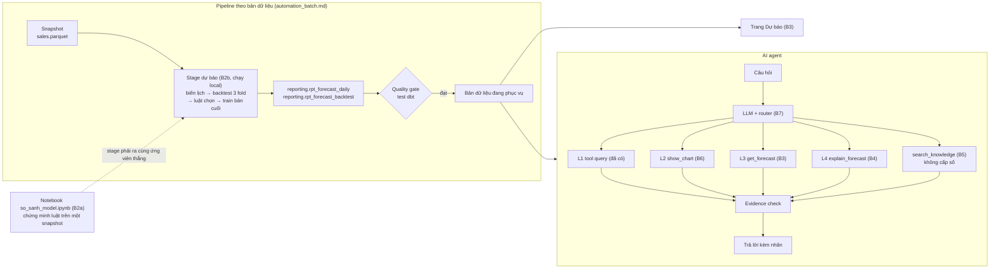

# Kế hoạch AI GĐ2: dự báo doanh thu và AI agent

**Tài liệu vào cửa cho mọi phiên Claude/Codex làm phần AI.** Phần AI gồm: dự báo ① (B2), đưa dự báo vào app và chat (B3),
giải thích (B4), RAG (B5), dashboard làm tool (B6), router và nghiệm thu (B7). Tài liệu này cũng là khung cho báo cáo research về dự báo và AI agent.

Tạo ngày 2026-10-14. Hạn tiến độ cứng: **2026-10-25**.

File này giữ bốn thứ: thứ tự đọc, sổ quyết định, lộ trình và nhật ký. Chi tiết kỹ thuật nằm ở các tài liệu được trỏ tới; **đừng chép lại vào đây**.

---

## 0. Cho Claude/Codex: mở phiên mới thì làm gì

### 0.1 Thứ tự đọc

1. **File này:** §2 (quyết định) và §8 (nhật ký, dòng cuối cùng). Biết đang ở bước nào trước khi làm gì.
2. `CLAUDE.md` §1, §5, §6: bài toán, 8 kết luận dữ liệu đã chứng minh, lỗi đã biết của baseline.
3. Theo việc được giao:

   | Việc | Skill | Đọc tiếp |
   |---|---|---|
   | B2 dự báo: notebook, stage pipeline, `rpt_forecast_*` | `retail-forecasting` | [hop_dong_du_bao.md](hop_dong_du_bao.md) (hợp đồng chi tiết) → [chon_model_du_bao.md](chon_model_du_bao.md) (vì sao chọn như vậy) → notebook `notebooks/04_forecasting/so_sanh_model.ipynb` |
   | B3 tool chat `get_forecast`, quyền đọc, eval | `retail-ai-explain` | **hợp đồng §7–§8** (agent dùng `is_primary`, lý do lấy từ `selection_step`, ứng viên khác chỉ khi được hỏi) và [chon_model_du_bao.md](chon_model_du_bao.md) §6.1; file `references/agent_levels.md` của skill; [ai_explain_plan.md](ai_explain_plan.md) §11–§14 |
   | B3 trang Dự báo | `retail-bi-product` | hợp đồng §7–§8 |
   | Đưa stage vào pipeline, quality gate | `retail-platform-validation` | [automation_batch.md](automation_batch.md) |
   | Định nghĩa metric mới | `retail-metric-design` | `docs/star_schema.md` §3 |

4. Kiểm hiện trạng: `git status`, `git log --oneline -5`. So với §8 để biết phiên trước dừng ở đâu.

PM giao việc cho agent theo sổ tay [giao_viec_agent_gd2.md](giao_viec_agent_gd2.md): thứ tự bước, prompt dán sẵn, cách nghiệm thu.

### 0.2 Luật cứng

- **Tài liệu lệch nhau thì sổ quyết định §2 thắng.** Sửa tài liệu cũ cho khớp, và nói ra trong câu trả lời (`CLAUDE.md` §8).
- **Không tự đổi quyết định đã chốt.** Muốn đổi thì đề nghị PM; PM mở lại thì ghi ngày vào §2.
- **Số chỉ vào `.md` khi đã có cell notebook chạy lại được** (`CLAUDE.md` §3). Nhật ký §8 chỉ ghi việc đã chạy thật, kèm nơi xem kết quả.
- **Luật chọn model và danh sách ứng viên chốt trước khi xem điểm.** Thêm ứng viên hay đổi ngưỡng sau khi đã thấy điểm là chọn theo kết quả.
- **Không làm gì với Kaggle** (PM chốt 2026-10-15). Không dùng phản hồi của tập test để chỉnh model (lý do không chép hệ số của lời giải tham khảo: §6).
- **Không trích paper từ trí nhớ** vào tài liệu khóa luận. Cần nguồn thì ghi "cần nguồn" (§7.3).
- **Một notebook một chủ** (`README.md`). Chủ `so_sanh_model.ipynb`: myuyen.
- **Không commit `data/`**, kể cả file nộp (`CLAUDE.md` §2).
- **Xong một chức năng** phải có tài liệu hướng dẫn và giải thích cho PM bằng lời đời thường. PM mới với dự báo: định nghĩa thuật ngữ ngay lần đầu dùng.

---

## 1. Mục tiêu

**Sản phẩm, trước 2026-10-25:**
- dự báo G (doanh thu gộp, gồm cả đơn hủy) và COGS theo ngày, 2023-01-01 → 2024-07-01 (548 ngày);
- file nộp `Date, Revenue, COGS`;
- trang Dự báo trên app;
- AI agent trả lời câu hỏi dự báo bằng ứng viên có sai số backtest tốt nhất theo luật, kèm nhãn và sai số.

**Mục tiêu PM nêu ngày 2026-10-13:** AI agent dùng model cho kết quả chính xác nhất.
Cách đạt: luật chọn cố định chạy trong pipeline (phương án A, §2). LLM không tự chọn model.

**Báo cáo research:** dự báo doanh thu bán lẻ chỉ bằng biến lịch, và cách một AI agent dùng kết quả dự báo mà không bịa số. Khung ở §7.

---

## 2. Sổ quyết định

Mọi quyết định ảnh hưởng phần AI. Dòng mới thêm ở cuối; quyết định bị thay thì ghi "thay bởi", không xóa.

| Ngày | Quyết định | Người chốt | Chi tiết |
|---|---|---|---|
| 2026-10-05 | Databricks là đích production; dev và test ở local trước | PM | `CLAUDE.md` §1 |
| 2026-10-11 | GĐ2: dự báo ① là lõi, rồi ② dashboard làm tool, ③ query (đã có). Airflow chạy Docker local. Kafka hoãn | Thầy giao, PM chốt | `CLAUDE.md` §1; [kien_truc_pipeline_tong.md](kien_truc_pipeline_tong.md) |
| 2026-10-11 | Target: **G theo ngày** (`sales.csv`). Nhãn "G – doanh thu gộp, gồm cả đơn hủy". Horizon 548 ngày. Dự báo R để sau | PM | hợp đồng §2 |
| 2026-10-11 | COGS suy qua tỷ lệ. **Thay bởi Q10 ngày 2026-10-14** | PM | — |
| 2026-10-13 | ARIMA, log + SARIMAX, LSTM là model thầy gợi ý, không bắt buộc. Được dùng model khác, chọn bằng backtest | PM | chọn model §0 |
| 2026-10-14 | **Q1:** chọn bằng điểm ngày kết hợp = (MAE G + MAE COGS) / 2, trung bình ba fold. RMSE, R² báo kèm. MAPE G tháng chỉ để hiển thị | PM | hợp đồng §0, §5 |
| 2026-10-14 | **Q2:** sàn = thắng seasonal naive 2 năm về điểm kết hợp ở cả ba fold | PM | hợp đồng §5 |
| 2026-10-14 | **Q3, Q4:** cờ đợt Urban Blowout (ngày lấy từ `promotions.csv`); mốc chế độ 2019-01-01, kiểm lại bằng cell | PM | hợp đồng §3 |
| 2026-10-14 | **Q6, Q7:** khoảng dự báo 80%; không hiển thị khoảng tháng | PM | hợp đồng §6 |
| 2026-10-14 | **Q8:** phương án A. Luật chọn chạy trong pipeline, đánh dấu đúng một ứng viên `is_primary`; agent đọc kết quả, không tự chọn | PM | hợp đồng §5, §7; chọn model §6.1 |
| 2026-10-14 | **Q9:** Must = mốc, log + SARIMAX, LightGBM, bản gộp hai model. Should = ARIMA. Could = LSTM. Không model nào được ưu tiên sẵn | PM | hợp đồng §4 |
| 2026-10-14 | **Q10:** mở lại cách tính COGS. Backtest quyết giữa qua tỷ lệ và dự báo trực tiếp | PM | hợp đồng §2.3 |
| 2026-10-14 | Ngưỡng hòa 1%; thứ tự đơn giản; lưới trọng số bản gộp; tham số model cố định trước | Dev định nghĩa, trước khi có điểm | hợp đồng §0 |
| 2026-10-15 | **Q11:** không làm gì liên quan tới Kaggle | PM | hợp đồng §0 |
| 2026-10-15 | Trang Dự báo lấy số thực tế G, COGS theo ngày từ bảng reporting mới `rpt_forecast_actual` (cùng bản dữ liệu, bật cùng hai bảng dự báo), không đọc marts | PM | hợp đồng §7 |
| 2026-10-15 | **Dự báo lên production trước 2026-10-25.** Kết quả và bảng dự báo nằm trên Databricks: pipeline chạy `--target databricks`, train chạy ở nơi chạy pipeline (Airflow Docker / máy), không train bằng compute Databricks. App public chuyển sang chế độ versioned. **Bỏ phương án demo local** | PM | [automation_batch.md](automation_batch.md) "Thứ tự chuyển bản public"; [dwh_huong_dan_pm_ba.md](dwh_huong_dan_pm_ba.md) §9 |
| 2026-10-15 | **Giữ một model chính** theo điểm ngày kết hợp (Q1, Q8 không đổi). PM đã xem: thước ngày chọn LightGBM, thước MAPE G tháng xếp log + SARIMAX tốt hơn. Phương án "mỗi loại câu hỏi một model chính" không làm (sẽ là luật đặt sau khi thấy điểm). Model khác vẫn có trong bản dữ liệu; agent đưa khi được hỏi đích danh hoặc hỏi độ chính xác | PM | hợp đồng §5, §7 |
| 2026-10-17 | **RV12 theo hướng (a):** câu trả lời khác `ok` có số của kỳ khác thì app tự viết câu dẫn số và khối "Số tham khảo, không phải số bạn hỏi"; câu của mô hình chỉ được giữ khi không có chữ số. Tiêu chí RV12 đổi từ "câu gán sai phải bị chặn" sang "câu gán sai không xuất hiện" | PM | [review_codex_ai_gd2_20261015.md](review_codex_ai_gd2_20261015.md) §9.10 |
| 2026-10-17 | **Làm hết các việc đang chờ.** PM giao việc, dev định cách làm; target, luật chọn, ứng viên, ngưỡng và thước đo giữ nguyên. Gồm: sửa hai lỗi V05, V03 của eval B6; app gắn ghi chú khi thước MAPE G tháng xếp model khác tốt hơn model chính (vẫn một model chính như quyết định 2026-10-15); mở R / G từng năm; prompt dặn câu lý do khác `ok` không kèm chữ số; giữ hạn mức 200.000 token / phiên, hạ trần token ra của một lần gọi từ 2048 xuống 1536 | PM giao, dev làm | review §9.11 |
| 2026-10-18 | **Mỗi trang PS1–PS5 có AI giải thích (AI explain).** Người đọc là stakeholder: đọc vào phải hiểu số và kết luận; lời diễn giải không trình bày máy móc, không công thức. Khối AI trên trang phải nhận ra được là AI và không lẫn với trang chat. Claude làm thay Codex; Codex dừng sửa trang PS | PM | §4 B8; [giao_viec_theo_so_do.md](giao_viec_theo_so_do.md) bước SPS |
| 2026-10-19 | **Nâng hạn mức token mỗi phiên chat từ 200.000 lên 500.000** (`SESSION_TOKEN_LIMIT`; vẫn là trần cứng, dừng trước khi gọi). Lý do: thêm tool `explain_forecast` (B4b) làm mỗi lượt xấu nhất tốn khoảng 71,6 nghìn token, 3 lượt xấu nhất vượt 200.000. Test vẫn đòi 3 lượt xấu nhất vừa hạn mức; với 500.000 vừa 6 lượt. Chi phí tối đa một phiên khoảng 0,15 USD (tính tay theo giá đầu vào trong `ai_live_eval.py`, chưa đo) | PM | [ai_eval_b4b_l4.md](ai_eval_b4b_l4.md) |

**Còn chờ PM:**
- ~~App public và chat đọc dự báo trước 2026-10-25 bằng đường nào?~~ **Đã quyết 2026-10-15** (bảng trên): lên Databricks, bỏ demo local.
  Bước 0 (writer SP `retail-pipeline-writer`) **xong 2026-10-15**; việc kế: chạy pipeline `--target databricks`.
  *2026-10-17:* PM push và Reboot bản public; dev chạy pipeline `--target databricks` tới publish, đạt (run `dbx-20261017-01`, release `cfe19211211e420abdfcabb3`, snapshot `5bd9a84aaf73`, code `153630d` (`code_version` `a974443dbfe90c84…`)). Bước 3–4 xong cùng ngày: PM bật `RETAIL_RELEASE_MODE = "versioned"` trong Secrets và Reboot sau bản sửa `6335164`; 19:42 chat public trả lời "Dự báo doanh thu tháng 8/2023" ra 74.151.832 VND, nhãn dự báo, LightGBM, `model_version` 3ac33fc83143, đọc Databricks (ảnh PM gửi). Còn: rollback trên cloud, chạy cloud qua Airflow Docker ([automation_batch.md](automation_batch.md)).
- Báo thầy về việc dùng model ngoài ba model gợi ý (LightGBM, bản gộp). Lý do soạn sẵn: [chon_model_du_bao.md](chon_model_du_bao.md) §10.
- Có cho tool nhận tên vùng tiếng Việt ("miền Tây / Đông / Trung") không? Live H08: mô hình truyền `group="miền Tây"` nên nhận `no_data` ([review](review_codex_ai_gd2_20261015.md) §9.11, phần giới hạn).

**Còn mở, backtest quyết:** cửa sổ train (toàn chuỗi kèm cờ chế độ, hay chỉ từ 2019).

---

## 3. Kiến trúc phần AI

- App và chat chỉ đọc `reporting.rpt_forecast_*` của bản dữ liệu đang phục vụ. Không tạo schema `forecast` riêng.
- Agent không train model trong lượt chat. Số dự báo luôn kèm "dự báo", nhãn G, khoảng 80%, `model_version`, `trained_through`.
- Quy tắc từng level, bẫy khi thêm relation mới, eval: skill `retail-ai-explain`, file `references/agent_levels.md`.

---

## 4. Lộ trình và trạng thái

| Bước | Nội dung | Xong khi | Trạng thái |
|---|---|---|---|
| B1 | Hợp đồng dự báo | PM chốt §0 | **Xong** 2026-10-14 |
| B2a | Notebook `so_sanh_model.ipynb`: cell bằng chứng, mốc, log + SARIMAX, LightGBM, bản gộp, hai cách COGS, luật chọn, file nộp | Notebook chạy hết từ đầu; bảng backtest theo fold; ứng viên `is_primary`; file nộp trong `data/` | **Xong** 2026-10-14 (chờ PM xem). Chưa có LSTM (Could) |
| B2b | Stage dự báo trong pipeline; dbt `rpt_forecast_daily`, `rpt_forecast_backtest` và test (hợp đồng §9); thêm thư mục code dự báo vào `code_version()` | Một bản dữ liệu qua quality gate có `rpt_forecast_*`; stage ra cùng ứng viên thắng với notebook, **và** điểm từng ứng viên khớp notebook trong sai số nhỏ | **Xong ở local DuckDB** 2026-10-15 (bản `4a117159e10b4362ac7f6c7b`). **Chạy Airflow Docker đạt** 2026-10-15 (release Docker `2dfcef8f75e04d01bab89cfa`, Python 3.12): cùng ứng viên chính, dự báo điểm của LightGBM trùng tuyệt đối, điểm backtest lệch tối đa 0,15%, không ứng viên nào vào vùng hòa ([automation_batch.md](automation_batch.md)). **Chạy trên Databricks đạt** 2026-10-17 (run `dbx-20261017-01`, release `cfe19211211e420abdfcabb3`, snapshot `5bd9a84aaf73`, code `153630d` (`code_version` `a974443dbfe90c84…`)), xem [automation_batch.md](automation_batch.md). **Airflow Docker chạy Databricks đạt** 2026-10-17 (release `b25b3e471bae45768a79e4a2`, đang phục vụ), rollback trên cloud đạt ([ghi_chu_l2_airflow_rollback_20261017.md](ghi_chu_l2_airflow_rollback_20261017.md)). Code: `scripts/forecast/`, notebook gọi cùng module |
| B3 | Trang Dự báo; tool `get_forecast`; allowlist và grant; eval G* | Eval G* chạy, có câu ngoài horizon bị từ chối | **B3a (tool chat) code xong ở local** 2026-10-15, đã sửa RV01–RV06 của review Codex, chờ Codex kiểm lại; bộ G* mới kiểm rubric. **B3b (trang Dự báo) dev xong ở local** 2026-10-15, chờ PM xem; chưa chạy Databricks. **B3c chạy LLM thật** 2026-10-15 trên bộ mới GM (local): 27/45 lượt đạt khi chấm máy và đọc tay; không lượt nào hiện số ngoài tool hay gọi dự báo là thực tế; phần lớn lượt trượt là bước kiểm của app chặn nhầm. **PM duyệt, đã sửa 7 đề xuất** 2026-10-16 (tool `v1.6`, prompt `b3c-2026-10-16`), chờ Codex kiểm lại; nghiệm thu lại cần bộ câu mới (B7) ([ai_eval_b3c_du_bao.md](ai_eval_b3c_du_bao.md) §4). 2026-10-17: app gắn ghi chú khi thước tháng xếp model khác tốt hơn model chính; chạy lại bộ GM (đã dùng) 15/15 khi chấm máy, GM11–GM14 đọc tay 4/4 sau khi sửa prompt ([ai_eval_b3c_du_bao.md](ai_eval_b3c_du_bao.md) §5) |
| B6 | `show_chart` | Biểu đồ vẽ từ đúng kết quả tool | **Dev xong ở local** 2026-10-16: tool `show_chart` vẽ từ đúng kết quả tool của lượt, 19 test; eval LLM thật bộ V 15/21 (máy 18/21), hai lỗi đề xuất sửa chờ PM ([ai_eval_b6_bieu_do.md](ai_eval_b6_bieu_do.md)). 2026-10-17: đã sửa hai lỗi (V05, V03) và mở R / G từng năm (tool `v1.7`); live bộ V 12/14 khi chấm máy, bộ N mới 4/5 rồi N01–N02 2/2 sau sửa ([ai_eval_b6_bieu_do.md](ai_eval_b6_bieu_do.md) §5); chờ Codex kiểm (review §9.11). Deep link (nút mở trang kèm bộ lọc) xong ở local 2026-10-17, chưa kiểm trên public ([ghi_chu_l2_airflow_rollback_20261017.md](ghi_chu_l2_airflow_rollback_20261017.md) mục 1) |
| B4 | `explain_forecast`: đọc phân rã LightGBM chính đã lưu trong `rpt_forecast_explain`; SARIMAX chưa có bảng phân rã | Nhãn "phân rã model, không phải nguyên nhân" do app gắn; số qua evidence; bản cũ báo thiếu trung thực | **B4a xong ở local 2026-10-19** (§8). **B4b/S7 xong dev 2026-10-20**: tool ngày/tháng và guard chế độ cũ/versioned đã đối chứng local/Databricks; `l4` là bộ phát triển sau 8 lượt chỉnh prompt. Với prompt `b4b-2026-10-20`, live `l4b` **3/5** (một lỗi model, một lỗi guard đã sửa), live `l4c` **5/5** ở lượt đo mới; [bằng chứng và giới hạn](ai_eval_b4b_l4.md). Code B4b chưa lên public (S9) |
| B5 | RAG lexical | hit@k, trích đúng nguồn | Chưa (Could) |
| B7 | Router, held-out eval, báo cáo AI4 | Live eval ghi đủ phiên bản | **Dev xong 2026-10-18, chưa commit**: router trong prompt `b7-2026-10-18`; held-out `b7` chạy 3 lần local (bản `fc14b8a2…`) và 1 lần Databricks (bản `b25b3e47…`), ghi đủ model, prompt, catalog, bản dữ liệu; còn 4 câu chưa đạt, có đề xuất ([ai_eval_b7_nghiem_thu.md](ai_eval_b7_nghiem_thu.md)) |
| B8 | AI giải thích trên từng trang PS1–PS5: khối dùng chung đặt cạnh biểu đồ chính. App lấy số theo đúng lựa chọn đang xem bằng tool chỉ đọc đã có; AI chỉ viết lời diễn giải, số qua cùng bước kiểm như chat. Lựa chọn mà tool chưa hỗ trợ thì báo chưa hỗ trợ, không gọi AI. Kèm sửa 3 lỗi của đợt bố cục mới (G − R và tháng cao / thấp tính trong app, đổi tên giai đoạn trong app) | Mỗi PS có khối AI; test provider giả: mỗi PS một ca, ca chưa hỗ trợ, rerun không gọi lại mô hình; prompt chat (`PROMPT_VERSION`) không đổi; chạy LLM thật mỗi PS một lượt khi PM duyệt chi phí | **Dev xong ở local, đã commit** 2026-10-18 (`8d89b22`…`3557424` dbt, `ab63a59`…`da9fbf1` code, `01dfd47`…`bd88334` test): provider giả 19 test, test app 943 đạt; **chưa chạy LLM thật** (điều kiện trước S6(a), chạy sau khi S2 publish bản local mới); §8 |

**Lịch đề xuất** (dev soạn, PM sửa được):

| Ngày | Việc |
|---|---|
| 10-14 → 10-15 | B2a, B2b (xong ở local) |
| 10-16 → 10-18 | B3a `get_forecast`, B3b trang Dự báo |
| 10-19 | B3c eval G* với LLM thật |
| 10-20 | B6 |
| 10-21 → 10-22 | B4 nếu kịp; viết chương thực nghiệm của báo cáo |
| 10-22 → 10-23 | B7 và báo cáo AI4 |
| 10-24 → 10-25 | Dự phòng, lên cloud nếu PM đã quyết, tài liệu hướng dẫn PM |

Cập nhật 2026-10-15; prompt giao từng bước: [giao_viec_agent_gd2.md](giao_viec_agent_gd2.md) §3.

Trễ thì cắt từ dưới lên: B5 → B4 → B6. Không cắt B2b: thiếu stage thì agent không có dự báo theo bản dữ liệu.

---

## 5. Thiết kế thí nghiệm B2 (tóm tắt)

Chi tiết và nhãn từng mục: [hop_dong_du_bao.md](hop_dong_du_bao.md). Ở đây chỉ có những thứ cần nhớ khi làm.

- **Dữ liệu train:** `sales.csv`, 3.833 ngày thật. Không dùng 548 dòng `is_actual = false` hay `sample_submission.csv`.
- **Ba fold**, mỗi fold dự báo 548 ngày như bài thật. Origin: 2020-06-30, 2020-12-31, 2021-06-30. Cả ba có tháng 8/2021 (năm lẻ).
- **Ứng viên** = (model, cửa sổ train, cách COGS). Cách COGS: `ratio` (G × hồ sơ tỷ lệ) hoặc `direct` (model riêng trên log COGS).
- **Biến:** chỉ suy từ lịch. Mỗi biến ngoài danh sách đã chứng minh (`CLAUDE.md` §5) phải có cell bằng chứng trong notebook **trước** cell chấm điểm. Không dùng thứ trong tuần (`CLAUDE.md` §5.5).
- **Luật chọn:** sàn ở cả ba fold → điểm trung bình thấp nhất → hòa trong 1% thì chọn đơn giản.
- **Chống rò rỉ:** tham số cố định trước; trọng số bản gộp chọn bằng năm cuối của phần train; khoảng 80% lấy quantile từ hai fold còn lại khi kiểm coverage.
- **Thứ tự cell trong notebook** (để luật chọn được "đăng ký trước"):
  1. kiểm điều kiện tiên quyết;
  2. cell bằng chứng: mốc chế độ, cửa sổ khuyến mãi, Tết, tỷ lệ COGS/G tháng 8 năm lẻ;
  3. danh sách ứng viên, tham số cố định và luật chọn;
  4. sau đó mới đến các cell chấm điểm.
- **Tái lập:** ghi phiên bản thư viện, seed, số luồng, hash của `sales.csv`.

---

## 6. Tài liệu tham khảo của chính bộ dữ liệu

`docs/references/[Reading]-Retail-Analytics-Forecasting.pdf` (AI VIET NAM). `docs/de_cuong_khoa_luan.md` gọi đây là lời giải cho đúng bộ dữ liệu này.
Đọc ngày 2026-10-14, Mục XIII–XIX. Mọi con số dưới đây là **theo tài liệu, chưa kiểm trên notebook**; không đưa vào `CLAUDE.md` §5.

| Điều tài liệu ghi | Ta dùng thế nào |
|---|---|
| Cuộc thi chấm MAE, RMSE, R² theo ngày, trên cả Revenue và COGS (XIII.2) | Thước chọn model Q1 |
| 3 fold theo năm, mỗi fold 12 tháng (XVI.1) | Không đổi fold của ta (548 ngày, giống horizon thật) |
| Biến: Fourier năm, cờ đầu/cuối tháng, Tết, 6 cửa sổ khuyến mãi, năm chẵn/lẻ, chế độ (XV) | Ý tưởng cho biến lịch. Mỗi biến phải có cell bằng chứng trong notebook của ta |
| Ridge trên log, LightGBM, Prophet, LightGBM chuyên theo quý; bản gộp với LightGBM chiếm phần lớn trọng số (XVII–XVIII) | Bản gộp là Must (Q9). LightGBM chuyên theo quý: Could, nếu còn thời gian |
| Dự báo COGS trực tiếp, không qua tỷ lệ, vì quý 3 năm lẻ có COGS > Revenue (XIV.5) | Q10: hai cách cùng dự thi |
| Trọng số mẫu theo giai đoạn (2014–2018 là 1,0; ngoài vùng đó 0,01) (XVII.3) | Không dùng. Gắn với bước nhân hệ số ở dòng dưới |
| Nhân dự báo với 1,26 (Revenue) và 1,32 (COGS), dò bằng cách nộp thử lên bảng xếp hạng (XIX.2) | **Không dùng.** Đó là chỉnh theo đáp án của tập test. Khóa luận phải nêu rõ điểm khác này |

---

## 7. Khung báo cáo research

### 7.1 Câu hỏi nghiên cứu

| Mã | Câu hỏi | Giả thuyết | Trả lời bằng |
|---|---|---|---|
| RQ1 | Chỉ dùng biến lịch, dự báo G và COGS theo ngày tốt hơn mốc seasonal naive bao nhiêu? (PS5 Q5.1) | Có, nhờ biến lịch nắm được cơ chế sinh dữ liệu | Bảng backtest theo fold |
| RQ2 | COGS qua tỷ lệ COGS/G hay dự báo trực tiếp? (H5.1) | Chưa đặt chiều, để backtest quyết | Hai cách COGS của cùng model |
| RQ3 | Model có tái tạo được biên độ sụt của tháng 8 năm lẻ không? (H5.3) | Tái tạo thiếu (tỷ lệ tái tạo < 1) | Chỉ số tỷ lệ tái tạo biên độ |
| RQ4 | Bản gộp hai họ model có hơn từng model? | Có, vì sai số không trùng nhau hoàn toàn | So bản gộp với hai thành viên, theo fold |
| RQ5 | AI agent có dùng dự báo trung thực không: nhãn đúng, không nhầm dự báo với thực tế, từ chối ngoài horizon, giải thích việc chọn model bằng dữ liệu chứ không bịa? | Có, khi số chỉ đến từ tool và evidence | Eval G* (B3, B7) |

### 7.2 Dàn ý báo cáo

1. Bài toán và dữ liệu: `CLAUDE.md` §1, §5; `docs/problem_statement.md` PS5.
2. Cơ sở lý thuyết: ARIMA/SARIMAX, gradient boosting, gộp dự báo, đánh giá rolling-origin, AI agent dùng tool. **Cần nguồn** (§7.3).
3. Phương pháp: hợp đồng dự báo, luật chọn đăng ký trước, kiến trúc pipeline và agent.
4. Thực nghiệm: bảng backtest, RQ1–RQ4, khoảng dự báo, coverage.
5. AI agent: thiết kế tool, luật evidence, eval G*, RQ5.
6. Giới hạn, phải nêu:
   - điểm của ứng viên thắng là lạc quan;
   - biến lịch được chọn sau khi xem EDA toàn lịch sử, nên điểm backtest có thể lạc quan nhẹ;
   - không có số thực 2023–2024;
   - khác lời giải tham khảo ở bước nhân hệ số theo bảng xếp hạng.

### 7.3 Nguồn học thuật

Chưa có nguồn nào được đọc và kiểm. **Không điền từ trí nhớ.** Mỗi nguồn thêm vào phải có người đã đọc, kèm trang hoặc mục được dẫn.

| Chủ đề | Nguồn | Người đã đọc |
|---|---|---|
| ARIMA/SARIMAX, hồi quy với sai số ARMA | cần nguồn | — |
| Gradient boosting, LightGBM | cần nguồn | — |
| Gộp dự báo (forecast combination) | cần nguồn | — |
| Đánh giá rolling-origin, chọn model khi có nhiều ứng viên | cần nguồn | — |
| AI agent dùng tool, chống bịa số | cần nguồn | — |

---

## 8. Nhật ký

Chỉ ghi việc đã chạy thật, kèm nơi xem kết quả. Số đo chỉ ghi khi có cell notebook.

| Ngày | Việc | Kết quả / nơi xem |
|---|---|---|
| 2026-10-20 | Đóng B4b/S7 sau rà Claude; giữ `l4` là bộ phát triển, đo một lượt `l4b` rồi một lượt `l4c` sau sửa guard L4B5 | Prompt `b4b-2026-10-20`, DuckDB versioned release `4559c2dd159f4334b2e11d4c`: `l4b` **3/5**, `set_hash=52622d4cc2f37b64`; `l4c` **5/5**, `set_hash=6dd3e3f066665259`. [Báo cáo, log và giới hạn](ai_eval_b4b_l4.md). Lúc đo code chưa commit; B4b chưa lên public (S9) |
| 2026-10-19 | B4b (L4): thêm tool `explain_forecast` đọc `rpt_forecast_explain` của release đang phục vụ; đóng góp ngày/tháng theo nhóm biến đi qua evidence, app tự gắn nhãn; thiếu bảng ở bản cũ trả `no_data`. Bộ eval L4 mới, không dùng lại B7; chạy rubric rồi live model | [Báo cáo B4b](ai_eval_b4b_l4.md): đối chứng SQL và guard đạt; rubric 4/4, mô hình thật 4/4 trên DuckDB Docker release `4559c2dd159f4334b2e11d4c`. Log local `warehouse/ai_eval/live_20261019T142140Z_l4_28168.jsonl` ghi model, `PROMPT_VERSION`, `CATALOG_VERSION`, `release_id`. Databricks release `ccde5a5e21c54e9e9054066f` đối chứng SQL ngày/tháng đạt 2/2; PostgreSQL cũ trả `no_data` trung thực. Public WebSocket HTTP 303, chưa kiểm được chat B4b. **Rà và sửa (Claude, cùng ngày):** bộ L4 chạy 8 lượt để chỉnh prompt nên là bộ phát triển, không phải nghiệm thu; lượt đầu đã nới test token, nay bỏ, PM nâng hạn mức lên 500.000 (§2); thêm router K02/K22, quy tắc 18 nói mức nền, kiểm nhân quả cho qua câu phủ định, test guard bằng bảng giả; prompt `b4b-2026-10-19b` (lúc đó; hiện tại `b4b-2026-10-20`). **Rà tiếp (Codex):** siết câu khẳng định nhân quả, chặn gán số G sang COGS, bộ mới `l4b` rubric 4/4 ca có tool/path và 1 ca bỏ qua; **lúc đó chưa chạy mô hình thật; PM đã chạy `l4b` ngày 2026-10-20, kết quả gốc 3/5** |
| 2026-10-19 | B4a (S5): `pred_contrib=True` từ cùng booster LightGBM bản cuối, gộp theo mùa vụ, đầu/cuối tháng, từng đợt khuyến mãi, chế độ sau 2018, năm chẵn/lẻ; `base_log + Σcontribution_log = log(G dự báo)`, `multiplier = exp(contribution_log)` (không cộng được, không phải nguyên nhân). Stage thêm parquet, dbt thêm `rpt_forecast_explain` và test gate; quyền đọc tùy chọn để rollback bản cũ | Dev xong, chưa commit; PM chưa nghiệm thu. Test nhanh: `test_forecast.py` + `test_ai_forecast.py` 273/273 đạt; PM bật Docker, `pg_ai_readonly_role.py` cấp quyền 14 bảng/view, guard đạt, `test_ai_tools.py` 195 pass, 0 skip; dbt parse/compile test mới đạt; test SQL nhỏ bắt sai tổng log và thiếu nhóm. PM chạy pipeline local run `s5-`, publish `31195a92…`, dbt 162 test pass; bảng phân rã 5.480 dòng, log ngày 15/08/2023 khớp tới 5×10⁻¹⁵. Claude đối chứng với S4: 8.220 dòng dự báo không đổi. Rollback S4 → S5 và chat PS/dự báo giả đạt trên DuckDB; kiểm guard và rollback Databricks ở S6. PM chạy notebook 22/22 cell code; §8.1 chứng minh 548 ngày × 10 nhóm, lệch log lớn nhất 4,796×10⁻¹⁴, output đã lưu trong notebook nguồn. **Cloud/LLM thật chưa chạy.** [Artifact và lệnh](automation_batch.md#b4a-dữ-liệu-phân-rã-model-s5-dev-xong-2026-10-19-chưa-commit) |
| 2026-10-16 | Theo yêu cầu PM, Codex sửa RV12 trong bước kiểm câu trả lời khác `ok`: câu hỏi có trỏ số tham khảo không còn được miễn vì dấu `?`; chữ phủ định phải nói về thiếu số hoặc không dùng số, không che câu gán kỳ sai; cho qua "làm mốc tham khảo" đúng nghĩa và chặn phủ định kép gợi dùng số. Thêm ca E08 từ log vì bản sửa đầu chặn nhầm "chưa gộp được khoảng ngày". Kiểm local: 11/11 ca Codex, probe Claude 25/25 và 155/155, nhóm RV12 70 passed, hồi quy liên quan 599 passed; phát lại 1.246 câu cũ không đổi so với bản trước sửa. Chưa chạy toàn bộ app, live LLM hay Databricks sau sửa | [Review §9.8](review_codex_ai_gd2_20261015.md#98-codex-sửa-và-kiểm-lại-rv12--2026-10-16); `scripts/review/review_rv12c_codex_20261016.py`; `warehouse/reviews/ai_gd2_20261015/codex_rv12d_replay_tight.json` |
| 2026-10-16 | Codex kiểm lại RV12 lượt 3: hai ca §9.5 đã bị chặn; probe Claude 25/25 và 155/155, hồi quy liên quan 588 passed, năm script review cũ đạt; phát lại 1.246 câu cũ không đổi. Kiểm độc lập thêm: 4 câu vẫn gán/gợi dùng số dự báo 08/2023 cho năm 2025 được hiện, 2 câu dùng đúng số đó làm mốc tham khảo bị chặn nhầm. RV12 còn mở. Chưa chạy lại toàn bộ app, live LLM hay Databricks trong lượt này | [Review §9.7](review_codex_ai_gd2_20261015.md#97-codex-kiểm-độc-lập-96--2026-10-16); `scripts/review/review_rv12c_codex_20261016.py` (exit 1); `warehouse/reviews/ai_gd2_20261015/codex_rv12c_extra.json` |
| 2026-10-16 | Codex kiểm độc lập RV12 lượt 2 (§9.4): probe của Claude 25/25, hồi quy liên quan 566 passed, toàn bộ test app 743 passed / 110 skipped; phát lại 1.246 câu cũ giữa bản cơ sở và bản hiện tại không khác nhau. Thử thêm hai câu vừa phủ định vừa gán số 08/2023 cho năm 2025: cả hai vẫn hiện ở `no_data`, nên RV12 còn mở. Provider giả, bản DuckDB local; chưa chạy live LLM hay cloud cho lượt này | [Review §9.5](review_codex_ai_gd2_20261015.md#95-codex-kiểm-độc-lập-94--2026-10-16); `scripts/review/review_rv12b_codex_20261016.py` (exit 1); `warehouse/reviews/ai_gd2_20261015/codex_rv12b_extra.json` |
| 2026-10-15 | Codex kiểm lại RV10–RV11: 478/478 test chat/trang Dự báo/pipeline/PostgreSQL đạt; bốn script review cũ exit 0; dbt parse DuckDB và PostgreSQL đạt khi bật UTF-8. Tái hiện RV12: trạng thái `no_data` gán số dự báo 08/2023 thành năm 2025. Chưa nghiệm thu AI; chưa chạy live LLM, cloud versioned hoặc full dbt build mới | [Review §9](review_codex_ai_gd2_20261015.md#9-codex-kiểm-lại-sau-sửa-rv10rv11--2026-10-15); `scripts/review/review_ai_nonok_period_20261015.py` |
| 2026-10-15 | Codex kiểm checkout có trang Dự báo B3b: 374 test local đạt, 90 test PostgreSQL bỏ qua; hai script review cũ đạt nhưng N05 vẫn lọt. Tái hiện RV11: app reader thiếu GRANT cho ba bảng trang Dự báo ở bản local mới (lỗi đường code trước cloud). Chưa chạy live LLM, Databricks hay full dbt build mới | [Review §8](review_codex_ai_gd2_20261015.md#8-codex-kiểm-checkout-có-b3b--2026-10-15); `scripts/review/review_forecast_page_grants_20261015.py` |
| 2026-10-15 | Codex kiểm lại sau khi Claude sửa RV07–RV09: hai script review trước đạt, ca N01–N04 được chặn, hồi quy 364 passed / 90 deselected. Ca N05 mới phát hiện trạng thái `needs_clarification` vẫn dẫn số tháng 8 khi người dùng nhập quý 5/2023; chưa nghiệm thu B3a. Chưa chạy live LLM/cloud/PostgreSQL/full dbt build | [Review §7.4](review_codex_ai_gd2_20261015.md#74-codex-kiểm-lại-sau-sửa-rv07rv09); `scripts/review/rereview_ai_forecast_20261015.py` |
| 2026-10-15 | Codex kiểm lại sau khi Claude sửa RV01–RV06: hai script tái hiện cũ đạt; hồi quy 334 passed / 90 deselected. Phát hiện RV07–RV09: một tháng bị gọi thành tổng quý, tiền/tỷ lệ COGS/G bị gán chéo, quý không hợp lệ gây exception. Chưa nghiệm thu B3a; chưa chạy LLM thật/cloud/full dbt build | [Review §7](review_codex_ai_gd2_20261015.md#7-codex-kiểm-lại-sau-sửa--2026-10-15); `scripts/review/rereview_ai_forecast_20261015.py` (2 đối chứng đạt, 4 ca sai còn lọt/lỗi) |
| 2026-10-14 | PM chốt §0 của hợp đồng (Q1–Q10). Sửa `hop_dong_du_bao.md`, `chon_model_du_bao.md`; tạo file này | — |
| 2026-10-14 | Cài statsmodels 0.15.0, lightgbm 4.7.0, holidays 0.106 (kéo theo scipy 1.18.1) vào `.venv` bằng `uv pip install`; thêm vào `requirements.txt` | Notebook B2a chạy được với pandas 3.0.5, numpy 2.5.1 |
| 2026-10-14 | B2a lần chạy 1: bộ tối ưu của log + SARIMAX **không hội tụ** ở mọi lần fit, nên điểm của log + SARIMAX và bản gộp lần đó không dùng được. Sửa: xuất phát từ nghiệm OLS, tối đa 1.000 vòng, dự phòng Powell. Ứng viên và luật chọn giữ nguyên | `notebooks/04_forecasting/so_sanh_model.ipynb` §5 (ghi chú lần chạy 1) |
| 2026-10-14 | B2a lần chạy 2 (chính thức), 32/32 lần fit hội tụ. Bằng chứng biến: 6 họ khuyến mãi lặp theo ngày dương lịch (dùng); Tết không đạt luật (không dùng); ngày 1–2 đầu tháng đạt luật (dùng, phát hiện mới); 1,34 và 1,36 là hai cách tính COGS/G tháng 8 năm lẻ | `notebooks/04_forecasting/so_sanh_model.ipynb` §2 |
| 2026-10-14 | Luật chọn ra **`lgbm_full / direct`** (bước 2), điểm ngày kết hợp thấp hơn seasonal naive 2 năm khoảng 20%. COGS trực tiếp có MAE COGS thấp hơn hồ sơ tỷ lệ (tháng × Urban Blowout) ở mọi model, nhưng chỉ chênh khoảng 1,2% điểm với LightGBM; hồ sơ tỷ lệ theo mọi đợt khuyến mãi chưa được thử. log + SARIMAX và bản gộp có MAPE G tháng tốt hơn nhưng điểm ngày kém hơn. Tháng 8/2023 đạt kiểm. File `data/submission_b2.csv` | `notebooks/04_forecasting/so_sanh_model.ipynb` §6–§8 |
| 2026-10-14 | Phát hiện lịch sử có nhiều ngày COGS/G > 1 ngoài Urban Blowout, nên sửa test COGS/G ở hợp đồng §9, skill và `kien_truc_pipeline_tong.md` | `notebooks/04_forecasting/so_sanh_model.ipynb` §8 |
| 2026-10-15 | PM: không làm gì liên quan tới Kaggle (Q11); đồng ý thêm chú thích `CLAUDE.md` §5.4, §5.6 (đã thêm) | `CLAUDE.md` §5 |
| 2026-10-15 | Tách code dự báo khỏi notebook sang `scripts/forecast/core.py`; notebook gọi module. Chạy lại notebook: cùng điểm, cùng ứng viên chính, dự báo cuối của 15 ứng viên lệch 0 so với trước khi tách | `notebooks/04_forecasting/so_sanh_model.ipynb` |
| 2026-10-15 | B2b: stage dự báo (`scripts/forecast/stage.py`) chạy trong stage `build` của pipeline, trước dbt. Pipeline local `b2b-01` (DuckDB) chạy hết 4 stage, publish bản `4a117159e10b4362ac7f6c7b`: dbt 220/220 đạt, gồm `rpt_forecast_daily` (15 ứng viên × 548 ngày), `rpt_forecast_backtest` và test `assert_rpt_forecast`. Stage tự chọn `lgbm_full / direct`, khớp notebook: dự báo lệch tối đa khoảng 2×10⁻⁹ đồng; 45 điểm ứng viên × fold (score, MAE G, MAE COGS, MAPE G tháng) lệch tương đối dưới 10⁻¹⁵ (so `data/forecast_b2_backtest.csv` của notebook với parquet của stage). Stage dự báo chạy 956 giây trên laptop | `warehouse/pipeline/runs/b2b-01/` (`context.json`, `forecast/forecast_meta.json`) |
| 2026-10-15 | Thử ngược: gắn tay sai ứng viên chính thì test `assert_rpt_forecast` báo đúng quy tắc "is_primary khớp luật chọn". Rollback về bản cũ trước B2b rồi trở lại bản mới: chạy được. `dbt parse` không có var `forecast_path` (duckdb, postgres): 214 node như trước, model và test dự báo tắt, không cảnh báo. Chưa chạy `dbt build` thường sau thay đổi. Test: 31 đạt (`scripts/forecast/tests`, `scripts/pipeline/tests`, `test_releases.py`) | `scripts/forecast/tests/test_forecast.py` |
| 2026-10-15 | Thời gian chạy dao động theo độ bận của máy: notebook 878 giây (cell cuối, lần chạy 2026-10-15); stage pipeline 956 giây (`forecast_meta.json`). Một lần chạy song song với việc khác mất 2.280 giây. Airflow cho mỗi task tối đa 65 phút | notebook cell cuối; `warehouse/pipeline/runs/b2b-01/forecast/forecast_meta.json` |
| 2026-10-15 | Codex review độc lập B2b/B3a đang làm: 40 test dự báo/tool và 241 test hồi quy local đạt; tái hiện các lỗi binding câu hỏi/metric/xếp hạng, thiếu quyền forecast trong pipeline, và lỗ hổng quality gate. Chưa nghiệm thu B3a; chưa gọi LLM thật/cloud. Claude sửa source, Codex kiểm lại theo bảng phối hợp (đề nghị) | [Review và cách tái hiện](review_codex_ai_gd2_20261015.md); `scripts/review/`; output `warehouse/reviews/ai_gd2_20261015/` |
| 2026-10-15 | B3a: tool chat `get_forecast` (ngày / tháng / năm / cả kỳ, mặc định model chính, model khác chỉ khi được hỏi đích danh) và `get_forecast_backtest` (cả hai thước: điểm ngày, MAPE G tháng; lý do chọn lấy từ `selection_step`), tool `v1.5`, prompt `b3-2026-10-15`, catalog `b3-2026-10-15` (nhãn G thành "G — doanh thu gộp, gồm cả đơn hủy"). Hai bảng dự báo là bảng **tùy chọn** (`OPTIONAL_RELATIONS`, var dbt `ai_optional_relations`): guard không đòi quyền trên chúng, chế độ cũ và bản trước B2b vẫn chạy chat PS1–PS5, tool dự báo trả `no_data`. App tự gắn nhãn dự báo, khoảng 80% (ngày) / sai số tháng điển hình (tháng, năm), "không phải model chính". Sửa RV01–RV06 của review Codex (ràng buộc kỳ / loại số / model / thước với câu hỏi; G ≠ COGS; quyền forecast trong pipeline; cổng chặn khoảng NULL, score và selection_step sai). Test (local DuckDB, không LLM): `test_ai_forecast.py` 53 passed; hai script review của Codex exit 0; pipeline + forecast 22 passed; toàn app trừ PostgreSQL 417 passed trước khi sửa RV (lỗi còn lại đều do Postgres tắt, và `test_m5` đếm cả test chỉ chạy trong pipeline, đã sửa). **Chưa chạy:** PostgreSQL, Databricks, live LLM | [review_codex_ai_gd2_20261015.md](review_codex_ai_gd2_20261015.md) §6; `apps/retail_app/tests/test_ai_forecast.py`; `warehouse/reviews/ai_gd2_20261015/` |
| 2026-10-15 | Sửa RV07–RV09 theo kiểm lại của Codex (§7): số một tháng không được gọi là tổng quý / nửa năm; tỷ lệ COGS/G là chỉ tiêu riêng; kỳ không hợp lệ (quý 5, tháng 13...) hỏi lại thay vì văng lỗi. Hồi quy theo lệnh §7.1: 364 passed (local, provider giả); ba script review exit 0. Chờ Codex kiểm lại | [review_codex_ai_gd2_20261015.md](review_codex_ai_gd2_20261015.md) §7.3 |
| 2026-10-15 | B3b: trang **Dự báo** (`apps/retail_app/views/du_bao.py`, lớp đọc `dwh/forecast_queries.py`) đọc `rpt_forecast_daily` (chỉ ứng viên `is_primary`) và `rpt_forecast_backtest` của bản dữ liệu đang phục vụ: G và COGS thực tế 2021–2022 nối với dự báo, khoảng 80% theo ngày cho G; bảng tổng tháng (COGS/G = ΣCOGS/ΣG, 07/2024 ghi tháng thiếu, không có khoảng tháng mà có sai số tháng điển hình); bảng mọi ứng viên và mốc (điểm ngày, thắng mốc sàn cả 3 fold, MAPE G tháng), ★ ứng viên chính và bước luật lấy từ `selection_step`. Nhãn G, model, cách COGS, lý do chọn dùng chung với chat. Hai bảng dự báo là tùy chọn, không vào `queries.SOURCE` / `app_read_relations`; bản không có dự báo thì trang báo trạng thái. **Ngoại lệ:** G và COGS thực tế theo ngày đọc từ `marts.fact_daily_sales` (`is_actual`) của cùng bản, vì chưa model reporting nào có COGS thực tế theo ngày và giao việc không cho sửa dbt; đề nghị PM duyệt một bảng reporting thay thế. Kiểm (local DuckDB, chế độ cũ và versioned): `tests/test_du_bao.py` 10 passed (3 trạng thái; tổng tháng khớp truy vấn đối chứng mở thẳng file DuckDB của bản và parquet của stage; G thực tế khớp `rpt_revenue_monthly.g` và `sales.csv`; sửa số trong bản sao thì trang đổi theo); toàn bộ test app, bỏ các test PostgreSQL: 496 passed, 110 skipped, 22 failed đều do PostgreSQL tắt (21 lỗi kết nối, 1 test trang Tổng quan mặc định đọc PostgreSQL, chạy với DuckDB thì đạt); bố cục kiểm bằng ảnh chụp Chrome headless. **Chưa chạy:** PostgreSQL, Databricks | `apps/retail_app/tests/test_du_bao.py`; [dwh_huong_dan_pm_ba.md](dwh_huong_dan_pm_ba.md) §9 |
| 2026-10-15 | PM duyệt bảng **`reporting.rpt_forecast_actual`** (ngày, G, COGS thực tế), bật cùng var `forecast_path` như hai bảng dự báo. Test `assert_rpt_forecast_actual` đối chứng thẳng `stg_sales` từng ngày, mỗi ngày một dòng, ngày cuối = `trained_through`, dự báo bắt đầu hôm sau; thử cố ý sai (lệch COGS 0,01, thiếu một ngày, trùng một ngày) đều bị bắt. Trang Dự báo đọc bảng này, **bỏ đọc marts**; bản chưa có bảng (`4a117159…`) vẫn hiện dự báo kèm thông báo thiếu số thực tế. `dbt parse` thường: 217 node như trước. Pipeline local `b3b-01` (snapshot `5bd9a84aaf73`) publish bản `fc14b8a2f5a24ff99a434d7c`: dbt 222/222 đạt; dự báo và backtest trùng bản `b2b-01` (sai khác 0), cùng ứng viên chính; bảng mới khớp `sales.csv` 3.833/3.833 ngày (đối chứng pandas độc lập). Test: `test_du_bao.py` 10 passed; toàn bộ test app, bỏ các test PostgreSQL: 496 passed, 110 skipped, 22 failed đều do PostgreSQL tắt; pipeline + forecast 22 passed; hai script review của Codex exit 0, `rereview_ai_forecast_20261015.py` exit 1 vì ca N05 Codex thêm cho RV10 (review §7.4, chưa sửa, không thuộc thay đổi này). **Chưa chạy:** PostgreSQL, Databricks | `retail_dbt/models/reporting/rpt_forecast_actual.sql`; `retail_dbt/tests/assert_rpt_forecast_actual.sql`; `warehouse/pipeline/runs/b3b-01/` |
| 2026-10-15 | Chạy **PostgreSQL** (bật riêng container `retail_dwh`, không bật Airflow). Kho PostgreSQL dựng 2026-10-05 nên dựng lại bằng code hiện tại: `dbt build --target postgres` 217/217 đạt, kể cả hook cấp quyền cho role chat; `scripts/ops/pg_ai_readonly_role.py --check` đạt (chỉ SELECT đúng danh sách). Dựng lại `warehouse/dbt.duckdb` (chế độ cũ, 217/217) vì file 2026-10-06 thiếu 3 cột phiên bản của `rpt_build_info`, làm test so hai backend trượt. Toàn bộ test app, có PostgreSQL: **646 passed, 0 failed**, 110 skipped (test cần Databricks); pipeline + forecast 22 passed. Trên PostgreSQL: trang Dự báo báo chưa có dự báo, không lỗi; `get_forecast` và `get_forecast_backtest` qua role chỉ đọc trả `no_data`, tool PS vẫn chạy (bảng dự báo là tùy chọn). Không có dự báo trên PostgreSQL vì dự báo chỉ có trong bản dữ liệu của pipeline | `apps/retail_app/tests/`; [dwh_huong_dan_pm_ba.md](dwh_huong_dan_pm_ba.md) §9 |
| 2026-10-15 | Chạy **Databricks chỉ đọc** (PM chọn; profile `retail-dev`, catalog `retail_lab`, chế độ cũ; không ghi gì lên cloud). `RETAIL_TEST_DATABRICKS=1` với `test_databricks.py` + `test_ai_databricks.py`: **151 passed, 1 failed**. Test trượt là so `rpt_build_info` với DuckDB: kho cloud dựng 2026-10-06 bằng code trước pipeline nên thiếu 3 cột phiên bản (`release_id`, `snapshot_id`, `code_version`); chưa dựng lại vì ngoài phạm vi chỉ đọc. Trang Dự báo trên Databricks báo chưa có dự báo, không lỗi. Chat qua SP chỉ đọc: `get_forecast`, `get_forecast_backtest` trả `no_data`, tool PS vẫn chạy, xác nhận trên cloud thật rằng bảng dự báo tùy chọn không chặn guard. Dự báo trên cloud vẫn cần pipeline Databricks (writer SP, chờ PM ở §2) | `apps/retail_app/tests/test_databricks.py`, `test_ai_databricks.py` |
| 2026-10-15 | Sửa RV10 theo review Codex §7.4: câu hỏi lại / từ chối có dẫn số cũng bị chặn khi câu hỏi nêu kỳ không hợp lệ (quý 5, tháng 13, ngày 31/2...), kể cả số tool thực tế; hỏi lại không dẫn số vẫn được. Ba script AI review exit 0 (N05 nay bị chặn); bộ hồi quy §8: 385 passed (`-k 'not pg'`), 475 passed khi bật PostgreSQL. RV11 (quyền app reader cho ba bảng trang Dự báo trên Databricks) còn mở. Chờ Codex kiểm lại | [review_codex_ai_gd2_20261015.md](review_codex_ai_gd2_20261015.md) §8.1 |
| 2026-10-15 | Sửa RV11 theo review Codex §8: app reader được cấp quyền / thử đọc ba bảng trang Dự báo qua var mới `app_optional_relations` (bảng tùy chọn, như bảng dự báo của chat); bản trước B2b vẫn qua kiểm reader nên rollback được. Bốn script review exit 0 (cả `review_forecast_page_grants_20261015.py`); bộ hồi quy §8: 388 passed (`-k 'not pg'`), 478 passed khi bật PostgreSQL. **Chưa chạy:** đường cloud (GRANT + thử đọc bằng app SP), cần writer SP; SP bản web public chưa nằm trong kiểm reader của pipeline. Chờ Codex kiểm lại | [review_codex_ai_gd2_20261015.md](review_codex_ai_gd2_20261015.md) §8.2 |
| 2026-10-15 | Bước 0 xong (PM đồng ý để dev chạy CLI, profile `retail-dev`): tạo writer SP `retail-pipeline-writer` (SQL access + workspace access), secret OAuth 90 ngày (hết hạn 2027-01-13) ghi thẳng vào `.env.airflow.local` không hiện ra; `Can use` trên warehouse; `USE CATALOG`, `CREATE SCHEMA`, `MANAGE` trên `retail_lab`. Quyền cũ của các SP và người dùng giữ nguyên (đã so trước/sau). Writer đăng nhập OAuth M2M được (`current_user.me()`). Chưa chạy pipeline cloud | `docs/checklist_sdlc_gd2.md` §5 Bước 0 |
| 2026-10-15 | B3c: eval câu hỏi dự báo với **LLM thật** (`deepseek-flash`), bộ mới GM (15 câu, 4 nhóm, chốt bằng mã băm `34347d35334ab02e` trước lượt gọi đầu vì chưa được commit; bộ G* là bộ phát triển, không nghiệm thu), 3 lần, local DuckDB versioned, bản `fc14b8a2f5a24ff99a434d7c`, prompt/catalog `b3-2026-10-15`, tool `v1.5`. Chấm máy 33/45, máy + đọc tay **27/45**: nhãn dự báo 12/12, ngoài kỳ 8/9, thực tế/dự báo 3/9, chọn model 4/15. Không lượt nào hiện số ngoài tool hay gọi dự báo là thực tế. Lượt trượt chủ yếu do bước kiểm của app chặn nhầm (khoảng tháng "từ 12/2022 đến 2/2023"; "cùng tháng năm 2022" bị đọc thành tháng 5; luật câu "chính xác nhất" áp cho câu so mốc / vì sao không chọn bản gộp), một lỗi hiển thị ô ngày (".,2f"), một câu giải thích sai ("G dự báo và G thực tế khác tập đơn"), tool đòi chọn cách COGS khi chỉ hỏi G. Đề xuất sửa ghi ở báo cáo, **chưa sửa, chờ PM**. Ước 0,38 USD. Script eval ghi thêm mã băm bộ / code, catalog, tool, bản dữ liệu mỗi lượt; bộ dự báo từ chối chạy ở chế độ cũ | [ai_eval_b3c_du_bao.md](ai_eval_b3c_du_bao.md); `warehouse/ai_eval/live_20261015T161752Z_gm_2920.jsonl` |
| 2026-10-15 | **Airflow Docker** (target duckdb, state riêng `warehouse/pipeline/docker`): build lại image (Python 3.12.14, cùng phiên bản thư viện dự báo với `.venv`). Lần 1 (`b3c-docker-01`) dừng ở stage dự báo: thư viện `holidays` đặt tên ngày lễ theo `LANG`, image có `LANG=C.UTF-8` nên không thấy "Lunar New Year". Sửa `scripts/forecast/core.py` (`tet_dates`, cố định `language='en_US'`; ứng viên, tham số, luật chọn không đổi) + test 3 giá trị `LANG`. Lần 2 (`b3c-docker-02`, pipeline run `9aa80137c3adf8d7f1e341e8`): 4 task đạt, dbt 222/222 (gồm `assert_rpt_forecast`, `assert_rpt_forecast_actual`), ba bảng dự báo 8.220 / 3.833 / 546 dòng, publish release `2dfcef8f75e04d01bab89cfa`, stage dự báo 268 giây. So với `b3b-01`: cùng ứng viên chính `lgbm_full / direct` (bước 2); dự báo điểm LightGBM, bản gộp, các mốc trùng tuyệt đối; điểm ngày LightGBM lệch tối đa 0,15%; biên khoảng 80% model chính lệch tối đa khoảng 11 nghìn đồng/ngày; SARIMAX lệch nhỏ (bộ tối ưu). Không ứng viên nào trong vùng hòa 1% (gần nhất 1,34%). Notebook `so_sanh_model.ipynb` **chưa chạy lại** sau khi sửa `core.py` (dự báo LightGBM trùng tuyệt đối cho thấy sửa không đổi kết quả). Image đã build trước khi sửa RV12: build lại trước khi chạy `--target databricks`. Airflow đã tắt sau khi chạy. **Chưa chạy** Databricks | [automation_batch.md](automation_batch.md) "Stage dự báo"; `python -m scripts.ops.so_sanh_du_bao <run A> <run B>` |
| 2026-10-15 | Sửa RV12 theo review Codex §9: câu hỏi lại / từ chối dẫn số dự báo kỳ khác phải ghi đúng kỳ của số đó (`evidence.reference_period_errors`); "Dự báo G năm 2025 là {số 08/2023}" bị chặn, "Riêng tháng 8/2023, dự báo G là …" vẫn hiện. Năm script review exit 0; bộ hồi quy §8 494 passed (có PostgreSQL); toàn bộ test app 671 passed, 110 skipped (Databricks), 0 failed. Chờ Codex kiểm lại | [review_codex_ai_gd2_20261015.md](review_codex_ai_gd2_20261015.md) §9.1 |
| 2026-10-16 | PM duyệt sửa 7 đề xuất B3c. Sửa bước kiểm (khoảng tháng vắt qua năm; "cùng tháng năm 2022"; câu so sánh tiếp nối; luật câu độ chính xác; ô ngày; dự báo chỉ tiêu chưa có), tool `v1.6` (tên họ model, không đòi cách COGS khi chỉ hỏi G, `missing_part`, `n_folds`), prompt `b3c-2026-10-16`. Test (provider giả): 16 test mới, hồi quy §8 510 passed, năm script review exit 0. Chạy lại bộ GM 1 lần với LLM thật (bộ đã dùng, không phải nghiệm thu): 14/15 đạt chấm máy, các câu từng trượt đọc tay đều đúng; GM14 còn một chặn nhầm, đã sửa sau đó, chưa chạy lại live. Chờ Codex kiểm lại | [ai_eval_b3c_du_bao.md](ai_eval_b3c_du_bao.md) §4; [review](review_codex_ai_gd2_20261015.md) §9.2 |
| 2026-10-16 | B6: tool `show_chart(ref, y, y2?)` (`ai_explain/charts.py`): mô hình chỉ nêu kết quả tool và cột, app lấy dữ liệu từ đúng `results[ref].rows` và tự ghi nhãn; không tính vào giới hạn đọc kho (trần riêng 2 biểu đồ); biểu đồ dự báo dùng nhãn app, 07/2024 không vẽ, chú thích Q7; trang chat vẽ khi câu trả lời `ok`, rerun không gọi lại mô hình. Prompt `b6-2026-10-16b` (rút gọn để trường hợp xấu nhất vẫn 3 lượt / 200k, nay 199.629). Test: `test_ai_charts.py` 19 passed (dữ liệu biểu đồ = bằng chứng = tổng tháng từ parquet); hồi quy §8 529 passed; năm script review exit 0. Eval LLM thật bộ V (7 câu chốt mã băm `025154a0c0baaa81`, 3 lần): máy 18/21, máy + tay 15/21; V05 bị chặn nhầm (tên chỉ tiêu "tháng cao nhất so với thấp nhất"), V03 thiếu câu "không phải nguyên nhân"; đề xuất sửa chờ PM. Ước 0,32 USD. **Chưa:** chuỗi R theo năm, deep link, Databricks | [ai_eval_b6_bieu_do.md](ai_eval_b6_bieu_do.md); `apps/retail_app/tests/test_ai_charts.py` |
| 2026-10-16 | Kiểm hồi quy bộ GM trên prompt rút gọn của B6 (`b6-2026-10-16b`): 14/15, GM09 / GM12 / GM14 vẫn đúng; GM10 lộ chặn nhầm "doanh thu gộp" bị coi là "tổng" (luật RV07), đã sửa + test, GM10 chạy lại 2/2. Hồi quy §8 529 passed, năm script review exit 0. Ước tổng chi phí API hai ngày 15–16/10: khoảng 1,0 USD (B3c 0,38; sau sửa 0,12 + 0,04; kiểm hồi quy 0,13 + 0,01; B6 0,24 + 0,08), đều là ước theo giá niêm yết | [ai_eval_b3c_du_bao.md](ai_eval_b3c_du_bao.md) §4 |
| 2026-10-16 | RV12 lượt 2. Script N06 của Codex đã đạt từ §9.1, nhưng 15 biến thể sát N06 (chốt trước khi sửa) còn 10 ca lọt: tháng không ghi năm, gán lại cho năm được hỏi ở vế hoặc câu sau, số derived cả vùng dự báo, số thực tế gọi là dự báo (cả `ok`). Có thêm lỗi cùng lớp ở `ok` của PS ("R năm 2019 là {số 2018}"). Khi tự review, thêm 2 ca câu miễn trừ "không phải số thực tế"; cả hai cũng lọt. Sửa bước kiểm, không đổi prompt: kỳ đọc theo từng chỗ đặt; số tham khảo phải ghi kỳ thật và không gán cho kỳ được hỏi; vế nhắc kỳ được hỏi phải nói kỳ đó không có số (danh sách dương); luật kỳ ghi sai áp mọi trạng thái, nên **đổi cả chat PS ở `ok`**. Phát lại 1.246 câu live cũ: bản sửa đầu chặn nhầm 9 câu đúng; sau khi sửa, so với lượt cơ sở tắt luật mới thì 0 câu khác. Test `test_rv12b_*` 37 ca; probe 25/25; năm script review exit 0; hồi quy §8 566 passed; toàn bộ test app 743 passed, 110 skipped (Databricks), 0 failed. Provider giả, chưa đo live. Chờ Codex kiểm lại | [review_codex_ai_gd2_20261015.md](review_codex_ai_gd2_20261015.md) §9.4 |
| 2026-10-16 | RV12 lượt 3. Codex §9.5: hai câu "năm 2025 chưa có dự báo **nhưng** số này là / có thể dùng làm dự báo năm 2025" vẫn hiện, vì một chữ "chưa" miễn cả vế. Bộ 155 ca chốt mã băm trước khi sửa (ma trận chữ phủ định × chữ nối × cách gán lại, đảo thứ tự, gán ngầm "dùng số này", bản `ok` / `unsupported`, 19 câu đúng): trước sửa chỉ 13/136 ca sai bị chặn. Sửa `_asked_mention_errors`: mỗi lần nhắc kỳ được hỏi cần chữ phủ định của riêng nó, trong đoạn giữa hai chữ nối; các kỳ liệt kê dùng chung một phủ định; chặn câu gán ngầm "dùng / lấy / áp dụng số này" không có phủ định. Prompt và `service.py` không đổi. Sau sửa: 155/155; probe lượt 2 25/25; sáu script review exit 0; phát lại 1.246 câu live cũ: bản đầu chặn nhầm 3 câu E08 (kỳ trong ngoặc), đã sửa, bản cuối cho kết quả bằng đúng lượt 2; thêm 22 test; hồi quy §8 588 passed; toàn bộ test app 765 passed, 110 skipped (Databricks), 0 failed. Luật áp cả chat PS1–PS5 khác `ok`. Còn lọt (đã thử): phủ định kép, câu kết thúc bằng "?" (chưa sửa, có đề xuất). Provider giả, chưa đo live. Báo cáo lượt 2 gửi PM ghi "RV12 đã đóng" là sai; nay chờ Codex kiểm | [review_codex_ai_gd2_20261015.md](review_codex_ai_gd2_20261015.md) §9.6 |
| 2026-10-16 | Claude kiểm lại RV12 lượt 4 (Codex §9.8). Tái hiện đủ: script Codex 11/11, sáu script review cũ exit 0, probe 25/25 và 155/155, phát lại 1.246 câu bằng lượt 2, hồi quy §8 599 passed, toàn bộ test app 776 passed, 110 skipped (Databricks), 0 failed. Bộ 37 ca mới (chốt mã băm trước lượt chạy đầu): 8/37 đúng. 17 câu từ chối đúng bị chặn nhầm, trong đó 10 câu do lượt 4 thu hẹp danh sách chữ phủ định ("chưa được hỗ trợ", "không thể đưa ra dự báo năm 2025", "Còn năm 2025 thì chưa có", PS "Dữ liệu năm 2023 chưa được cập nhật"). Đây là trường hợp xấu nhất, vì provider giả gửi lại nguyên câu ở lượt sửa; với AI thật, câu chặn nhầm thường chỉ tốn thêm một lượt gọi. 9 câu gán sai vẫn lọt, vì cụm còn trong danh sách lại phủ định việc khác ("Số này là dự báo năm 2025 chưa có số thực tế", "vượt kỳ vọng"). Thêm 3 câu phỏng đoán "mức tương tự", không kèm số, cũng lọt. RV12 vẫn mở. Claude không sửa source. Đề xuất chờ PM: app dựng câu dẫn số tham khảo theo khuôn, hoặc bỏ số tham khảo khỏi câu trả lời khác `ok`; sau đó đo live GM + V. Provider giả | [review_codex_ai_gd2_20261015.md](review_codex_ai_gd2_20261015.md) §9.9 |
| 2026-10-17 | RV12 lượt 5 (PM chọn hướng (a) sau §9.9). Câu trả lời khác `ok` có số của kỳ khác: app tự viết câu dẫn số. Gồm câu "X nằm ngoài vùng dự báo / dữ liệu thực tế" (chỉ khi chắc chắn), rồi khối "Số tham khảo, không phải số bạn hỏi:" với mỗi số một dòng ghi kỳ, nhóm, chỉ tiêu lấy từ dòng dữ liệu. Câu của mô hình chỉ được giữ khi không có chữ số, chỗ đặt hay chữ trỏ / dùng / phỏng đoán số; có câu "ngoài vùng" thì bỏ hết câu dẫn của mô hình. Gỡ luật chữ phủ định của lượt 2–4. Nhánh `ok` và RV10 không đổi; prompt không đổi. Tiêu chí RV12 đổi từ "câu gán sai phải bị chặn" sang "câu gán sai không xuất hiện, số kỳ khác chỉ hiện trong dòng app viết". Chạy lại câu đầu vào mọi bộ RV12 (Codex 14, Claude 217; chốt mã băm trước lượt chạy đầu): 231/231. 38 test cũ đổi sang kiểm khuôn, thêm 12 test; phá thử bộ lọc / kỳ: 8 / 54 test trượt. Phát lại 1.246 câu: status không đổi. Hồi quy §8 611 passed (599 cũ + 12 test `rv12e`); toàn bộ test app chưa có kết quả trọn vẹn: Claude Code dừng lần chạy vì máy thiếu bộ nhớ, khi đã qua khoảng 90% số test và chưa có test nào hỏng; cần chạy lại. Ba script Codex (`review_rv12b`, `review_rv12c`, `review_ai_nonok_period`) exit 1 vì còn tiêu chí "phải chặn", chờ Codex đổi. Đánh đổi: 8/16 câu live mất câu lý do (câu đó có chữ số). Provider giả, chưa đo live, chưa commit | [review_codex_ai_gd2_20261015.md](review_codex_ai_gd2_20261015.md) §9.10 |
| 2026-10-17 | Claude review code AI theo yêu cầu PM, rồi sửa hai lỗi ở bước kiểm câu dự báo (PM đồng ý sửa trong phiên). (1) "Q3/2023" bị đọc thành tháng 3/2023 và "quý III/2023" thành cả năm 2023. Hệ quả: câu trả lời lặp lại "Q3/2023" kèm số tháng 3 vẫn **lọt**, còn câu nêu riêng tháng 7, 8, 9 thì bị chặn nhầm. Cách viết "quý 3/2023" đã bị chặn từ RV12 lượt 2. Nay `question_periods` đọc Q1–Q4 và I–IV thành khoảng quý; "Q5/2023" là kỳ không hợp lệ. (2) Câu hỏi có nêu năm ("tổng dự báo 2023–2024", "tháng nào cao nhất từ 2023 đến 2024") luôn bị chặn khi dẫn số của cả vùng dự báo. Nay tháng cao / thấp nhất cả vùng được qua khi mọi tháng đó nằm trong kỳ được hỏi. Tổng cả vùng chỉ được qua khi câu hỏi gồm cả năm 2023 và 2024 và câu dẫn số gọi là "cả vùng / kỳ dự báo", vì vùng dừng ở 01/07/2024 nên không phải tổng 2023–2024. "2023–2024" vẫn đọc là hai năm, nên chat PS không đổi. Kiểm: 25 test mới, 16 test đỏ trước khi sửa; hồi quy §8 636 passed (611 + 25); phát lại 1.246 câu live: 0 câu đổi status, câu hiện ra hay lỗi; bảy script review cho kết quả giống hệt trước và sau sửa, đầu ra chỉ khác mã băm file: bốn script exit 0, ba script `review_ai_nonok_period`, `review_rv12b`, `review_rv12c` exit 1 (còn tiêu chí cũ "phải chặn", đã biết từ §9.10). Provider giả, chưa đo live. Code đã commit trong đợt 50 commit ghi ở dòng dưới (`10ae314` `evidence.py`, `7568282` test), chưa push; chạy lại 7 file `test_ai_*.py` trên bản đã commit: 665 passed, 83 skipped, 0 failed. Còn mở: nhãn app gắn cho tổng cả vùng chỉ ghi "(dự báo G)", chưa ghi ngày đầu / cuối của vùng | `apps/retail_app/tests/test_ai_forecast.py` (cuối file, mục "review Claude 2026-10-17"); phát lại: `warehouse/reviews/ai_gd2_20261015/claude_q3_hz_phat_lai.py`, `claude_q3_hz_phat_lai_truoc.json` / `claude_q3_hz_phat_lai_sau.json` |
| 2026-10-17 | PM giao "làm hết" các việc đang chờ. Claude sửa: (1) V05: tên chỉ tiêu "tháng cao nhất so với tháng thấp nhất" không còn bị coi là câu xếp hạng; (2) V03: ghi chú "phân rã số học, không chứng minh nguyên nhân" do app in dưới câu trả lời, không gửi cho mô hình; (3) ghi chú thước tháng: app gắn khi MAPE G tháng xếp model khác tốt hơn model chính, luật chọn không đổi; (4) chuỗi R / G từng năm (`get_revenue_summary` thêm `to_year`, vẽ được thành đường); (5) prompt `b6-2026-10-17b`: câu lý do khác `ok` không kèm chữ số; (6) trần token ra của một lần gọi 2048 → 1536, giữ 200.000 / phiên, trường hợp xấu nhất 3 câu còn dư 1.547 token (trước: 371). Kiểm: 36 test mới, thử phá 8 kiểu đều làm test trượt; hồi quy §8 672 passed; toàn bộ test app 844 passed, 110 skipped (Databricks), 0 failed; probe RV12 231/231; phát lại 1.246 câu live: status không đổi; phát lại 32 câu live từng bị chặn: 21 câu nay hiện, 4 trong số đó nhờ sửa V05. Live (`deepseek-flash`, ước 0,50 USD theo giá niêm yết): GM 15/15 khi chấm máy, GM11–GM14 4/4 sau khi trả câu "điểm của model thắng là lạc quan" vào prompt; V 12/14 (V06 lệch tiêu chí có chủ ý); 6 câu PS × 3 lần: 16/18 khi chấm máy, 18/18 giữ câu lý do, nhưng không lượt nào dẫn số của kỳ khác, nên khuôn RV12 lượt 5 vẫn chưa được thử với AI thật; bộ N mới (chốt mã băm trước lượt gọi đầu) 4/5, N01–N02 chạy lại 2/2 sau sửa. Code commit từng file theo yêu cầu PM: 50 commit `9f54cab` → `153630d` trên `app/myuyen`, gồm cả phần sửa quý của phiên Claude khác (dòng trên). **Chưa push** (chế độ auto của Claude Code chặn lệnh push, PM tự push), chưa chạy Databricks, chưa được Codex kiểm | [review_codex_ai_gd2_20261015.md](review_codex_ai_gd2_20261015.md) §9.11; [ai_eval_b6_bieu_do.md](ai_eval_b6_bieu_do.md) §5; [ai_eval_b3c_du_bao.md](ai_eval_b3c_du_bao.md) §5; log `warehouse/ai_eval/live_20261017T*.jsonl` |
| 2026-10-17 | PM push `153630d` và Reboot bản public; Claude chạy pipeline `--target databricks` bằng CLI trên máy, từng stage (run `dbx-20261017-01`, release `cfe19211211e420abdfcabb3`, snapshot `5bd9a84aaf73`, code `153630d` (`code_version` `a974443dbfe90c84…`)). Kết quả: prepare 49 giây (tạo registry `retail_control.state` trên cloud); build 1.420 giây (stage dự báo 747 giây, chọn `lgbm_full / direct` như local; dbt DuckDB 222/222, dbt Databricks 222/222); validate 437 giây (G / COGS 3.833 ngày khớp snapshot, parity 36 relation khớp, cấp quyền và thử đọc bằng chính SP app và SP AI đạt); publish 108 giây. Bảng của bản mới trên cloud: `rpt_forecast_daily` 8.220, `rpt_forecast_backtest` 546, `rpt_forecast_actual` 3.833 dòng, như bản Airflow Docker; tổng G dự báo 08/2023 74.151.832, như local. Giữa validate và publish: chạy test chat trên Databricks bằng SP AI ở chế độ cũ (chưa versioned), 124/124 đạt (một ca lỗi kết nối, chạy lại đạt). Test này chỉ gọi tool, không chạy trọn lượt chat, nên chưa chứng minh chat không bị khóa (xem dòng dưới). Để chạy CLI trên máy, đã cài thêm `dbt-duckdb==1.11.0` vào `.venv-databricks` và trỏ `RETAIL_DBT_EXECUTABLE` tới dbt ở đó (pipeline cần một dbt có cả hai adapter). Chưa làm: PM hỏi thử chat public; bật versioned (bước 4, PM); rollback trên cloud; chạy cloud qua Airflow Docker | [automation_batch.md](automation_batch.md), mục Databricks; `warehouse/pipeline/runs/dbx-20261017-01/` |
| 2026-10-17 | Sự cố chat public: sau khi PM bật `RETAIL_RELEASE_MODE = "versioned"`, chat public báo "Không đọc được danh sách nhóm… (GuardError)" ở mọi câu có số, kể cả câu PS. Tool vẫn đọc đúng bản mới. Nguyên nhân: `tools.known_groups` mở phiên đọc không kèm `OPTIONAL_RELATIONS`, nên quyền đọc `rpt_forecast_*` mà pipeline cấp cho SP AI bị guard coi là quyền thừa. Lỗi này có ở cả chế độ cũ, ngay từ khi validate cấp quyền. Test `test_databricks_tra_cung_so_duckdb` chỉ gọi `tools.run`, không chạy trọn một lượt chat, nên không bắt được. Sửa: `known_groups` mở phiên cùng phạm vi quyền với `run` (`20aa3f5`); test `test_moi_phien_cua_chat_cung_pham_vi_quyen` bắt mọi phiên chat phải cùng (allowed, optional), và test này hỏng khi bỏ phần sửa (`6335164`). Kiểm trên Databricks, chế độ versioned, SP AI, provider giả: code cũ cho đúng lỗi của PM ở cả câu dự báo 08/2023 lẫn câu R 2019; code sửa trả 74.151.832 và 864.329.802. Hồi quy test app (`-k "ai or releases"`): 850 passed, 110 skipped (Databricks), 0 failed. PM push `6335164`. Dữ liệu cloud không đổi nên không chạy lại pipeline; `code_version` ghi trong bản `cfe19211…` là của `153630d`. Bài học: sau mỗi lần đổi quyền, phải kiểm bằng một lượt `service.run_turn` trọn vẹn trên backend thật, không chỉ `tools.run` | `apps/retail_app/tests/test_ai_databricks.py` |
| 2026-10-17 | PM bật `RETAIL_RELEASE_MODE = "versioned"` trong Secrets và Reboot sau bản sửa `6335164`; 19:42 chat public trả lời "Dự báo doanh thu tháng 8/2023" ra 74.151.832 VND, nhãn dự báo, LightGBM, `model_version` 3ac33fc83143, đọc Databricks (ảnh PM gửi). Lỗi lời nhỏ chưa sửa: mô hình viết lại "sai số tháng điển hình 11,4%" ngay sau nhãn app đã có số đó (quy tắc 16 dặn không viết lại). PM hỏi thêm "R năm 2019" trên bản public: 864.329.802 VND, đúng. Chưa kiểm `release_id` trong phần Bằng chứng | ảnh chụp của PM |
| 2026-10-17 | B6 deep link (L2): dưới câu trả lời `ok`, app hiện nút mở trang PS1 / PS2 / PS3 / PS4 / PS5 / Dự báo kèm bộ lọc, dựng từ tham số của tool đã `ok` (`ai_explain/links.py`), không từ câu văn của mô hình; không thêm tool, không sửa prompt. Trang đọc `?ky`, `?chieu`, `?nam` (`ui.common.url_choice`); giá trị lạ thì báo và dùng mặc định. Không có link khi trang không giữ được bộ lọc (chuỗi nhiều năm, model không phải model chính, tổ hợp chỉ có R). Test `test_ai_links.py` 26 passed (đối chứng bằng widget của chính trang), thử phá 3 kiểu đều bắt được; hồi quy test app 876 passed, 110 skipped. Commit `22677c0`…`532b240`, chưa push. Chưa kiểm trên public | [ghi_chu_l2_airflow_rollback_20261017.md](ghi_chu_l2_airflow_rollback_20261017.md) |
| 2026-10-17 | Airflow Docker chạy target Databricks: run `dbx-airflow-20261017-01` (pipeline `de80c263dce23aec44d70c44`), release `b25b3e471bae45768a79e4a2`, snapshot `5bd9a84aaf73`, image dựng từ bản xuất sạch của `532b240` (`code_version` `660b2aff…`). 4/4 task đạt trong 22 phút 34 giây; dbt 222/222 hai target, G / COGS 3.833 ngày, parity 36 relation; model chính `lgbm_full / direct`, `model_version` `3ac33fc83143`; so bản `cfe19211…`: dự báo điểm model chính trùng, khoảng 80% lệch ≤ 0,3%, điểm backtest lệch ≤ 1,03% (thứ hạng không đổi). Rollback trên cloud: `b25b3e47…` → `cfe19211…` → `b25b3e47…`; sau mỗi lần đổi, app và chat (đúng hai SP của bản public, một lượt chat trọn vẹn) đọc đúng bản, R 2019 = 864.329.802 và G dự báo 08/2023 = 74.151.832 không đổi. Rollback lặp lại không đổi registry; mã bản lạ bị từ chối nhưng báo `KeyError` thô (đã sửa, dòng dưới). Chưa thử gate lỗi trên cloud | [ghi_chu_l2_airflow_rollback_20261017.md](ghi_chu_l2_airflow_rollback_20261017.md) |
| 2026-10-17 | Rollback gõ mã bản không có trong registry: trước báo `KeyError` thô, exit 1 (Airflow sẽ coi là lỗi tạm và thử lại). Sửa `scripts/pipeline/cli.py` (`2c067ac`): báo rõ mã gõ sai và các bản rollback được, exit 2, registry không đổi. Test `b5aa37c` (trượt trước khi sửa); `scripts/pipeline/tests` 16/16. Chưa chạy lại trên Databricks. `code_version` đổi nên lần pipeline sau dựng bản mới | [ghi_chu_l2_airflow_rollback_20261017.md](ghi_chu_l2_airflow_rollback_20261017.md) §3.3 |
| 2026-10-18 | Nhận và commit phần sửa RV12 lượt "rv12f" do Codex làm tối 2026-10-17 (21:01), trước đó chưa ghi nhật ký: câu hỏi vừa có kỳ ngoài vừa có kỳ trong vùng dự báo chỉ nêu đúng kỳ ngoài vùng, số tham khảo gắn đúng kỳ, status "ok" ép về `no_data` để app dẫn số theo khuôn (`evidence.py`, `946f507`); 5 test rv12f và 1 test GM10 (`test_ai_forecast.py`, `c2e443f`). PM chốt giữ. Trước khi commit: `test_ai_forecast.py` 258 passed; `test_ai_chat.py` + `test_ai_charts.py` + `test_ai_chuoi_nam_ghi_chu.py` 124 passed; cả bộ test app cùng ngày (phiên retail-analytics-40, kiểm S0) 853 passed, 3 failed ở trang PS1 / PS5 Codex đang sửa, không liên quan. Chưa phát lại log chat thật cũ, chưa chạy live | [giao_viec_theo_so_do.md](giao_viec_theo_so_do.md) S0 |
| 2026-10-18 | B7 (S1): chốt bộ held-out `b7` TRƯỚC lượt gọi mô hình đầu tiên. 24 câu K01–K24: L1 mỗi PS một câu, L2 hai câu vẽ, L3 năm câu, bốn câu trộn thực tế / dự báo, ba câu ngoài phạm vi, hai câu mơ hồ, ba câu tiếp nối. Mã băm bộ `721a9fed30c20b7d`; lúc chốt: prompt `b7-2026-10-18`, catalog `b6-2026-10-17`, tool `v1.7`, code `d695b9fc717ea960` (chưa commit). `--kiem-rubric` 24/24 trên local DuckDB chế độ versioned, bản `fc14b8a2f5a24ff99a434d7c`. Từ đây không sửa câu, tiêu chí hay prompt rồi chạy lại mà vẫn gọi là held-out. Chưa gọi mô hình: chờ PM chọn backend và đồng ý chi phí | `scripts/ops/ai_live_eval.py` (`ACCEPT_B7`) |
| 2026-10-18 | B7 (S1): router và nghiệm thu AI4, dev xong ở local, chưa commit.
 **Code:** mục "CHỌN TOOL (router)" trong system prompt, `PROMPT_VERSION` `b7-2026-10-18`; `MAX_OUTPUT_TOKENS` 1.536 → 1.408 để 3 câu xấu nhất vẫn vừa 200 nghìn token.
 **`evidence.py`:** (1) sửa hẹp luật rv12f: kỳ đã qua có số thực tế không còn bị ép `no_data` (trước đây mọi câu trộn có chữ "dự báo" đều bị ép); (2) app gắn nhãn "thực tế" cho số thực tế khi câu trả lời có cả số dự báo; (3) chặn câu đặt chung hai loại số hoặc so chúng với nhau.
 **Kiểm không gọi LLM:** `test_ai_router.py` 20 test; `test_ai_*` 722 đạt, 83 bỏ qua; phát lại 1.335 lượt live cũ: 0 lượt đổi trạng thái.
 **Held-out `b7`** (mã băm `721a9fed30c20b7d`, `deepseek-flash`):
 - local DuckDB, bản `fc14b8a2…`, 3 lần: chấm máy 67/72, đọc tay 66/72, đạt cả hai 64/72;
 - Databricks, bản `b25b3e471bae45768a79e4a2`, SP AI chỉ đọc, 1 lần: máy 22/24, tay 22/24, đạt cả hai 21/24.
 **Chưa đạt:** K02 (router không nhận khoảng năm trùng ranh giới giai đoạn), K17 (khuôn dẫn số rv12f gọi số được hỏi là "không phải số bạn hỏi"), K21 (rubric chỉ nhận `R_and_G`), K08 (2 lượt không nói thước chọn). Đề xuất sửa ghi ở báo cáo, chưa sửa.
 **Chi phí:** ước khoảng 0,77 USD | [ai_eval_b7_nghiem_thu.md](ai_eval_b7_nghiem_thu.md) |
| 2026-10-18 | B7 S1b (PM chốt; điểm AI4 giữ nguyên, không chấm lại `b7`): sửa phía app ba câu trượt, chưa commit, không gọi LLM.
 **K17** (`evidence.py`):
 - khuôn dẫn số chỉ bật khi có kỳ được hỏi thiếu số, kỳ là khoảng, hoặc có số của kỳ khác;
 - kỳ đã có số thực tế không bị gọi là "ngoài vùng dự báo";
 - số đúng kỳ, đúng loại nằm ở mục riêng "Số đúng kỳ trong câu hỏi"; giữ mục tham khảo khi câu hỏi xin "mốc tham khảo" hoặc lọc nhóm, và với kỳ là khoảng (quý).
 **K16** (`evidence.py`): phủ định tính từ đầu vế câu hoặc trong 3 chữ ngay trước, không vắt qua "nhưng / còn". Câu "không phải R, nhưng cao hơn thực tế" trước lọt, nay bị chặn.
 **K08** (`tools.py`): ghi chú app `SELECTION_NOTE` cho `get_forecast_backtest`; `TOOL_VERSION` `v1.8`; prompt không đổi.
 **Test:** 9 test mới trong `test_ai_router.py`, các ca phải chặn hoặc phải đạt đều trượt trước khi sửa; `test_ai_*` 731 đạt, 83 bỏ qua.
 **Phát lại 1.431 lượt live** (1.335 cũ + 96 lượt `b7`), so `evidence.py` HEAD với bản sửa: 0 lượt đổi trạng thái; 2 lượt đổi chữ, đều là K17 (local lần 3 nay hiện câu của mô hình kèm nhãn; Databricks nay xếp G 2021 vào mục đúng kỳ). Lượt phát lại đầu bắt được E38 ("R quý 2/2019": số tháng 4 bị gọi là "đúng kỳ"), đã sửa và thêm test.
 K02, K22 để S7; K21 sửa rubric ở bộ sau. Đo lại ở S9 | [ai_eval_b7_nghiem_thu.md](ai_eval_b7_nghiem_thu.md) §7 |
| 2026-10-18 | B8 (bước SPS): AI giải thích trên từng trang PS1–PS5, dev xong ở local, đã commit (`8d89b22`…`4ef1b24`, PM cho commit qua phiên Head of AI), **chưa gọi LLM thật**.
 **Code:** `ai_explain/page_explain.py` (mới): app chọn tool theo lựa chọn đang xem (PS1 kỳ / năm, PS2 giai đoạn và điểm đổi hướng, PS3 nhịp, PS4 năm, PS5 chiều × năm), chạy tool trước; kết quả không ok thì dừng, không gọi mô hình. Dùng nguyên `system_prompt` và bước kiểm `_check_final` của chat, thêm một tin nhắn hệ thống "chế độ giải thích trang" (người đọc là stakeholder, lời thường, không công thức). Mô hình không nhận schema tool. `PROMPT_VERSION` của chat không đổi; lượt trang ghi `PAGE_PROMPT_VERSION` `b8-2026-10-18`. Bản cho người đọc bỏ nhãn kỹ thuật bước kiểm gắn sau số, tiền ghi gọn ("554,9 triệu đồng"); giá trị và nhãn đầy đủ ở bảng "Số liệu AI đã dùng".
 **Giao diện:** `ui/ai_panel.py` (mới): khung tím "AI diễn giải" ở cột phải, dưới khung "Tóm tắt từ số liệu" (đổi tên, ghi "không do AI viết"); không có ô nhập; AI chạy khi bấm nút; cache theo backend, bản dữ liệu, prompt trang và lựa chọn; token cộng vào hạn mức phiên chung với chat. Lựa chọn chưa hỗ trợ (PS1 kỳ 2012–2022, PS4 giai đoạn) có link mở lựa chọn gần nhất AI giải thích được. Trang chat dùng chung hàm điều kiện `ai_unavailable`.
 **Sửa kèm:** cột dbt `gap_g_minus_r` (`rpt_revenue_total`, `rpt_revenue_yearly`) và `peak_month` / `trough_month` (`rpt_calendar_stability`), test `assert_rpt_gap_peak`; trang PS1 / PS3 hết tính trong app và chịu được bản dữ liệu cũ chưa có cột (ẩn thẻ / tên tháng). Bỏ đổi tên giai đoạn trong app (PS2, PS3 ghi đúng seed như PS4 và chat). PS5 luôn có câu "chưa phải nguyên nhân" dưới biểu đồ.
 **Kiểm:** dbt 218/218 trên DuckDB và Postgres; `pg_ai_readonly_role.py` chạy lại, guard đạt. `test_b8_ai_trang.py` 19 test với provider giả (mỗi PS, 3 lựa chọn chưa hỗ trợ không gọi mô hình, số tự viết bị chặn, mô hình gọi tool bị chặn, hết hạn mức, rerun và đổi lựa chọn rồi quay lại không gọi lại). Test app đầy đủ: 943 đạt, 110 bỏ qua (Databricks), 0 lỗi (chạy trước hai sửa cuối của `ui/ai_panel.py`: link sang trang chat luôn hiện, link sang lựa chọn AI giải thích được); chạy lại trên code cuối các bộ trang PS, chat, deep link và B8 (`test_m1`–`test_m5`, `test_smoke`, `test_khong_hardcode`, `test_ai_links`, `test_ai_chat`, `test_b8_ai_trang`): 242/242 đạt. Ảnh giao diện sáng PS1, PS4, PS5. **Bản dữ liệu cũ** (trường hợp bản public sau Reboot ở S6(a), trước khi pipeline dựng bản mới, và khi rollback): AppTest chế độ versioned trên bản local `fc14b8a2…` (dựng trước B8, xác nhận chưa có ba cột mới), 9/9 đạt: năm trang PS và trang chat không lỗi; PS1 ẩn thẻ G − R, PS3 không nêu tên tháng, đổi đủ ba nhịp; khung AI PS4 và PS3 chạy (provider giả), cache gắn đúng mã bản. Kiểm tay bằng script ngoài repo vì phụ thuộc state local; test cố định trong repo giả lập bản cũ bằng cách bỏ cột.
 **LLM thật trên Databricks** (PM duyệt, 2026-10-18 21:17): 1 lượt mỗi PS, bản đang phục vụ `b25b3e471bae45768a79e4a2`, SP AI chỉ đọc, chế độ versioned, `deepseek-flash`, prompt trang `b8-2026-10-18`, tool `v1.8`. 5/5 `ok`, không lỗi guard hay quyền; mọi kết quả tool đọc schema `r_b25b3e47…_reporting` và ghi đúng `release_id`; số trong lời AI là số của kết quả tool (bước kiểm); PS4 cần 1 lần sửa (lần đầu câu "chủ yếu do ít đơn" không có chỗ đặt xếp hạng, bị chặn). 55.397 token cho 5 lượt (khoảng 9 nghìn mỗi lượt, PS4 18 nghìn). Đọc tay: số và lưu ý "chưa phải nguyên nhân" đúng ở cả 5; hai lỗi lời: PS1 gọi R/G là "tỷ lệ thực nhận" và G − R là "hụt doanh thu" (quy ước KPI: không coi G − R là thất thoát); PS2 thêm nhận định không có số ("phần lớn mức mất đi của cả kỳ tập trung vào một cú rơi duy nhất"). Đã thêm hai dòng vào `PAGE_NOTE` (không gọi R là "thực nhận", không gọi G − R là hụt / mất / thất thoát; câu ý nghĩa không thêm nhận định không có số), `PAGE_PROMPT_VERSION` `b8-2026-10-18b`; prompt chat, `evidence.py`, `tools.py` không đổi. Test khóa hai dòng này; `test_b8_ai_trang.py` + `test_ai_*` (bỏ Postgres) 750 đạt, 83 bỏ qua. 5 lượt Databricks ở trên là của prompt `b8-2026-10-18`; 15 lượt local đo prompt `…b`.
 **LLM thật local** (PM duyệt, 2026-10-18 22:17): 3 lượt mỗi PS ở lựa chọn mặc định (PS1 kỳ 2013–2022), DuckDB versioned, bản `06f157ee26ce43639051ad35` (run `s2-20261018-02`, có ba cột B8), `deepseek-flash`, prompt trang `b8-2026-10-18b` (`eafc91d`), tool `v1.8`. Bước kiểm: 14/15 `ok`; PS5 lượt 1 bị chặn cả hai lần (câu ý nghĩa dùng "chủ yếu" không có chỗ đặt xếp hạng) nên khung báo "chưa tạo được lời diễn giải", không hiện câu sai. 4 lượt khác cần 1 lần sửa vì cùng lý do. 179.825 token cho 15 lượt; 1,6–3,8 giây mỗi lượt. Đọc tay (số đúng; không "thực nhận" / "hụt"; không nhận định không có số; dễ hiểu): **12/15 đạt** (PS1 3/3, PS2 2/3, PS3 2/3, PS4 3/3, PS5 2/3). Không câu nào sai số, không câu nào còn "thực nhận" hay "hụt". Ba lượt không đạt: PS5 lượt 1 (không có lời); PS2 lượt 2 vẫn thêm nhận định không có số ("phần lớn mức xuống của cả kỳ tập trung vào một giai đoạn"); PS3 lượt 2 nói quá ("nhịp mùa vụ ổn định chứ không phải dao động ngẫu nhiên": kết luận thống kê khi chưa có kiểm định). Đề xuất (chờ PM): thêm vào `PAGE_NOTE` cấm từ xếp hạng ("chủ yếu", "phần lớn", "nhiều nhất") nếu câu không có chỗ đặt xếp hạng, và cấm kết luận thống kê ("ngẫu nhiên", "có ý nghĩa thống kê"); đổi prompt thì đo lại bằng lượt mới. Kết quả: `b8_live_20261018_221726.json` (scratchpad, ngoài repo). Kèm phát hiện ngoài B8: đường đọc của app trên máy local (profile `retail-dev`, tài khoản cá nhân) thiếu `USE SCHEMA` trên `retail_lab.retail_control`, nên trang PS mở từ máy local trên Databricks chế độ versioned không lấy được bản; bản public dùng SP của app nên không bị. Không cấp quyền. Kết quả: `b8_databricks_20261018_211751.json` (scratchpad, ngoài repo).
 **Giới hạn:** chưa chạy LLM thật; cận trên một lần giải thích khoảng 25–28 nghìn token, cộng vào hạn mức 200 nghìn chung với chat. Cột dbt mới chỉ có trên cloud sau lần chạy pipeline ở S6; trước đó bản public ẩn thẻ G − R và tên tháng | [dwh_huong_dan_pm_ba.md](dwh_huong_dan_pm_ba.md) §9 mục B8 |
| 2026-10-19 | B8 (SPS) siết prompt trang và đo lại. PAGE_NOTE thêm hai luật: từ xếp hạng / tỷ trọng (chủ yếu, phần lớn, nhiều nhất…) chỉ khi câu có số xếp hạng / tỷ trọng; không kết luận kiểu thống kê (ngẫu nhiên, có ý nghĩa thống kê…). `PAGE_PROMPT_VERSION` `b8-2026-10-19`; prompt chat không đổi. **Đo lại (PM tự chạy, luật 7):** script mới `scripts/ops/ai_page_live_eval.py --runs 3`, chạy hai lần, 30 lượt trên bản local `06f157ee…`, deepseek-flash: chấm máy 30/30 (ok, không cụm cấm, không lượt nào phải sửa); token 2 × khoảng 143 nghìn, ước 0,10 USD. Log `warehouse/ai_eval/page_20261019T005442Z_duckdb_21036.jsonl`, `…T005520Z_duckdb_18636.jsonl`. **Đọc tay 28/30** (Claude): PS1 6/6, PS3 6/6, PS4 6/6 ("chủ yếu đến từ số đơn" có số ngay câu sau, tính đạt), PS2 5/6 (một lượt còn "phần lớn mức sụt nằm ở bước chuyển…" không có số), PS5 5/6. **Lỗi thật ở PS5 (một lượt):** mô hình gọi ΔR của riêng Streetwear (−463,9 triệu) là "mức đổi của toàn công ty" (đúng là −554,9 triệu). Bước kiểm cho qua vì số đúng ô; chat có nhãn "(ΔR, Streetwear, 2019)" nên người đọc thấy, còn `plain_answer` của bản trang bỏ nhãn nên che mất lỗi. Sửa: trang PS5 giữ tên nhóm sau số của nhóm ("−463,9 triệu đồng (Streetwear)"); test `test_ps5_so_cua_nhom_giu_ten_nhom`; `test_b8_ai_trang.py` 20/20. Chưa đo lại bằng LLM sau phần sửa này (sửa phía app, tất định) | [giao_viec_theo_so_do.md](giao_viec_theo_so_do.md) bước SPS |
