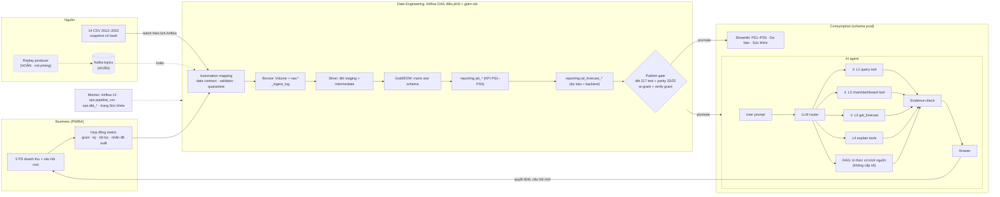

# Kiến trúc tổng: pipeline Data Engineering (GĐ1) → AI agent 4 level (GĐ2)

Viết ngày 2026-10-11, vai solution architect. Tài liệu này **chỉ thiết kế, không chứa code**.

**Cập nhật triển khai 2026-10-12:** bảng trạng thái bên dưới là ảnh chụp trước khi bắt đầu implementation.
Automation batch hiện đã có snapshot, Airflow, dbt build cách ly, quality gate, con trỏ phát hành và rollback;
đã nghiệm thu local, chưa nghiệm thu Databricks. Bằng chứng và cách chạy ở
[`automation_batch.md`](automation_batch.md). Ưu tiên dự báo/BI của GĐ2 trong phần sau vẫn là kế hoạch tiếp theo.

Đầu vào là hai sơ đồ thầy hướng dẫn vẽ tay. Thầy giao làm tiếp ngày 2026-10-10.
- [`references/pipeline.jpg`](references/pipeline.jpg): GĐ1, phần Data Engineering.
- [`references/pipeline-gd2.jpg`](references/pipeline-gd2.jpg): GĐ2, gồm AI agent và dự báo.

Đọc kèm:
- [`dwh_roadmap.md`](dwh_roadmap.md): lộ trình và lịch sử quyết định;
- [`ai_explain_plan.md`](ai_explain_plan.md): luật của chat;
- `CLAUDE.md` §5: kết luận dữ liệu, dùng khi thiết kế dự báo.

Quy ước trạng thái dùng trong tài liệu:

| Nhãn | Nghĩa |
|---|---|
| **Chạy** | Đã có và đã chạy, có bằng chứng |
| **Có, chưa chạy** | Đã có code nhưng chưa chạy |
| **Chỉ trong tài liệu** | Mới được nêu trong tài liệu, chưa có code |
| **Chưa có** | Chưa có cả code lẫn kế hoạch chi tiết |

---

## 0. Hai sơ đồ của thầy nói gì

**Sơ đồ GĐ1, `pipeline.jpg`.**
- Luồng chính: Raw Data → Kafka → *automation mapping data* → Silver Data → (fetch) → Data Warehouse (platform?).
- Đầu ra: Data Analyst / BI → code product, gồm Python Streamlit, BI và AI Explain.
- Một mũi tên lớn ghi "automation pipeline" và "monitor (Airflow)" phủ cả chuỗi.
- Nhánh phụ: "realtime? platform?" → OLAP → Power BI / MS SQL (DAX).

**Sơ đồ GĐ2, `pipeline-gd2.jpg`.**
- Vòng ngoài: Business → Tech (DE) → AI (LLM) → Business.
- Luồng dữ liệu: Streaming Kafka → preprocessing data → Apache Airflow DAG (Automation DE) → EDW → Streamlit.
- Agent: User prompt (NLP) → LLM → RAG → gọi các tool → Answer.
- Các tool:

  | Level | Nội dung | Số khoanh |
  |---|---|---|
  | L1 | Query trên EDW | ③ |
  | L2 | Dashboard → BI | ② |
  | L3 | Dự báo time series: ARIMA, log + SARIMAX, LSTM (ANN) → Output | ① |
  | L4 | Explainable (Expert) | không khoanh |

**Cách đọc các số khoanh:** PM xác nhận ngày 2026-10-11 rằng ①②③ là **thứ tự ưu tiên thầy giao**. Vì vậy dự báo (L3) làm trước nhất, rồi đến dashboard (L2). Query (L1) đã có.

---

## 1. GĐ1 đã tới đâu: đối chiếu từng ô của `pipeline.jpg`

| Ô trên sơ đồ | Trạng thái | Bằng chứng | Còn thiếu |
|---|---|---|---|
| Raw Data | **Chạy** | 14 CSV trong `data/`. Snapshot Parquet có hash (`scripts/ingest/snapshot.py`, snapshot `5bd9a84aaf73`). Ba script nạp: `ingest_raw.py` (Postgres), `ingest_databricks.py` (Volume + `retail_lab.raw.*`). Log nạp ghi vào `raw._ingest_log` | Ingest mới kiểm **số dòng**; tài liệu ghi "kiểm header" nhưng code chưa làm. Chưa kiểm kiểu và PK lúc nạp. Nạp lặp trên Databricks chưa được test |
| Kafka | **Chưa có, đã hoãn** (PM chốt 2026-10-11, xem §4) | Không có producer, consumer hay topic. `docker-compose.yml` chỉ có Postgres | Không làm trong đợt hạn 2026-10-25. Thiết kế giữ sẵn ở §5, A5 |
| Automation mapping data | **Có, phần ánh xạ còn viết tay** | 14 model `retail_dbt/models/staging/` + macro `clean()` (`retail_dbt/macros/cross_db.sql`). Hợp đồng khai báo kiểu, được rỗng và khóa chính (`scripts/ingest/source_contract.py`), kiểm ở stage prepare bằng `scripts/pipeline/contract.py` (S4, 2026-10-19); dòng lỗi ghi vào quarantine của run rồi dừng | Chưa xử lý đổi schema hay định dạng mới (JSON); chưa có luật miền (giá trị đúng kiểu, sai miền vẫn lọt); một dòng lỗi là dừng cả lượt. Thiết kế auto mapping (máy đề xuất, BA duyệt) ở `docs/tien_hoa_schema.md` §5b, §6; đang làm trên nhánh `schema/myuyen` (cập nhật 2026-10-27) |
| Silver Data | **Chạy, nhưng tên gọi lệch** | Trên đường tự động, Silver là dbt `staging` + `intermediate`. Ngoài ra còn thư mục `silver/` (3NF, `scripts/build/build_silver.py`), là script chạy một lần | Chốt tên lớp (xem §3) |
| Fetch | Không có bước riêng | dbt đọc `raw` trong cùng database/catalog (`retail_dbt/models/staging/_sources.yml`) | — |
| Data Warehouse (platform) | **Chạy** | `retail_dbt/` có 53 model và 158 test. DuckDB và Databricks đạt 217/217 (2026-10-06); Postgres đạt 216/216 ở lần chạy gần nhất có ghi nhận, trước khi thêm hook thứ ba. Đối soát `scripts/parity/compare_dwh.py` 33/33 | **Chưa tách stage/prod**: dbt build ghi đè thẳng `retail_lab`, đúng schema app public đang đọc. Mọi model là full refresh, không có incremental |
| DA/BI → code product | **Chạy** | `apps/retail_app/`: Streamlit 8 trang + chat AI Explain. Có bản public trên Streamlit Cloud đọc Databricks (2026-10-09) và bản Databricks Apps (2026-10-07) | — |
| OLAP / Power BI / DAX | Không làm, đã chốt | `dwh_roadmap.md`: chọn hướng code product, Power BI không bắt buộc | Khi bảo vệ cần nêu lý do không chọn |
| **Automation pipeline** | **Chưa có** | Không có Airflow, Databricks Job, CI hay Makefile. Mỗi nền tảng chạy tay 3–6 lệnh (ví dụ Databricks: `snapshot.py` → `ingest_databricks.py` → `scripts/databricks/run_dbt.py` → `compare_dwh.py`) | Toàn bộ |
| **Monitor (Airflow)** | **Một phần, chỉ thụ động** | Hook dbt ghi `ops.dbt_invocation`/`ops.dbt_node_result` (`retail_dbt/macros/health_log.sql`). Model `rpt_health_*` và trang *Sức khỏe dữ liệu* đọc lại các bảng đó | Chưa có lịch sử lần chạy pipeline, cảnh báo khi lỗi, dbt source freshness |

**Kết luận GĐ1:** đếm theo bảng trên, có 7 ô cần làm:
- **4 ô chạy:** Raw Data, Silver, Data Warehouse, DA/BI.
- **2 ô một phần:** automation mapping (còn viết tay), monitor (chỉ thụ động).
- **1 ô chưa có:** automation pipeline.

Ba ô không tính: Fetch (đã gộp vào dbt), OLAP (không chọn) và Kafka (hoãn từ 2026-10-11).

Theo hai mảng:
- Phần **dữ liệu đúng** đã vững: test nhiều tầng, đối soát giữa các nền tảng, quyền chỉ-đọc cho chat.
- Phần **vận hành tự động** gần như chưa có: thiếu điều phối (Airflow), thiếu cổng kiểm trước khi công bố (publish gate), thiếu cảnh báo. Luồng sự kiện (Kafka) đã hoãn, không tính vào phần còn thiếu của đợt này.

## 2. GĐ2 đã tới đâu: đối chiếu `pipeline-gd2.jpg`

| Thành phần | Trạng thái | Bằng chứng / ghi chú |
|---|---|---|
| ③ L1 Query EDW | **Chạy** | 8 tool cố định (`apps/retail_app/ai_explain/tools.py`, tool v1.4) trên 14 bảng `reporting`. Guard chỉ-đọc cho DuckDB/PG/Databricks (`dwh/guarded.py`). Số trong câu trả lời đi qua placeholder `{cX}` và được kiểm bằng `evidence.py`. Có bộ eval E/H/A/B/C/D/F (`ai_explain_nhat_ky.md`) |
| ② L2 Dashboard | **Chỉ có giao diện** | Có trang PS1–PS5, nhưng chat chưa gọi được dashboard/biểu đồ như một tool |
| ① L3 Dự báo | **Chưa có** | Chỉ có `notebooks/04_forecasting/baseline.ipynb`, đã biết là sai (`CLAUDE.md` §6). `fact_daily_sales` chứa 548 dòng giữ chỗ chép từ `sample_submission`, chưa phải dự báo. Chat đang từ chối mọi câu hỏi sau 2022-12-31 |
| L4 Explainable | **Một phần** | Đã có phân rã số học: N × U × P, cầu G → R, đóng góp nhóm vào ΔR. Tất cả gắn nhãn "không phải nguyên nhân". Chưa có giải thích model |
| LLM | **Chạy** | DeepSeek flash qua client tương thích OpenAI (`ai_explain/provider.py`). Giới hạn ≤ 4 tool/câu, ≤ 200k token/phiên |
| RAG | **Chưa có** | Không có retriever. Skill `retail-ai-explain` cấm *mặc định* dùng vector DB/text-to-SQL; cách dung hòa xem §5, B5 |

## 3. Luồng tổng: ghép hai sơ đồ

Nét đứt là phần **hoãn** (Kafka, PM chốt 2026-10-11). Luồng chạy thật trong đợt này là batch: CSV → Airflow → EDW.

### Tên các lớp (chốt một lần cho cả khóa luận)

Hiện hai tài liệu gọi tên lớp khác nhau: `dwh_roadmap.md` gọi staging ≈ Bronze, còn `dwh_huong_dan_pm_ba.md` gọi staging + intermediate là Silver. Từ nay dùng một cách:

| Lớp | Thành phần | Ô tương ứng trên sơ đồ thầy |
|---|---|---|
| **Bronze** | `raw.*` + Volume / landing Parquet, kèm `_ingest_log` | Raw Data (cả đầu ra Kafka nếu sau này làm A5) |
| **Silver** | dbt `staging` + `intermediate` | Automation mapping → Silver Data |
| **Gold** | dbt `marts` (star schema) | Data Warehouse / EDW |
| **Serving** | dbt `reporting`, gồm cả `rpt_forecast_*` (sửa 2026-10-12: không tạo schema `forecast` riêng, vì chỉ `reporting` được công bố theo bản, xem `automation_batch.md`) | DA/BI, các tool của agent |

Thư mục `silver/` (19 bảng 3NF) là **sản phẩm thiết kế** của chương chuẩn hóa. Nó nằm ngoài đường tự động: dbt không đọc nó.

### Ba câu hỏi bỏ ngỏ trên sơ đồ GĐ1

- **"Realtime?"** **Không.** Pipeline chạy **batch theo lịch Airflow**. Data dừng ở 2022-12-31, nên không có nguồn sự kiện thật. Kafka chỉ có thể phát lại (replay) dữ liệu cũ như một **mô phỏng**, và phần này đã hoãn (§4). Nếu sau này làm A5, phải ghi rõ là mô phỏng, không gọi là realtime nghiệp vụ (`dwh_roadmap.md`).
- **"Platform?"** Databricks Free Edition là production (chốt 2026-10-05). DuckDB/PostgreSQL dùng cho dev/test local.
- **OLAP / Power BI / DAX:** không chọn. Lý do: hướng *code product* (Streamlit + chat) đã chốt. Không vẽ vào luồng chính.

### Giới hạn Databricks Free Edition ảnh hưởng thiết kế

Nguồn: tài liệu chính thức *Free Edition limitations*, kiểm ngày 2026-10-11.

| Giới hạn | Hệ quả thiết kế |
|---|---|
| Chỉ có serverless compute; tối đa 5 job task chạy đồng thời | Có Jobs, nhưng nhỏ |
| Outbound internet chỉ tới một số domain tin cậy | Chỉ áp dụng nếu làm A5: Databricks không đọc được Kafka trên laptop, nên consumer phải chạy local rồi đẩy file lên Volume |
| Vượt quota ngày thì compute bị tắt tới hết ngày | Lịch chạy batch trên Databricks phải thưa. Nếu làm A5: nhịp micro-batch trên Databricks cũng phải thưa, demo nhịp dày làm trên Postgres local |
| 1 SQL warehouse 2X-Small; tối đa 3 app, app tự dừng sau 24 giờ | — |
| 1 endpoint AI Search (vector search) | Chỉ dùng khi đo thấy cần (xem B5) |

---

## 4. Quyết định

**Đã chốt ngày 2026-10-11 (PM/BA):**
- Hạn tiến độ **2026-10-25 vẫn cứng**.
- ①②③ trên sơ đồ GĐ2 là **thứ tự ưu tiên thầy giao**.
- Target dự báo là **G theo ngày** (`sales.csv`, gồm cả đơn hủy; đúng đề Datathon). **COGS** suy qua tỷ lệ COGS/G (`CLAUDE.md` §5.7). App và chat phải ghi "G – doanh thu gộp" để không lẫn với R của PS1–PS5. Dự báo R để sau.
- **Airflow chạy trong Docker local**, điều phối cả local lẫn Databricks. Khi bảo vệ phải nói rõ lịch chạy nằm trên laptop, không phải scheduler production.

- **Kafka (A5) hoãn**, ngoài phạm vi đợt hạn 2026-10-25, có thể không làm. Pipeline chạy batch theo lịch Airflow. Thiết kế A5 giữ sẵn ở §5 làm hướng phát triển.

**Lý do hoãn Kafka**, dùng khi báo thầy và khi bảo vệ. Kafka là ô đầu luồng dữ liệu trên `pipeline-gd2.jpg` và ô thứ hai trên `pipeline.jpg`, nên đây là chỗ lệch so với sơ đồ thầy giao:
1. Data tĩnh, dừng ở 2022-12-31, không có nguồn sự kiện thật. Kafka chỉ phát lại dữ liệu cũ, tức là mô phỏng.
2. Databricks Free Edition chỉ cho gọi ra một số domain tin cậy, nên không đọc được Kafka chạy trên laptop. Muốn làm phải thêm một consumer local đẩy file lên Volume.
3. ① của thầy là dự báo, và hạn 2026-10-25 cứng. Phần ô "preprocessing → Airflow DAG → EDW" trên sơ đồ GĐ2 vẫn được đáp ứng bằng batch.

**Còn chờ:**
- Cửa sổ train: dùng toàn chuỗi kèm biến chế độ sau 2018, hay chỉ dùng từ 2019. Sẽ chốt bằng backtest ở B2.

**Lưu ý thứ tự:** ban đầu PM muốn làm xong automation `pipeline.jpg` (gồm Kafka) rồi mới sang GĐ2. Nay Kafka đã hoãn. Airflow và publish gate vẫn làm sớm, vì dự báo cần chúng để lên prod an toàn.

## 5. Lộ trình

### Phải sửa trước khi xây thêm (A0)

1. **FB07:** test `test_trang_chat_doi_backend_xoa_hoi_thoai` đang đỏ. Nguyên nhân: `page_header()` chạy trước bước reset hội thoại (`apps/retail_app/views/ai_explain.py`). Các mục FB01–FB06 trong `feedback_ps1_ps5_streamlit_ai_20261010.md` chưa xử lý.
2. **Tài liệu lệch code:**
   - `databricks_readiness_review.md` (ngày 2026-10-02);
   - header `retail_dbt/dbt_project.yml` và `profiles.yml` còn ghi Snowflake production / Databricks lab / GitHub Actions (đã sửa 2026-10-18; Snowflake bỏ hẳn cùng ngày);
   - số test 216 so với 217;
   - câu "chạy tự động trong một lệnh" ở `dwh_huong_dan_pm_ba.md`.
3. **Git:**
   - `main` local đang chậm so với `origin/main`;
   - `origin/app/myuyen` có commit devcontainer chưa kéo về;
   - hai nhánh D2 của thành viên còn lại chưa merge.

### GĐ1-hoàn thiện: DE automation

**A1 – Airflow local trên Postgres.**
- **Hạ tầng:** Airflow LocalExecutor trong Docker Compose. Metadata DB riêng, đặt trên container Postgres sẵn có.
- **Runtime container (hiện chưa có):**
  - image Linux có dbt-postgres, dbt-databricks, databricks-sdk;
  - mount repo và `data/`;
  - gọi Postgres bằng tên service, không qua `localhost:5433`;
  - đặt `PYTHONUTF8=1`.

  Script hiện chạy bằng `.venv` Windows và profile OAuth CLI cá nhân, container không dùng được hai thứ này.
- **DAG `retail_batch`:** `snapshot` → `contract_check` → `ingest` → `dbt_build` → `regrant_ai_ro` (`scripts/ops/pg_ai_readonly_role.py`) → `verify_grants` → `parity` (`compare_dwh.py`) → `record_run`.
- **Nguyên tắc:** task chỉ bọc script có sẵn, không viết lại logic. Có retry, có tham số `snapshot_id` / `target`.
- **Lý do phải có `regrant_ai_ro`:** mỗi lần build lại Postgres là mất quyền của role `retail_ai_ro`.

**A2 – Publish gate và tách stage/prod trên Databricks** (mục DB06 còn mở).
- **Danh tính ghi:** dùng **writer SP** riêng (OAuth M2M), sở hữu stage và prod, tách khỏi hai SP chỉ-đọc `retail-ai-ro` và `retail-web-ro`. Secret để ngoài git như các file `.env.*.local` hiện có.
- **Build:** dbt build vào `retail_stage`. App và chat vẫn đọc `retail_lab`.
- **Promote:** chỉ promote khi đủ 217 test và parity 33/33.
  - Bảng: Delta CLONE từ stage sang prod.
  - Khoảng 24 view: tạo lại cho trỏ vào prod. Hai cách: chạy dbt riêng cho view trên target prod, hoặc materialize thành table mọi relation mà app/chat đọc.
  - Relation `ops`/health: cũng phải promote, nếu không thì trang *Sức khỏe dữ liệu* và `rpt_build_info` không cập nhật.
  - **Phải kiểm trên workspace** xem CLONE có chạy được trên Free serverless không.
- **Sau promote:**
  1. Re-grant cho `retail-ai-ro` (14 bảng) và `retail-web-ro` (21 bảng).
  2. Chạy kiểm tra guard `_dbx_violations`.
- **Cô lập stage:** hai SP chỉ-đọc **không được thấy** `retail_stage`. Nếu thấy, guard sẽ tự khóa chat.
- **Thứ tự triển khai:** gate phải chạy được ở local rồi mới trỏ DAG sang Databricks.

**A3 – Automation mapping bằng data contract.**
- Mỗi nguồn có một bản khai báo: cột, kiểu, nullable, PK, cột thời gian sự kiện.
- Một validator cho batch. Nếu sau này làm A5, consumer Kafka dùng lại đúng validator này.
- Dòng lỗi vào `raw._quarantine`, kèm lý do.
- Có test đối chiếu contract với `_sources.yml`.
- Bổ sung kiểm header cho đúng với tài liệu.

**A4 – Monitor.**
- Bảng `ops.pipeline_run`, do callback của Airflow ghi.
- dbt source freshness.
- Thẻ "lần chạy gần nhất" trên trang *Sức khỏe dữ liệu*.

**A5 – Kafka replay. HOÃN** (PM chốt 2026-10-11): ngoài phạm vi đợt hạn 2026-10-25, có thể không làm. Thiết kế dưới đây giữ làm hướng phát triển. Nếu làm thì làm local trước, Databricks sau.
- **Môi trường riêng `retail_replay`:** không bao giờ đụng prod.
- **Chia dữ liệu:** batch nạp tới mốc cắt (đề xuất 2022-06-30, chưa chốt). Phần sau mốc phát lại thành event theo thời gian sự kiện, có hệ số tua nhanh.
- **Topic:** mỗi thực thể một topic, key `order_id`.
- **Envelope:** `event_id` tất định, `event_type`, `event_time`, `schema_version`.
- **Consumer:** validate theo contract → micro-batch Parquet → Volume → `raw` append. Chỉ commit offset sau khi file đã ghi xong; at-least-once kết hợp dedupe theo `event_id`.
- **Kích hoạt dbt:** Airflow sensor chạy dbt theo micro-batch, dạng full refresh.
- **Test:** giữa chừng chỉ chạy test cấu trúc (PK/FK/not_null). Các test số dòng và đối soát (`sales.csv`, payments, inventory…) **sẽ fail giữa chừng là đúng**, nên bộ đầy đủ và parity chỉ chạy ở cuối.

### GĐ2: AI agent 4 level

**B1 – Hợp đồng dự báo** (skill `retail-metric-design`). **Đây là việc đầu tiên của GĐ2**; BA làm song song với A1.
- **Target và phạm vi:**
  - target G theo ngày;
  - horizon 548 ngày (2023-01-01 → 2024-07-01);
  - hiển thị gộp theo tháng;
  - COGS suy qua tỷ lệ.
- **Biến ngoại sinh:** chỉ dùng biến suy từ lịch (`CLAUDE.md` §5, ràng buộc feature).
  - Dùng: tháng, ngày-trong-tháng, cờ tháng 8 năm lẻ, cờ chế độ sau đứt gãy 2018.
  - **Không** dùng thứ trong tuần (§5.5).
- **Đánh giá:** rolling-origin backtest trên 2020–2022. Đo MAE/RMSE/sMAPE, và đo riêng sai số tháng 8 năm lẻ.
- **Mốc so sánh:** seasonal naive và `baseline.ipynb`. Notebook baseline chỉ làm mốc, không xây tiếp lên nó (`CLAUDE.md` §6).

**B2 – Model và kho dự báo.**
- **Notebook so sánh** `notebooks/04_forecasting/so_sanh_model.ipynb`, notebook là nơi chứng minh.
  Danh sách ứng viên, thước chọn và luật chọn: PM chốt ngày 2026-10-14 ở `docs/hop_dong_du_bao.md` §0, §4, §5
  (Must: mốc, log + SARIMAX, LightGBM, bản gộp; Should: ARIMA; Could: LSTM; COGS hai cách cùng dự thi).
  Trạng thái và nhật ký: `docs/ke_hoach_ai_gd2.md`.
- **Kho dự báo** (sửa 2026-10-12 cho khớp pipeline theo bản dữ liệu của `automation_batch.md`; **đã chạy ở local DuckDB 2026-10-15**, chưa chạy Databricks, xem `docs/ke_hoach_ai_gd2.md` §8):
  - app và chat chỉ đọc `reporting.rpt_forecast_daily` (`model`, `model_version`, `run_id`, `trained_through`, `yhat`, `lower`, `upper`) và `reporting.rpt_forecast_backtest`; trang Dự báo đọc thêm `reporting.rpt_forecast_actual` (số thực tế theo ngày, từ 2026-10-15);
  - kết quả model vào bản dữ liệu qua một stage của pipeline, không do script ghi thẳng vào catalog đang phục vụ. Đề xuất: stage đứng sau snapshot, trước dbt build, train từ `sales.parquet` của snapshot;
  - tách khỏi 548 dòng giữ chỗ của `fact_daily_sales`.
- **dbt `rpt_forecast_*` kèm test:**
  - đủ 548 ngày;
  - `lower ≤ yhat ≤ upper`;
  - tỷ lệ COGS/G ngày trong khoảng đã thấy trong lịch sử; lịch sử có COGS/G > 1 cả ngoài tháng 8 năm lẻ (`docs/hop_dong_du_bao.md` §9);
  - kiểm tường minh **tháng 8/2023: G sụt và COGS/G > 1**.
- **File nộp:** xuất file `Date, Revenue, COGS` theo mẫu `sample_submission` vào `data/`. **Không commit** file này (`CLAUDE.md` §2).
- **Airflow:** thêm task `forecast_train_score` đứng trước gate. Task chỉ train lại khi `snapshot_id` hoặc code dự báo đổi; thư mục code dự báo phải nằm trong `code_version()` (`scripts/pipeline/cli.py`).

**B3 – Đưa dự báo vào sản phẩm.**
- **Trang Streamlit "Dự báo"**, là phần L2 của dự báo: thực tế + dự báo + khoảng tin cậy, bảng backtest, các lưu ý.
- **Tool chat `get_forecast` (L3):**
  - luật evidence mới: số dự báo luôn kèm nhãn "dự báo", khoảng tin cậy, `model_version` và `trained_through`;
  - catalog chỉ mở mốc "sau 2022-12-31" cho riêng tool này.
- **Quyền đọc:** thêm `reporting.rpt_forecast_*` vào `ALLOWED_RELATIONS` (`ai_explain/tools.py`), script role PG, và các biến dbt `ai_readonly_relations` / `app_read_relations` (macro `ai_readonly_grants.sql` grant cho SP chat, SP app và SP web; pipeline grant theo cùng hai biến cho từng bản). Thiếu bước này thì tool lỗi, hoặc guard khóa chat. Thêm relation cũng làm hỏng rollback về các bản dựng trước đó. Danh sách bước: skill `retail-ai-explain`, `references/agent_levels.md`.
- **Eval:** bộ eval mới G*, gồm cả câu ngoài horizon phải bị từ chối.

**B4 – L4 Explainable.**
- Tool `explain_forecast`: tách đóng góp của từng thành phần SARIMAX (tháng, ngày-trong-tháng, tháng 8 năm lẻ, chế độ). Gắn nhãn "phân rã model, không phải nguyên nhân".
- Mở thêm tool C/F theo FB05.
- Permutation importance cho LSTM để sau.

**B5 – RAG tri thức.**
- **Corpus tuyển chọn:** metric catalog, quy ước PS, business notes, data dictionary, kết luận §5, lịch khuyến mãi, model card.
- **Truy xuất:** lexical (BM25), qua tool `search_knowledge`. Tool trả đoạn văn kèm đường dẫn và mục nguồn.
- **RAG không bao giờ cấp số.** Evidence vẫn chỉ nhận số từ tool. Đây là cách dung hòa với luật "không mặc định vector DB" của skill.
- **Embedding / AI Search:** chỉ dùng khi đo thấy cần.
- **Eval:** hit@k và tỷ lệ trích đúng nguồn.

**B6 – L2 thành tool.** Tool `show_chart` vẽ biểu đồ ngay trong chat, hoặc deep link sang trang có sẵn bộ lọc.

**B7 – Router và nghiệm thu.**
- Prompt chọn level phù hợp cho từng câu hỏi.
- Bộ câu held-out mới, live eval trên Databricks.
- Báo cáo AI4.

### Ưu tiên trong 14 ngày (tới 2026-10-25)

| Nhóm | Hạng mục | Ước tính |
|---|---|---|
| **Must** | A0 · B1 · A1 (gồm runtime container) · B2 (ARIMA + log-SARIMAX trước, LSTM sau cùng) · A2 (gồm writer SP) · B3 · tài liệu + AI4 | khoảng 10,5 ngày |
| **Should** | B6 · A3 bản gọn · A4 | khoảng 2 ngày |
| **Could** | B4 (làm trong ngày dự phòng nếu không có rủi ro nào nổ) · B5 · dbt incremental + surrogate key dạng hash | — |
| **Hoãn** | A5 Kafka replay, cả local lẫn Databricks (PM chốt 2026-10-11) | — |

Must + Should khoảng 12,5 ngày trên 14 ngày. Bản trước còn A5 thì tổng là 14,5 ngày, tức đã vượt hạn.

| Ngày | Việc |
|---|---|
| D1 | A0 + B1 |
| D2–4 | A1. DAG để sẵn chỗ cho `forecast_train_score` |
| D3–5 | B2, song song với A1. Có thể giao thành viên còn lại; mỗi notebook một chủ |
| D6–7 | A2 + writer SP + đưa kho dự báo vào DAG |
| D8–9 | B3 + grant/allowlist + eval G* |
| D10 | B6 + A3 bản gọn + A4 |
| D11–12 | **Dự phòng** cho các rủi ro chưa kiểm: CLONE trên Free serverless, writer SP, quota ngày. Không có gì nổ thì làm B4 |
| D13 | Dự phòng / B4 nếu chưa xong |
| D14 | Tài liệu, AI4, kịch bản demo |

Hai ngày D11–12 trước đây dành cho A5. Không đôn B5 (RAG) lên các ngày này.

Nếu trễ, cắt từ dưới lên theo thứ tự B4 → B6. **Không cắt A2**: thiếu gate thì DAG sẽ ghi đè prod mà app public đang đọc.

## 6. Kiểm chứng từng bước

| Bước | Cách kiểm |
|---|---|
| A1 | Chạy DAG trên Postgres sạch: 217/217, parity 33/33, test chat trên PG vẫn pass. Chạy lần hai cho kết quả y hệt (idempotent) |
| A2 | Cố ý làm hỏng một test ở stage: prod không đổi, app public vẫn chạy. Chạy bình thường: `rpt_build_info` đổi invocation, guard SP sạch, mọi view prod trỏ vào prod. CLONE được kiểm thực tế trên workspace |
| A3 | Mutation (đổi tên cột, sai kiểu, PK trùng): pipeline dừng trước dbt, lý do nằm trong quarantine |
| A5 (hoãn, chỉ dùng khi làm lại) | Replay xong thì `retail_replay` bằng batch (compare 33/33 + dbt 217). Replay lần hai, hoặc kill consumer giữa chừng: 0 dòng trùng, 0 dòng mất. Có ghi độ trễ event → DWH và nhãn "mô phỏng" |
| B2 | Bảng backtest: mỗi model so với seasonal naive và baseline. Test dbt forecast pass, có cả kiểm tháng 8/2023 |
| B3–B5 | Eval G* và test retrieval offline (không gọi LLM). Live eval ghi đủ phiên bản model / prompt / catalog / dữ liệu |

Báo cáo cloud tách riêng các bước compile / deploy / run / parity / publish (`agent_workflows.md`). Bước nào chưa chạy trên cloud thì ghi rõ là chưa chạy.
