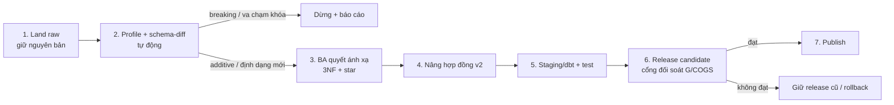

# Tiến hóa schema: khi dữ liệu mới thêm field hoặc đổi định dạng

> **Trạng thái: ĐỀ XUẤT, chờ PM/BA duyệt** (soạn 2026-10-26). Chưa có dòng code nào được sửa theo tài liệu này.
>
> **Cập nhật 2026-10-27:** PM đã chốt 5 câu ở §10 và chọn làm **auto mapping** ở mức "hệ thống tự đề xuất, BA duyệt"
> (thiết kế ở §5b). Thứ tự PM chọn: duyệt tài liệu này trước, rồi mới code.
>
> **Dấu †**: số liệu khảo sát sơ bộ, lấy bằng script tạm ngoài repo, **chưa có cell chứng minh**. Các cell sẽ nằm ở
> `notebooks/02_design/schema_evolution.ipynb` (bước sau, §9). Theo quy ước `.md` diễn giải, notebook chứng minh
> (CLAUDE.md §3), số có † chưa được dùng làm kết luận chính thức.
>
> **Cập nhật 2026-10-27 (bước 2):** notebook đã chạy. Mọi số ở §2, §3.2, §5b và §7 nay có cell (phần 1–8), nên đã bỏ dấu †.
> Bốn chỗ notebook ra khác bản khảo sát sơ bộ đã được sửa theo notebook: 17 thuộc tính shipper (không phải 15), 2 `promo_name`
> rỗng (không phải 1), 2 ngày sai trong tf (thêm `'2026-99-99'`), và mức lệch COGS khi nạp epd (§7).

## 1. Câu hỏi và trả lời ngắn

**Câu hỏi của giảng viên.** Giảng viên giao bộ `student_data.zip` và hỏi: nếu stakeholder muốn đưa dữ liệu mới vào, và dữ liệu đó
có thêm field, đổi kiểu dữ liệu hoặc ở định dạng khác như JSON, thì hệ thống có xử lý được không? Nếu được thì đồng bộ dữ liệu
mới với thiết kế (3NF, star schema) bằng cách nào?

**Trả lời ngắn.**

- **Hiện tại hệ thống phát hiện và chặn được các thay đổi về cấu trúc và kiểu.** Nó *fail-closed*: dừng trước khi dbt chạy, ghi bằng
  chứng vào quarantine và không công bố bản dữ liệu nào.
- **Có hai lỗ hổng:** giá trị đúng kiểu nhưng sai miền (giá âm, `999999999`) và nguồn đánh lại khóa vẫn lọt qua hợp đồng
  đầu vào. Với nguồn lõi thì cổng đối soát G/COGS ở cuối còn chặn được; với nguồn phụ như web traffic thì không có gì
  chặn (§3.2).
- **Hệ thống chưa tự tiếp nhận được.** Không có đường đọc JSON. Cột mới không được nâng vào mô hình, và một dòng bẩn
  là dừng cả lượt.
- **Muốn nhận dữ liệu mới thì không nạp thẳng.** Phải đi qua một quy trình tiến hóa có kiểm soát (§5): land nguyên bản →
  so schema → BA quyết ánh xạ vào thiết kế → nâng hợp đồng → dbt + test → bản ứng viên qua cổng đối soát → công bố hoặc
  rollback.

**Vì sao chọn "chặn trước, tiếp nhận có kiểm soát" mà không "nạp được gì thì nạp".** Doanh thu và COGS là hàm xác định
của dữ liệu giao dịch (CLAUDE.md §5 điểm 1: `Revenue = Σ quantity × unit_price`, `COGS = Σ quantity × cogs`). Nạp sai
một dòng `products` hoặc `order_items` là lệch đối soát với `sales` ngay. Vì thế, với nguồn lõi doanh thu, an toàn được
ưu tiên hơn sự tiện.

## 2. Bộ dữ liệu giảng viên giao: thật ra có gì mới

Zip gồm 15 file. **10 file CSV trùng từng byte với `data/` hiện có**: customers, geography, inventory, order_items,
payments, products, promotions, returns, reviews, web_traffic. Thay đổi thật chỉ nằm ở 5 file dưới đây. Riêng `sales.csv`
và `sample_submission.csv` thì không có trong zip.

| File mới | Tương ứng nguồn cũ | Thay đổi | Phát hiện chính (notebook phần 1–6) |
|---|---|---|---|
| `orders_enriched.csv` (646.945 dòng) | `orders` | Đổi tên file, **có BOM UTF-8**, thêm 9 cột | 8 cột gốc trùng 100% với `orders.csv`. `city, region, district` khớp `geography` qua `zip` ở 646.945/646.945 dòng, tức là **thừa**. `sales_employee_id, sales_employee_name, marital_status, education_level, years_experience` cho 200 nhân viên; id quyết định mọi thuộc tính khác (0 vi phạm phụ thuộc hàm), 0 dòng thiếu id. `comment` chỉ có **18 câu mẫu**, không null |
| `shipments_realistic.csv` (566.067 dòng) | `shipments` | Đổi tên file, thêm 18 cột về shipper | 4 cột gốc trùng 100%. Có 80 `shipper_id`; cả 17 thuộc tính shipper đều phụ thuộc hàm vào id (0 vi phạm). Có **PII**: tên, số điện thoại, tuổi, giới tính. `join_date` chạy từ 2018-01-12 tới **2026-03-17** và **lớn hơn `ship_date` ở 519.276 dòng (≈92%)**: thuộc tính là ảnh chụp hiện tại, không phải lịch sử. `city` của shipper khác `city` của đơn ở ≈97% dòng (là nơi của shipper, không phải nơi giao) |
| `eprom.json` (1.000 bản ghi) | `promotions` (50 dòng) | Định dạng JSON, id mới | Cùng 10 trường với `promotions`. Id dạng `PROMO-00xx-nnnn`, trung bình 20 bản cho mỗi trong 50 promo gốc, gần như sao chép (chỉ vài trường lệch). **0 dòng `order_items` tham chiếu** tới các id này. Có 1 id dính khoảng trắng đầu. `discount_value` lẫn chuỗi `'twenty percent'` và `'30%%'`; 2 `promo_name` rỗng (một `None`, một chuỗi rỗng) |
| `epd.json` (1.000 bản ghi) | `products` (2.412 dòng) | Định dạng JSON, **đánh lại khóa** | Cùng 8 trường. **995/1.000 bản ghi là bản sao y của một sản phẩm đang có** (khớp đủ tên, category, segment, size, color, price, cogs), nhưng `product_id` bị **đánh số lại 1–1.000**. Ví dụ id 1 trong epd là sản phẩm 1902 trong `products`. Hệ quả: 997 id trùng số với id đang có nhưng trỏ tới sản phẩm khác. 5 bản ghi còn lại bị cấy giá trị sai: `price = -150`, `'N/A'`, `999999999`; `category = 'N/A'`, `'Unknown_999'`. Ngoài ra có `product_id` rỗng hoặc None, và id 405 xuất hiện hai lần |
| `tf.json` (1.000 bản ghi) | `web_traffic` (3.652 dòng) | Định dạng JSON | Cùng 7 trường. **998 ngày đã có trong `web_traffic`**, tức là phát lại bản ghi cũ. `traffic_source` bị gắn hậu tố `" Variant nnnn"`. Trên các ngày trùng, **mọi chỗ lệch đều là giá trị bị cấy**: `sessions` có None, `-100`, `'N/A'`, `999999999`; `unique_visitors` có `-50`, `'unknown'`; `traffic_source` có `''`, `'N/A'` và một giá trị dính khoảng trắng hai đầu. Thêm 2 ngày không hợp lệ: `'not_a_date'` và `'2026-99-99'` |

**Đọc nhanh:** bộ dữ liệu cố tình gom đủ các tình huống điển hình của "dữ liệu mới từ stakeholder":

- field mới hợp lệ (nhân viên, shipper);
- field thừa (city, region, district);
- PII;
- đổi tên file;
- encoding (BOM);
- định dạng mới (JSON);
- lệch kiểu (`'N/A'`, `'twenty percent'`);
- giá trị đúng kiểu nhưng sai miền (`-150`, `999999999`, `'Unknown_999'`);
- đánh lại khóa (epd);
- phát lại bản ghi cũ (tf).

## 3. Hệ thống hiện tại xử lý thế nào

### 3.1 Những chốt chặn đang có

| Chốt chặn | Ở đâu | Làm gì |
|---|---|---|
| Hợp đồng nguồn | `scripts/ingest/source_contract.py` | `SOURCES` gồm header và số dòng; `COLUMNS` gồm kiểu và cờ được rỗng; `KEYS` là khóa chính. 14 nguồn, tên file cố định `data/{name}.csv` |
| Kiểm header + số dòng | `scripts/pipeline/snapshot.py:53` và `:56` | Header phải **bằng tuyệt đối** hợp đồng; số dòng phải đúng; dòng nào thiếu hoặc thừa field cũng dừng |
| Kiểm kiểu, not-null, khóa chính | `scripts/pipeline/contract.py` | `try_cast(nullif(trim(col),'') as kiểu)` chạy trên snapshot. Dòng sai vào `runs/<id>/quarantine/` và **dừng cả lượt** (docstring dòng 6–7) |
| Ghi bằng chứng khi header lệch | `scripts/pipeline/cli.py:324–328` | Ghi lỗi vào `quarantine/summary.json` rồi dừng |
| Mã thoát và Airflow | `cli.py:516` (exit 2), `deploy/airflow/dags/retail_batch_pipeline.py:47` | Lỗi hợp đồng dẫn tới `AirflowFailException`, không retry |
| Staging dbt | `retail_dbt/models/staging/stg_*.sql` | Chọn **cột tường minh**, mỗi cột `cast(clean(col) as kiểu)`; cột lạ trong raw bị bỏ qua an toàn |
| Hợp đồng khớp staging | `scripts/pipeline/tests/test_contract.py:47` | Test buộc kiểu trong `COLUMNS` khớp phép cast ở `stg_*` |
| Phiên bản và công bố | snapshot_id, release_id, cổng `validate` (`cli.py`), rollback | Bản dữ liệu bất biến; G/COGS đối soát với `sales` trước khi publish |

### 3.2 Đưa từng file của giảng viên vào hệ thống hiện tại thì sao

*Đã chạy thật bằng `snapshot.prepare` và `contract.check` trên thư mục tạm (notebook phần 8). Hai dòng Postgres và silver vẫn là
đọc code, chưa chạy.*

| Cách đưa vào | Kết quả dự kiến | Nhận xét |
|---|---|---|
| Đặt file mới cạnh nguồn cũ (`orders_enriched.csv` cạnh `orders.csv`; notebook thử `epd.json` cạnh `products.csv`) | **Bị bỏ qua, không báo gì.** `prepare` chỉ mở `data/<nguồn>.csv`; manifest chỉ ghi nguồn cũ | Lỗ hổng: dữ liệu mới "nằm đó" mà không ai biết là chưa nạp |
| Thay nội dung `orders.csv` bằng bản enriched | Dừng ở `snapshot.py:53`: `orders: header sai hợp đồng`. Có 2 lý do: BOM làm cột đầu thành `order_id`, và thừa 9 cột | Chặn đúng, nhưng lỗi trần không nói *lệch ở đâu* |
| Thay `shipments.csv` bằng bản realistic | Dừng, `shipments: header sai hợp đồng` | Như trên |
| Đưa JSON (eprom, epd, tf) | **Không có đường nào đọc JSON** | Phải chuyển tay sang CSV. Nếu ghi đè `products.csv` bằng epd thì dừng ở `snapshot.py:56` (1.000 ≠ 2.412 dòng); nếu qua được số dòng thì `contract.py` bắt trùng khóa, rỗng và `'N/A'`, **nhưng để lọt `-150`, `999999999`, `category = 'N/A'`, `'Unknown_999'`** (đúng kiểu, sai miền) và không phát hiện được việc đánh lại khóa: 991 bản ghi mang id sai qua lọt |
| Ghi đè `web_traffic.csv` bằng tf chuyển sang CSV | Dừng ở số dòng (1.000 ≠ 3.652). Nếu qua được, `contract.py` bắt 2 ngày sai, `'N/A'`, `'unknown'` và ô rỗng, **nhưng để lọt `sessions = -100`, `999999999`, `unique_visitors = -50`, `traffic_source = 'N/A'`** và hậu tố `Variant` | Không có cổng đối soát nào cho web traffic ở cuối |
| Nạp qua đường Postgres (`scripts/ingest/ingest_raw.py`) | **Cột thừa lọt vào raw mà không báo gì.** Dòng 50–51 tạo bảng theo header bất kỳ, chỉ kiểm số dòng | Lệch với docstring dòng 10 ("header + số dòng"). Cần sửa khi làm prototype |
| Dựng silver 3NF (`scripts/build/build_silver.py:64`) | Dừng vì header lệch | — |

**Kết luận §3:** đường production (Airflow → `scripts.pipeline.cli`) **an toàn**, vì không có dữ liệu lạ nào lọt vào
release. Nhưng nó **cứng** ở 4 chỗ:

1. Header phải bằng tuyệt đối, kể cả với cột thêm vô hại.
2. Tên file cố định.
3. Số dòng cố định ở 5 nơi: `SOURCES`, `build_silver.py`, `ingest_raw.py`, `scripts/ingest/snapshot.py` và
   `retail_dbt/tests/assert_row_counts.sql`.
4. Một dòng bẩn là dừng tất cả.

Ngược lại, có hai chỗ hệ thống **chưa chặn**: giá trị đúng kiểu nhưng sai miền, và nguồn dùng id riêng (đánh lại khóa).
Với nguồn lõi, chỉ cổng `validate` G/COGS ở cuối mới bắt được hai lỗi này. Thêm vào đó, thông báo lỗi chưa giúp BA biết *phải đổi thiết kế thế nào*.

## 4. Phân loại thay đổi: hiện nay làm gì, đề xuất làm gì

| # | Loại thay đổi | Ví dụ thật trong zip | Hiện nay | Đề xuất |
|---|---|---|---|---|
| 1 | **Thêm cột** (additive) | `orders` thêm 9 cột, `shipments` thêm 18 cột | Dừng | Nhận vào raw. Staging vẫn chỉ đọc cột trong hợp đồng, nên mô hình không đổi. Cột mới được ghi vào báo cáo schema-diff, chờ BA quyết (§5 bước 3) |
| 2 | **Thiếu hoặc đổi tên cột** (breaking) | (không có trong zip) | Dừng | **Vẫn dừng**, nhưng kèm báo cáo schema-diff: thiếu cột nào, cột nào nghi là đổi tên |
| 3 | **Đổi tên file** | `orders_enriched.csv`, `shipments_realistic.csv` | Bị bỏ qua, không báo | Bảng ánh xạ *file → nguồn logic* khai báo trong hợp đồng. File lạ trong thư mục nhận thì **báo**, không âm thầm bỏ qua |
| 4 | **Encoding / BOM** | `orders_enriched.csv` | Dừng (lỗi khó hiểu) | Đọc bằng `utf-8-sig` để bỏ BOM; encoding khác UTF-8 thì dừng và báo rõ |
| 5 | **Định dạng mới (JSON)** | eprom, epd, tf | Không hỗ trợ | **Adapter** chuyển mảng đối tượng JSON thành bảng *toàn chuỗi* (header = hợp các khóa; giá trị lồng nhau giữ dạng chuỗi JSON). Sau đó JSON đi **chung một đường** với CSV: cùng hợp đồng, cùng `try_cast`, cùng quarantine. Định dạng chỉ là chuyện đọc file, không phải chuyện mô hình |
| 6 | **Lệch kiểu / dòng bẩn** | `'N/A'`, `'unknown'`, `'twenty percent'`, `'not_a_date'` | Dừng cả lượt | Ba tầng (§6.1): tự chuẩn hóa, sửa theo luật BA đã duyệt, còn lại **cách ly + ngưỡng**. Không bao giờ tự đoán giá trị |
| 7 | **Đánh lại khóa master data** (hệ thống nguồn dùng id riêng) | `epd.json`: sản phẩm cũ mang id mới, id mới trùng số với sản phẩm khác | (chưa gặp) | **Không bao giờ nạp theo id của nguồn.** Phát hiện bằng cách so thuộc tính: cùng id nhưng khác thuộc tính, trong khi thuộc tính khớp một bản ghi khác. Từ chối cập nhật master và xuất báo cáo xung đột. Nếu BA cần dùng nguồn này thì dựng **bảng ánh xạ khóa** (`source_system`, `source_id`) → `product_id`, bằng cách khớp đủ thuộc tính. Dòng khớp 0 hoặc nhiều bản ghi thì vào quarantine |
| 7b | **Đúng kiểu nhưng sai miền** | `price = -150`, `999999999`; `sessions = -100`; `category = 'Unknown_999'` | **Lọt qua**: `contract.py` chỉ kiểm kiểu, rỗng và khóa chính | Thêm **luật miền** vào hợp đồng: min/max cho số (giá > 0, lượt truy cập ≥ 0), danh mục hợp lệ cho cột phân loại. Dòng vi phạm đi chung đường cách ly + ngưỡng (§6) |
| 8 | **Phát lại bản ghi cũ** | `tf.json`: 998 ngày đã có | (chưa gặp) | Nạp **idempotent theo grain** (`web_traffic`: một dòng mỗi `date`). Trùng và giống nhau thì bỏ qua; trùng nhưng khác giá trị thì giữ bản đang có và đưa bản mới vào báo cáo xung đột, không ghi đè |
| 9 | **Thuộc tính thừa** (phụ thuộc bắc cầu) | `orders.city/region/district` | (chưa gặp) | **Không lưu lại.** `zip → city, region, district` đã nằm ở `geography`; lưu thêm là vi phạm 3NF và mở ra khả năng lệch nhau sau này. Chỉ giữ một phép kiểm "khớp geography" làm test |
| 10 | **PII, thuộc tính ảnh chụp hiện tại** | Tên/SĐT shipper, tên nhân viên; `join_date` > `ship_date` | (chưa gặp) | Che hoặc bỏ PII trước khi vào mart, chat và RAG. Thuộc tính ảnh chụp hiện tại thì dùng dim **Type 1**, ghi rõ "không dùng để phân tích theo thời điểm giao"; chỉ lên SCD2 khi nguồn thật sự ghi lại lịch sử thay đổi |

## 5. Quy trình đồng bộ dữ liệu mới với thiết kế

Đây là phần trả lời chính cho câu "xử lý thế nào để đồng bộ". Nguyên tắc: **dữ liệu không tự quyết định thiết kế**.
Dữ liệu mới chỉ vào được mô hình sau khi có người quyết định nó *là gì* trong thiết kế.

| Bước | Ai | Đầu vào → đầu ra | Cổng chặn |
|---|---|---|---|
| 1. Land raw | Pipeline | File stakeholder gửi (CSV, JSON) → bản nguyên vẹn + manifest (tên file, hash, số dòng, encoding) | File hỏng hoặc không đọc được |
| 2. Profile + schema-diff | Pipeline, tự động | Raw → báo cáo: cột thêm/thiếu/đổi tên, kiểu suy được, tỷ lệ rỗng, trùng khóa, va chạm khóa với master data đang có, phát lại theo grain | **Breaking** (thiếu cột, va chạm khóa): dừng. **Additive**: sang bước 3 |
| 3. Quyết ánh xạ | **BA/PM** (skill `retail-metric-design`) | Báo cáo bước 2 → quyết định cho **từng field**. Ở 3NF: thực thể mới, thuộc tính của thực thể cũ, hay thuộc tính thừa (phụ thuộc bắc cầu)? Ở star: dim mới, cột fact mới, thuộc tính dim, hay *không đưa vào* vì chưa có câu hỏi nghiệp vụ dùng tới? PII thì che hay bỏ? | Field không trả lời được câu hỏi nghiệp vụ nào thì **dừng ở silver**, không lên star |
| 4. Nâng hợp đồng (v2) | Dev | Quyết định bước 3 → hợp đồng thêm: cột, kiểu, được rỗng, khóa, **ngưỡng lỗi**, ánh xạ file → nguồn | `test_contract.py`: hợp đồng phải khớp cast ở staging |
| 5. Staging/dbt + test | Dev (skill `retail-analytics-engineering`) | Hợp đồng v2 → `stg_*` mới, dim/fact mới, test `unique`, `not_null`, `relationships` | dbt test FAIL thì không sang bước 6 |
| 6. Release candidate | Pipeline | Bản dữ liệu mới (snapshot_id mới) → schema `r_<release_id>_*` | Cổng `validate`: G/COGS theo ngày phải khớp `sales`. Đây là **lưới an toàn cuối**: nếu epd lỡ lọt vào `products` thì COGS lệch và cổng này chặn |
| 7. Publish / rollback | PM bấm | Release đạt → con trỏ active | Có rollback về release trước |

**Về phiên bản dữ liệu.** Bộ Datathon hiện tại giữ nguyên hợp đồng và snapshot_id cũ. Bật nguồn mở rộng là một hợp
đồng khác, nên sinh **snapshot_id mới và release mới**. App và chat vẫn đọc release cũ cho tới khi PM publish. Vì vậy
thay đổi schema luôn **quay lui được**.

## 5b. Auto mapping: tự đề xuất, BA duyệt

Đây là ô *"automation mapping data"* trên sơ đồ GĐ1 của thầy (`docs/kien_truc_pipeline_tong.md` §0, §1; ô này hiện ghi
"có nhưng viết tay"). PM chốt mức tự động ngày 2026-10-27: **máy làm bước 2 và soạn sẵn bước 3 của §5; người duyệt
mới thành hợp đồng.** Không có ánh xạ nào được nạp khi chưa duyệt.

### Máy tự làm gì

| Việc | Cách đề xuất | Bằng chứng ghi kèm |
|---|---|---|
| **Đọc file lạ** | Adapter: CSV đọc `utf-8-sig` (bỏ BOM); JSON mảng đối tượng thành bảng toàn chuỗi (§4 dòng 5). Encoding khác thì dừng và báo | Tên file, hash, số dòng, encoding, định dạng |
| **File → nguồn logic** | Chấm điểm file với từng nguồn trong hợp đồng: tỷ lệ tên cột trùng (sau khi chuẩn hóa chữ thường, bỏ khoảng trắng/BOM) và độ giống tên file. Chọn nguồn điểm cao nhất nếu vượt ngưỡng **và** cách nguồn thứ hai đủ xa; không thì ghi "chưa rõ" | Điểm của 2 nguồn đứng đầu |
| **Cột → cột hợp đồng** | Trùng tên chuẩn hóa thì khớp. Cột hợp đồng bị thiếu thì tìm ứng viên đổi tên: cùng kiểu suy được và giá trị trùng nhiều với cột cũ | Tỷ lệ giá trị trùng, kiểu suy được |
| **Phân loại cột thêm** | (a) **thừa**: suy được từ bảng đã có qua khóa nối, ví dụ `city, region, district` khớp `geography` qua `zip`; (b) **thực thể mới**: nhóm cột phụ thuộc hàm vào một cột id mới, ví dụ nhân viên, shipper; (c) **thuộc tính lẻ**, ví dụ `comment`; (d) **nghi PII**: theo tên cột và mẫu giá trị (tên người, số điện thoại) | Số vi phạm phụ thuộc hàm, tỷ lệ khớp, số giá trị phân biệt |
| **Khóa** | Nguồn master data (có khóa chính): so thuộc tính theo id. Cùng id mà khác thuộc tính, trong khi thuộc tính khớp một bản ghi khác, là **đánh lại khóa**. Khi đó máy đề xuất bảng `(source_system, source_id) → product_id` bằng khớp đủ thuộc tính; dòng khớp 0 hoặc nhiều bản ghi vào quarantine | Số dòng khớp đúng 1, khớp 0, khớp nhiều |
| **Phát lại** | Nguồn có grain (ví dụ `web_traffic`: một dòng mỗi ngày): đếm dòng trùng grain, trùng mà giống, trùng mà khác | Ba con số trên |
| **Giá trị lạ** | Chỉ **báo**: `'N/A'`, số âm, `999999999`... Không tự sửa (§6 quy tắc 1). Lỗi có quy luật (ví dụ cùng một hậu tố) thì đề xuất **luật sửa ứng viên** tầng 2, chờ BA duyệt (§6.1) | Mẫu dòng, `_src_row` |

### Đầu ra và cách duyệt

- Mỗi batch sinh hai file trong thư mục run (gitignored, cùng chỗ với quarantine):
  - `mapping_de_xuat.yml`: mọi đề xuất ở trạng thái `de_xuat`, kèm điểm và bằng chứng;
  - `bao_cao_mapping.md`: bản đọc cho BA, xếp theo mức cần quyết, ca mơ hồ và va chạm khóa đứng đầu.
- BA đọc báo cáo rồi sửa hoặc giữ từng dòng. Bản đã duyệt được chép thành **hợp đồng mở rộng** trong repo, tách khỏi
  `SOURCES` của bộ Datathon, và vào `main` qua PR. Vì vậy mỗi ánh xạ đều có người duyệt và có lịch sử git.
- Pipeline chỉ đọc hợp đồng đã duyệt. File, cột hoặc khóa chưa được duyệt **không được nạp**, và lần chạy sau vẫn báo lại.
- Hợp đồng mở rộng nằm trong `scripts/ingest`, nên `code_version` đổi. Bật nguồn mới vì thế luôn sinh release mới, đi qua
  cổng `validate` và rollback được (§5, "Về phiên bản dữ liệu").

### Máy không bao giờ tự làm

- Quyết định trường mới vào đâu trong star schema (dim mới, cột fact, hay dừng ở silver). Việc này là bước 3 của §5, do BA làm.
- Nạp master data theo id của nguồn.
- Áp luật sửa chưa được duyệt, đoán nghĩa hoặc điền giá trị.
- Đổi hành vi của 14 nguồn Datathon: cùng dữ liệu thì `snapshot_id` giữ nguyên, và giá trị ở marts/reporting phải khớp,
  trừ siêu dữ liệu build (`code_version`, `release_id`, `rpt_build_info.built_at_utc` luôn đổi khi code đổi).

### Tiêu chí nghiệm thu (PM duyệt 2026-10-27)

| # | Tiêu chí | Kiểm bằng |
|---|---|---|
| 1 | **Máy đề xuất, BA duyệt, không sửa code lõi**: file mới sinh `mapping_de_xuat.yml` + báo cáo; chỉ ánh xạ đã duyệt mới được nạp | Test: ánh xạ chưa duyệt không được nạp |
| 2 | **Tự phát hiện và phân loại thay đổi** đúng cho cả 5 file của giảng viên | Bảng "Bộ nghiệm thu" ngay dưới, đối chiếu notebook |
| 3 | **Dòng bẩn có chỗ chứa, có ngưỡng**: nguồn mở rộng dưới 1% thì cách ly rồi chạy tiếp; cả 14 nguồn Datathon giữ ngưỡng 0 | Test ngưỡng; test cũ "1 dòng lỗi là dừng" vẫn đạt |
| 4 | **Bộ cũ không đổi**: cùng dữ liệu thì cùng `snapshot_id`, cùng số ở marts | Test cũ trong `scripts/pipeline/tests` đạt nguyên trạng |
| 5 | **Không làm hỏng doanh thu**: bản ứng viên local qua cổng `validate` (G/COGS khớp `sales`); không publish, không đụng Databricks | `dbt build` xanh + `validate` đạt |

### Bộ nghiệm thu: `student_data.zip`

Kỳ vọng lấy từ §2 và §7; số đã có cell ở notebook phần 1–6.

| File | Đề xuất auto mapping phải ra |
|---|---|
| `orders_enriched.csv` | Nguồn `orders`; nhận ra BOM; 8 cột khớp tên; `city, region, district` là thừa (khớp `geography` qua `zip`); 5 cột nhân viên là thực thể mới theo `sales_employee_id`, `sales_employee_name`, `marital_status`, `education_level` bị gắn nghi PII; `comment` là thuộc tính lẻ |
| `shipments_realistic.csv` | Nguồn `shipments`; 4 cột khớp; 80 shipper là thực thể mới; tên, số điện thoại, tuổi, giới tính, hôn nhân, học vấn bị gắn nghi PII |
| `eprom.json` | Cấu trúc khớp `promotions` nhưng id không thuộc bảng đó, nên đề xuất nguồn mở rộng `promotions_ext` (chỉ ở silver, không trộn vào `promotions`, §7 và §10 câu 4); id không va chạm; 0 dòng `order_items` tham chiếu; báo giá trị lạ `'twenty percent'`, `'30%%'` |
| `epd.json` | Nguồn `products`; **đánh lại khóa**; bảng ánh xạ đề xuất 995 dòng khớp đúng 1 sản phẩm; 5 dòng giá trị cấy, cùng các id rỗng/trùng, vào quarantine |
| `tf.json` | Nguồn `web_traffic`; 998 ngày phát lại; báo hậu tố `Variant` và các giá trị cấy |
| 10 CSV trùng byte và bộ Datathon | Không đổi gì; `snapshot_id` như cũ |

## 5c. Đối chiếu với cách làm trong ngành

*Nghiên cứu bước 1, 2026-10-27. Chỉ đọc tài liệu chính thức (nguồn ở cuối mục), chưa thử trên workspace.*

| Công cụ | Cơ chế | Ứng với thiết kế này |
|---|---|---|
| **Databricks Auto Loader**, `cloudFiles.schemaEvolutionMode` | `addNewColumns` (mặc định khi không khai báo schema): thêm cột mới vào schema, stream dừng, chạy lại thì nhận. `rescue`: không đổi schema, không dừng, cột mới vào `_rescued_data`. `failOnNewColumns`: dừng tới khi sửa schema. `none` (mặc định khi có schema): bỏ qua cột mới. `addNewColumnsWithTypeWidening`: nới kiểu, đang Preview. Với JSON, CSV, XML, Auto Loader đọc **mọi cột thành chuỗi** trừ khi bật `cloudFiles.inferColumnTypes`. `_rescued_data` là một JSON chứa phần không đọc được (cột lạ, sai kiểu, lệch hoa thường) kèm đường dẫn file | Hành vi hiện tại của mình gần với `failOnNewColumns`. Đề xuất ở §4 dòng 1 (nhận vào raw, staging bỏ qua cột chưa duyệt) gần với `none`/`rescue`. Adapter "đọc toàn chuỗi rồi `try_cast`" (§4 dòng 5) cũng là mặc định của Auto Loader |
| **Delta Lake**, `mergeSchema` | Khi ghi, cột có ở nguồn mà bảng đích chưa có thì được tự thêm, dòng cũ nhận `NULL`. Đổi kiểu, đổi tên hoặc xóa cột thì phải viết lại bảng bằng `overwriteSchema` | Đúng ranh giới additive / breaking ở §4 dòng 1–2 |
| **Confluent Schema Registry**, mức tương thích | `BACKWARD` (mặc định): bên đọc dùng schema mới đọc được dữ liệu cũ; được thêm field tùy chọn và xóa field. `FORWARD`: chiều ngược lại. `FULL`: cả hai chiều, chỉ thêm hoặc xóa field tùy chọn. Bản `_TRANSITIVE` so với mọi phiên bản cũ. `NONE`: tắt kiểm | Cùng ý phân loại thay đổi theo mức an toàn. Dùng khi làm nhánh Kafka (A5, đang hoãn): envelope có `schema_version` |
| **dbt model contracts** (`contract: enforced: true`) | Kiểm **hình dạng** lúc build: tên và kiểu cột của model phải khớp khai báo, lệch thì build lỗi. **Không kiểm giá trị**; giá trị dùng data test sau build | Repo đã có tương đương: `test_contract.py` buộc hợp đồng khớp phép cast ở staging. Vì contract không xét giá trị, **luật miền** (§4 dòng 7b: `-150`, `999999999`) phải nằm ở validator hoặc data test, không dựa vào contract |
| **Lakeflow Declarative Pipelines expectations** | Ba cách xử lý dòng vi phạm: `warn` (vẫn ghi), `drop` (bỏ dòng), `fail` (dừng lượt cập nhật). Không có sẵn hành động cách ly; tài liệu chỉ gợi ý tự dựng | Ngưỡng 0 ứng với `fail`. Nguồn mở rộng dưới 1% ứng với `drop`, nhưng mình **giữ dấu vết** ở quarantine thay vì bỏ trần (§6 quy tắc 2) |

**Rút ra.** Các công cụ trên lo phần **cơ học**: thêm cột, đọc kiểu, chặn hoặc bỏ dòng. Không công cụ nào tự quyết
**nghĩa** của field:

- `city, region, district` là thuộc tính thừa;
- nhân viên và shipper là thực thể mới;
- epd đánh lại khóa.

Ví dụ, epd có đúng 8 field của `products`. Notebook phần 8b cho thấy hợp đồng kiểu và khóa hiện có (cùng loại kiểm với
các công cụ trên) để lọt 991 bản ghi mang id sai. Phần nghĩa là việc của §5b: máy đề xuất, BA duyệt.

Khi đưa lên Databricks, có thể thay adapter và schema-diff tự viết bằng Auto Loader (chế độ `rescue` hoặc `none`), còn
lớp đề xuất + duyệt và luật miền giữ nguyên. Đây là hướng mở, chưa phải quyết định.

Nguồn (đọc 2026-10-27):

- [Auto Loader: schema inference and evolution](https://docs.databricks.com/aws/en/ingestion/cloud-object-storage/auto-loader/schema)
- [Delta Lake: update table schema](https://docs.databricks.com/aws/en/delta/update-schema)
- [Confluent: schema evolution and compatibility](https://docs.confluent.io/platform/current/schema-registry/fundamentals/schema-evolution.html)
- [dbt: model contracts](https://docs.getdbt.com/docs/mesh/govern/model-contracts)
- [Lakeflow: expectations](https://docs.databricks.com/aws/en/ldp/expectations)

## 6. Chính sách dòng bẩn: chuẩn hóa → sửa theo luật đã duyệt → cách ly + ngưỡng

Người dùng đã chọn hướng cách ly + ngưỡng ngày 2026-10-26. PM chốt ngưỡng 1% ngày 2026-10-27 (§10 câu 1), và thêm tầng
"sửa theo luật đã duyệt" cùng ngày.

### 6.1 Ba tầng xử lý dữ liệu bẩn

Dữ liệu bẩn chia theo một câu hỏi: **sửa có cần đoán không?**

| Tầng | Loại lỗi | Ai quyết | Ví dụ trong zip | Áp cho |
|---|---|---|---|---|
| **1. Tự chuẩn hóa** | Sai định dạng, nghĩa rõ, chỉ có một đáp án | Máy, luôn bật | BOM, khoảng trắng hai đầu (`'   PROMO-0037-0712   '`), ô `''` thành rỗng | Mọi nguồn. Đã có sẵn: staging và `contract.py` dùng `nullif(trim(col), '')`; adapter đọc `utf-8-sig` |
| **2. Sửa theo luật đã duyệt** | Có quy luật rõ, nhưng phải có người xác nhận quy luật đó | **BA duyệt luật một lần**, máy áp cho mọi batch | Hậu tố `" Variant nnnn"` ở `traffic_source` (997 dòng, notebook phần 6); nếu BA đồng ý thì `'30%%'` → `30` | Chỉ nguồn mở rộng |
| **3. Cách ly** | Muốn sửa thì phải đoán | Không ai đoán; nguồn gửi lại, hoặc BA viết thêm luật ở tầng 2 | `price = -150` (giá thật 2.015,37), `sessions = -100` (thật 29.053), `999999999`, `'N/A'`, `None`, `'not_a_date'` | Mọi nguồn, theo ngưỡng ở 6.2 |

Các giá trị thật trong cột ví dụ của tầng 3 tra được từ `data/products.csv` và `data/web_traffic.csv`. Chúng cho thấy đoán
kiểu "bỏ dấu âm" sẽ sai (150 thay cho 2.015,37). Với một batch mới thật thì không có bản cũ để tra.

**Luật ở tầng 2 phải thỏa cả bốn điều:**

1. **Tất định.** Luật chỉ có hai dạng: bảng thay giá trị (`'30%%'` → `30`) và bỏ một mẫu chuỗi cố định (regex bỏ
   ` Variant \d+$`). Không dùng thống kê, nội suy, trung bình, hay "bỏ dấu âm".
2. **Khai báo trong hợp đồng mở rộng**, kèm người duyệt và ngày duyệt. Vào `main` qua PR như mọi ánh xạ khác (§5b).
3. **Có nhật ký.** Mỗi lần áp, ghi `_src_row`, cột, giá trị trước, giá trị sau và tên luật vào thư mục run (cùng chỗ với
   quarantine). Báo cáo ghi số dòng mỗi luật đã sửa. Bản raw giữ nguyên giá trị gốc.
4. **Sửa xong vẫn phải qua hợp đồng.** Dòng đã sửa vẫn đi qua kiểm kiểu, luật miền và khóa; sai thì vẫn vào cách ly.

Auto mapping (§5b) được **đề xuất** luật ứng viên, ví dụ khi thấy 997/1.000 giá trị cùng có một hậu tố. Luật chỉ có hiệu lực
sau khi BA duyệt.

**14 nguồn Datathon không có tầng 2.** Bộ này không cần làm sạch (CLAUDE.md §5 điểm 8), và thêm luật sửa sẽ làm đổi
dữ liệu, trái tiêu chí nghiệm thu 4 (§5b).

### 6.2 Ngưỡng cách ly

| Nhóm nguồn | Ngưỡng | Khi có dòng sai |
|---|---|---|
| **14 nguồn hiện có** (bộ Datathon, gồm nguồn lõi doanh thu `orders`, `order_items`, `products`, `sales`) | **0**, giữ như hiện nay | Dừng cả lượt. Bỏ một dòng ở nguồn lõi là lệch đối soát G/COGS (CLAUDE.md §5 điểm 1). Các nguồn hiện có khác cũng giữ 0 để release đang chạy không đổi hành vi |
| **Nguồn mở rộng** (chỉ nguồn mới thêm qua hợp đồng v2: nhân viên, shipper, `promotions_ext`, phần mới của web traffic...) | **1%** số dòng của nguồn (PM chốt 2026-10-27) | Dưới ngưỡng: dòng sai vào quarantine kèm lý do; phần còn lại chạy tiếp; báo cáo ghi rõ đã loại bao nhiêu dòng. Vượt ngưỡng: dừng, vì lỗi nhiều như vậy là lỗi hệ thống nguồn chứ không còn là lỗi lẻ |

**Quan hệ cha–con khi cách ly.** Cách ly một dòng *cha* (ví dụ một dòng `sales_employees` hay `shippers`) làm các dòng
*con* trỏ tới nó (`order_sales_rep`, `shipment_shipper`) thành mồ côi, và test `relationships` của dbt sẽ đỏ. Quy tắc:

- Dòng cha bị cách ly thì **cách ly dây chuyền** mọi dòng con trỏ tới nó. Số dòng con cũng tính vào ngưỡng của nguồn con.
- Không gán FK của dòng con về rỗng một cách im lặng; nếu BA cho phép giữ dòng con thì phải gắn cờ `thiếu_cha` và báo cáo.
- Dòng con trỏ vào bảng lõi (ví dụ `order_sales_rep.order_id` → `orders`) không bao giờ làm cách ly dòng lõi; chỉ dòng con
  bị cách ly.

Ba quy tắc không đổi, áp cho cả §6:

1. **Không tự đoán giá trị.** `'twenty percent'` không tự đổi thành 20, `'30%%'` không tự đổi thành 30, trừ khi BA đã
   duyệt một luật tầng 2 cho đúng giá trị đó (6.1). Ngoài luật đã duyệt, chỉ nguồn gửi lại mới sửa được. Tự đoán nghĩa
   là đưa số giả vào DWH.
2. **Mọi dòng bị loại đều có dấu vết**: dòng gốc (`_src_row`), lý do, cột.
3. **Chính sách khai báo trong hợp đồng**, không viết rải rác trong code: mỗi nguồn có ngưỡng riêng, mặc định 0.

## 7. Áp vào bộ dữ liệu giảng viên giao: thiết kế đích

| File | Tầng 3NF (silver) | Tầng star (dbt marts) | Lý do |
|---|---|---|---|
| `orders_enriched` | `orders` giữ nguyên 8 cột. Thêm `sales_employees(sales_employee_id PK, name, marital_status, education_level, years_experience)`, 200 dòng. Thêm `order_sales_rep(order_id PK/FK, sales_employee_id FK, comment)`. **Bỏ** `city, region, district` | Thêm `dim_sales_employee`. Giữ mã nhân viên, **tên**, số năm kinh nghiệm; **không đưa** tình trạng hôn nhân và trình độ học vấn vào mart (§10 câu 3, PM sửa 2026-10-28). Thêm cột `sales_employee_sk` vào `fact_order` (grain một dòng mỗi đơn; mỗi đơn đúng một nhân viên; NULL khi dòng của đơn bị cách ly ở `prepare`, PM chốt 2026-10-28, phiếu lát 3 §10). `comment` **chưa lên star** | Nhân viên là thực thể mới, phụ thuộc hàm đúng. City/region/district là phụ thuộc bắc cầu qua zip. Comment chỉ có 18 câu mẫu và chưa có câu hỏi nghiệp vụ nào dùng, nên dừng ở silver |
| `shipments_realistic` | `shipments` giữ nguyên 4 cột. Thêm `shippers(shipper_id PK, company, vehicle, ...)`, 80 dòng. Thêm `shipment_shipper(order_id PK/FK, shipper_id FK)` | Thêm `dim_shipper` **Type 1**. Giữ **tên và SĐT** shipper trên mart; không đưa tình trạng hôn nhân và học vấn (§10 câu 3, PM sửa 2026-10-28). Thêm `shipper_key` vào `fact_order`, được rỗng, vì `fact_order` đã mang thông tin giao hàng (`fact_order.sql:10–18`) và không phải đơn nào cũng có shipment | Shipper là thực thể mới. `join_date` sau `ship_date` ở ≈92% dòng chứng tỏ thuộc tính là ảnh chụp hiện tại; ghi chú trên dim để không ai phân tích "kinh nghiệm shipper lúc giao" |
| `eprom.json` | Nguồn riêng `promotions_ext` có cột `source_system`; **không** trộn vào `promotions` | **Không đưa vào** `dim_promotion` | Không đơn nào tham chiếu, nên không đóng góp vào doanh thu hay câu hỏi PS nào. Id mới không va chạm. PM chốt 2026-10-27 giữ ở silver, không lên star (§10 câu 4) |
| `epd.json` | **Không cập nhật `products`.** Xuất báo cáo xung đột. Nếu BA cần nguồn này: thêm bảng ánh xạ khóa `product_key_map(source_system, source_id, product_id)` dựng bằng khớp đủ thuộc tính (995 dòng khớp đúng một sản phẩm); 5 dòng giá trị cấy và các id rỗng/trùng vào quarantine | Không | epd không chứa sản phẩm mới: 995/1.000 là sản phẩm cũ mang id mới. Nếu nạp theo id, `order_items` của sản phẩm 1 sẽ nhận `cogs` của sản phẩm 1902, kéo COGS ngày sai. Notebook phần 7: nạp theo id ghi đè `cogs` của 997 sản phẩm, COGS lệch ở **cả 3.833/3.833 ngày**, tổng COGS thấp hơn **17,69%**, ngày lệch nhiều nhất ≈3,63 triệu; Revenue không đổi vì dùng `order_items.unit_price`. Cổng `validate` sẽ chặn ở bước 6 |
| `tf.json` | Bỏ hậu tố `Variant`. Ngày đã có thì **giữ bản gốc**, khác giá trị thì vào báo cáo xung đột. Ngày mới (nếu có) và đạt hợp đồng, kể cả luật miền, thì nhận | `fact_web_traffic` không đổi grain | Phát lại 998 ngày, và mọi chỗ lệch đều là giá trị cấy. Grain `date` là khóa idempotent |

**Ảnh hưởng tới chat AI và RAG.** Không đưa tình trạng hôn nhân hay học vấn (của nhân viên và shipper) vào ngữ cảnh LLM hay vào kho RAG. Tên nhân viên bán hàng, tên và SĐT shipper thì được hiện (PM chốt 2026-10-28, §10 câu 3).
Chat chỉ được mở câu hỏi về nhân viên hoặc shipper sau khi backend đã kiểm chứng (nguyên tắc AI0/AI1 ở
`docs/ai_explain_plan.md`), nên các dim mới **chưa tự động** thành câu hỏi chat được.

**Không đổi CLAUDE.md §5.** Tám kết luận ở §5, kể cả điểm 8 "toàn vẹn tham chiếu hoàn hảo", nói về snapshot Datathon và
vẫn đúng với bộ đó. Bộ của giảng viên cố ý phá các tính chất ấy; đó là lý do cần quy trình ở §5, không phải lý do sửa
kết luận cũ.

## 8. Việc phải làm trước khi nhận batch thật (ngoài phạm vi prototype)

Prototype ở §9 chỉ chứng minh cơ chế trên bộ zip. Muốn nhận dữ liệu stakeholder định kỳ thì còn thiếu:

1. **Bỏ số dòng cố định.** Hiện số dòng nằm ở 5 nơi (§3). Chuyển sang lấy số dòng từ manifest của chính batch, và chỉ
   bộ Datathon mới giữ số cố định.
2. **Khóa thay thế bền vững.** Surrogate key hiện là `ROW_NUMBER` khi build lại toàn bộ (`docs/star_schema.md` §6);
   thêm dữ liệu sẽ đánh số lại và làm hỏng FK.
3. **SCD2** cho dim có lịch sử thật (`star_schema.md` §6). Chỉ làm khi nguồn ghi lại thay đổi.
4. **Nạp tăng dần, idempotent**: dedup theo khóa nghiệp vụ, xử lý bản ghi đến muộn. Nhánh Kafka/A5 trong
   `docs/kien_truc_pipeline_tong.md` đang hoãn.

Ghi chú: bảng ở `docs/kien_truc_pipeline_tong.md` L59–61 ghi "chưa có hợp đồng dữ liệu… chưa xử lý đổi schema" và
"tài liệu ghi kiểm header nhưng code chưa làm". Hai câu này **đã lỗi thời một phần**: header check đã có ở
`scripts/pipeline/snapshot.py:53`, hợp đồng kiểu/khóa đã có ở `contract.py`. PM đồng ý, đã sửa dòng ô "Automation mapping
data" ngày 2026-10-27. Ô "Raw Data" giữ nguyên: câu "code chưa làm" vẫn đúng với `ingest_raw.py`.

## 9. Kế hoạch triển khai sau khi tài liệu được duyệt

*Chưa làm ở bước này.*

0. **Điều kiện trước:** chạy trọn một lượt pipeline trên code hiện tại (rà 2026-10-27: image Airflow còn code
   2026-10-19, các lượt lịch từ đó đều bỏ qua, nên code sau đợt xóa Snowflake chưa chạy prepare → publish lần nào).
   - Local: PM tự chạy `python -m scripts.pipeline.cli run --target duckdb --run-id review-20261027 --root warehouse/pipeline/review-20261027`.
     Đạt thì chỉ chứng minh đường DuckDB.
   - Production: đợt xóa Snowflake sửa macro `cross_db`, `profiles.yml`, `compare_dwh`; phía Databricks mới `dbt parse` offline
     (`docs/d4_cleanup_report.md`). Phải dựng lại image Airflow từ code hiện tại rồi PM trigger DAG target databricks và theo dõi
     tới `validate`. Không chạy target databricks với `--root` riêng: registry của target này nằm trên cloud
     (`retail_control.state`), nên `publish` vẫn đổi con trỏ đang phục vụ. Hỏng thì rollback được.
1. Tạo worktree nhánh `schema/myuyen` từ `origin/main` (đã chứa code hợp đồng S4; `main` local đang cũ), không đụng nhánh `app/myuyen` đang sửa dở. Chuyển `student_data.zip`
   từ root repo vào `data/student_data/` (thư mục đã gitignore) rồi giải nén.
   *Đã làm 2026-10-27: worktree `D:/retail-analytics-schema`, `data/` chép riêng, 15 file giải nén ở `data/student_data/`.*
2. Notebook `notebooks/02_design/schema_evolution.ipynb`:
   - mỗi số † là một cell;
   - thêm cell tính mức lệch COGS nếu nạp epd;
   - cell (a): chạy `snapshot.prepare` hiện tại, cho thấy hệ thống dừng;
   *Ba ý trên đã làm 2026-10-27 (phần 1–8 của notebook, chạy sạch). Cell (b) làm khi có prototype.*
   - cell (b): chạy prototype, cho thấy nhận được và có quarantine.
3. Prototype, làm và kiểm ở local trước (từ 2026-10-28 phải lên được production, xem bước 6):
   - `scripts/ingest/adapters.py`: CSV `utf-8-sig`, JSON thành bảng toàn chuỗi;
   - `scripts/ingest/schema_diff.py`: phân loại additive/breaking;
   - `scripts/ingest/auto_mapping.py`: sinh `mapping_de_xuat.yml` + `bao_cao_mapping.md` theo §5b; chỉ đề xuất, không nạp;
   - hợp đồng mở rộng đọc **chỉ** ánh xạ đã duyệt;
   - báo cáo xung đột khóa và phát lại;
   - ngưỡng `TOLERANCE` theo nguồn trong `scripts/pipeline/contract.py`, mặc định 0 để giữ hành vi cũ, kèm cách ly
     dây chuyền cha–con;
   - luật miền (min/max, danh mục hợp lệ) trong hợp đồng mở rộng;
   - luật sửa tầng 2 (§6.1): bảng thay giá trị và bỏ mẫu chuỗi, áp trước bước kiểm hợp đồng, ghi nhật ký trước/sau;
   - hợp đồng mở rộng tách riêng khỏi `SOURCES`;
   - dbt mẫu `dim_sales_employee` + `sales_employee_sk`, chỉ bật bằng biến `extensions`;
   - sửa `ingest_raw.py` để kiểm header đúng như docstring.
4. Test:
   - test cũ không đổi (header sai vẫn dừng, ngưỡng 0 vẫn dừng ở 1 dòng lỗi, snapshot_id bộ Datathon không đổi);
   - test mới cho adapter, schema-diff, ngưỡng và từ chối epd;
   - test luật sửa: luật chưa duyệt không được áp; dòng sửa xong vẫn sai miền thì vẫn bị cách ly; nguồn Datathon không bị áp luật nào;
   - test auto mapping theo bảng nghiệm thu §5b; ánh xạ chưa duyệt không được nạp.
5. Release candidate local trên DuckDB: `dbt build` xanh, cổng `validate` G/COGS khớp `sales`. Việc nặng thì đưa lệnh
   để PM tự chạy.
6. **Production Databricks** (PM chốt 2026-10-28, §10 mục 6; bước 3–5 vẫn làm local trước).
   - **Vì sao phía cloud gần như không phải làm mới.**
     - Adapter, cách ly và ánh xạ đã duyệt đều chạy ở `prepare`, trong container Airflow, và ra parquet ghi trong manifest.
     - `runtime.ingest` (`scripts/pipeline/runtime.py`) lặp qua `manifest['sources']` cho mọi nguồn rồi nạp vào schema riêng `r_<release_id>_raw`.
     - Vì vậy JSON không bao giờ lên Databricks, và không cần Auto Loader.
   - **Cổng phải qua trước lượt cloud đầu** (đã kiểm chỉ đọc ngày 2026-10-28, chưa sửa gì):
     1. **Ánh xạ đã duyệt phải nằm trong Git.**
        - Hiện `mapping_de_xuat.yml` nằm ở `warehouse/`, thư mục bị gitignore.
        - Bản BA duyệt phải commit, để vào image và được `code_version` bao.
     2. **Đếm dòng khi có cách ly.**
        - `snapshot.py` buộc `_src_row` chạy liền 1..N, và `runtime.ingest` buộc số dòng trên Delta bằng `rows` của manifest.
        - Manifest của nguồn mở rộng phải ghi riêng số dòng nhận và số dòng cách ly, đánh `_src_row` trên phần nhận, và giữ số dòng gốc của file.
     3. **Phiên bản DuckDB.** Image dùng `duckdb==1.5.6` (`deploy/airflow/requirements-pipeline.txt`), còn `.venv` dùng 1.5.5.
        Phải chạy `scripts/ingest/tests` trong image, vì đọc JSON dựa vào `json_each`. Image đã có `PyYAML`.
     4. **Dữ liệu trong container.**
        - Airflow mount `./data` chỉ đọc (`docker-compose.airflow.yml`).
        - `data/student_data/` của worktree chính hiện chỉ có file zip, nên phải giải nén ở đó trước khi chạy.
     5. **dbt trên Databricks.** Model mở rộng phải qua `dbt compile --target databricks` khi bật `extension`, vì macro `cross_db` khác DuckDB.
     6. **PII ở raw trên cloud.**
        - Tên và SĐT sẽ nằm trong `r_<id>_raw`.
        - Chỉ service principal của pipeline được đọc raw; chat và RAG chỉ đọc mart.
        - Không cấp cho `account users` (bẫy 2026-10-25: cấp cho cả nhóm làm khóa chat).
     7. **Nhánh.** Commit 9fa4c1c, gốc của image cloud đang phục vụ, đã nằm trong `main`, và `schema/myuyen` tách từ `main` (8bffc1d), nên không vướng thứ tự merge.
        Vẫn phải PR vào `main` rồi dựng lại image từ `main`.
   - **Thứ tự chạy cloud.** PM tự trigger; Claude đưa lệnh và theo dõi tới `validate`.
     1. Chạy target databricks với `extension` **tắt**. Phải cho ra cùng snapshot_id, và `validate` qua: chứng minh bộ Datathon không đổi.
     2. Bật `extension`: ra snapshot_id mới, qua `validate`, rồi `publish`. Lệnh rollback về release trước phải sẵn trước khi publish.
   - Registry của target databricks nằm trên cloud: `publish` đổi con trỏ đang phục vụ app và chat. Không có lượt "chạy thử riêng".
   - **Lát app/chat** (PM chốt 2026-10-28: app/chat phải hiển thị chiều nhân viên bán hàng). Làm sau khi DWH có `dim_sales_employee`:
     - trước tiên, BA định câu hỏi nghiệp vụ, metric, grain và tiêu chí nghiệm thu, theo skill `retail-metric-design`;
     - BI: thêm bộ lọc hoặc trang theo nhân viên, theo skill `retail-bi-product`;
     - chat: chỉ mở loại câu hỏi mà backend đã kiểm chứng (`docs/ai_explain_plan.md` AI0–AI1).
     - App/chat hiện mã `sales_employee_id`, tên `sales_employee_name` và `years_experience`. Không hiện tình trạng hôn nhân và học vấn.
     - Cổng cloud có thêm: app/chat đọc release mới vẫn qua bộ kiểm hồi quy hiện có.

## 10. Câu hỏi PM/BA đã chốt (2026-10-27)

| # | Câu hỏi | PM chốt |
|---|---|---|
| 1 | Ngưỡng lỗi cho nguồn mới | **1% số dòng** của nguồn; không thêm ngưỡng tuyệt đối. 14 nguồn Datathon giữ 0 |
| 2 | Master data dùng id riêng (kiểu epd) | **Tự khớp, BA duyệt**: máy đề xuất `(source_system, source_id) → product_id` bằng khớp đủ thuộc tính; BA duyệt bảng này; không bao giờ nạp theo id của nguồn |
| 3 | PII (tên nhân viên, tên và SĐT shipper) | **Bỏ hẳn khỏi mart**; chỉ nằm ở raw/silver; không vào ngữ cảnh chat hay kho RAG. *Bổ sung 2026-10-28:* tình trạng hôn nhân và trình độ học vấn (của nhân viên và shipper) cũng tính là nhạy cảm, xử lý như PII. *Sửa 2026-10-28 (PM):* **tên nhân viên bán hàng được đưa lên mart và hiện trên app/chat**; **tên và SĐT shipper cũng được hiện**; chỉ tình trạng hôn nhân và học vấn (của nhân viên và shipper) vẫn ẩn, không lên mart, app, chat hay RAG |
| 4 | `eprom` | **Giữ ở silver** (`promotions_ext`), không lên star |
| 5 | `comment` của đơn | **Giữ ở silver** (`order_sales_rep`), không lên star cho tới khi có câu hỏi nghiệp vụ cần |
| 6 | Phạm vi chạy (2026-10-28) | **Phải chạy được trên production Databricks.** Bỏ giới hạn "chỉ local, không publish" của lúc chọn phạm vi. Bước 3–5 vẫn làm local trước; đường lên cloud ở §9 bước 6. **Phạm vi production gồm:** bảng mới trong DWH Databricks, và app/chat trên Databricks hiển thị chiều nhân viên bán hàng. Theo mục 3 (sửa 2026-10-28), `dim_sales_employee` trên mart gồm `sales_employee_id`, `sales_employee_name` và `years_experience`; tình trạng hôn nhân và học vấn không lên mart hay app/chat |

Thêm: mức tự động của auto mapping là **tự đề xuất, BA duyệt** (§5b).
